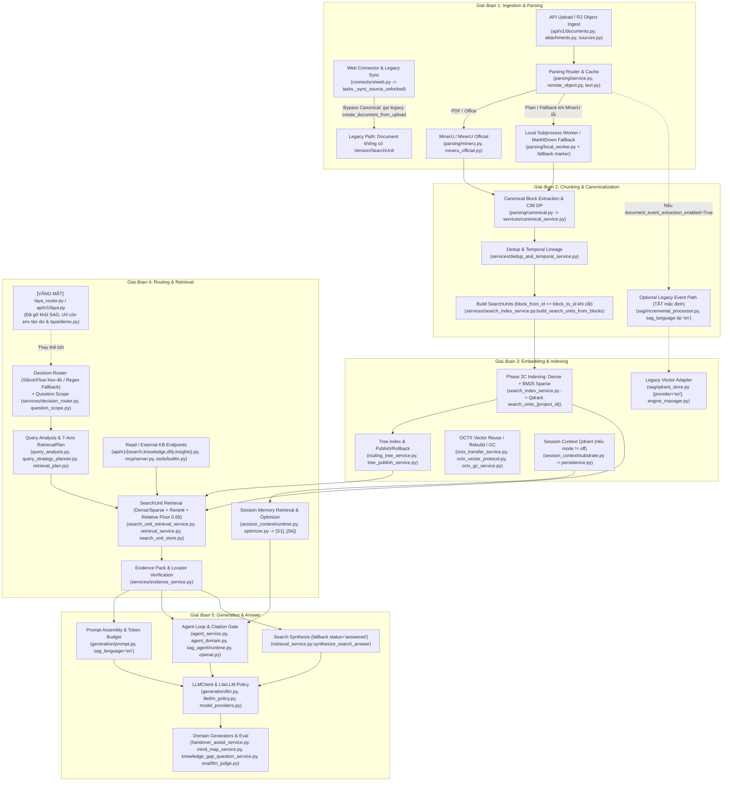

# Báo cáo Kiểm toán Toàn diện 5 Giai đoạn Hệ thống RAG SAG (Hallucination, Regex & Flags/Toggles)

**Đối tượng kiểm toán:** Hệ thống RAG **SAG** tại `d:\DoAnTotnghiep\sag-laya-integration\SAG` (trọng tâm backend Python: `apps/api/sag_api` + `apps/api/sag_agent`, cùng `scripts/`, `tests/`, `migrations/`, cấu hình triển khai và tài liệu thiết kế).  
**Phương pháp:** Kiểm toán tĩnh chỉ đọc (Static Read-Only Audit) tổng hợp từ 5 báo cáo kiểm toán chuyên sâu (Stage 1 & 2, Stage 3, Stage 4, Stage 5, và Global Cross-Cutting) kèm đối chiếu trực tiếp cấu hình cốt lõi (`sag_api/core/config.py`).  
**Ràng buộc bảo mật:** Không đọc giá trị bí mật (API key, mật khẩu, token) trong `.env`; mọi tham chiếu tới `.env` chỉ nêu **tên biến** và trạng thái cấu hình phi bí mật.

---

## 0. Tóm tắt điều hành & Phạm vi kiểm toán

### 0.1. Bức tranh tổng thể & Phát hiện cốt lõi

Kiểm toán cho thấy **kiến trúc vận hành thực tế của SAG khác biệt đáng kể so với mô tả trong một số tài liệu nội bộ và cấu hình mẫu**:

1. **Laya Router & E2 LLM Enrichment đã bị gỡ bỏ khỏi runtime nhưng vẫn để lại "dư lượng gây ảo giác" (Developer-Hallucination):**
   - Hai tệp `sag_api/services/laya_router.py` và `sag_api/api/v1/laya.py` **không tồn tại** trong `SAG` (chỉ có script demo độc lập ngoài `SAG` tại `d:\DoAnTotnghiep\sag-laya-integration\laya\demo.py`). Định tuyến truy vấn thực tế do `services/decision_router.py` (gọi SiliconFlow `Kev-4b`, hoặc fallback regex khi thiếu key/lỗi) đảm nhiệm. Tuy vậy `.env` vẫn giữ `SAG_ENABLE_LAYA`, `SAG_LAYA_MODEL_PATH`, `SAG_LAYA_DEVICE` và `tasks/plan.md`, `tasks/todo.md` vẫn nhắc tới Laya.
   - Tương tự, **E2 LLM enrichment** đã bị gỡ theo `docs/adr-remove-e2-llm-enrichment.md` (`document_event_extraction_enabled = False`, chỉ chạy Phase 5A `FOUNDATION` E0/E1 + DenseGraph và đường ống chính **Phase 2C `SearchUnit`** trên PostgreSQL + Qdrant), nhưng `README.md` và `compose.yaml:108-111` vẫn mô tả/truyền `SAG_KNOWLEDGE_E2_*`.
2. **Nguy cơ Hallucination hệ thống nghiêm trọng nhất (Critical) trải dọc từ Stage 2 → Stage 5:**
   - **Stage 2 (`search_index_service.py:640-655` vs `document_service.py:2251-2278`):** Khi cắt `CanonicalBlock` quá khổ, mọi `SearchUnit` con đều gán `block_from_id == block_to_id == block.id`, khiến API `/chunks` trả về **toàn bộ nội dung block gốc lặp lại N lần y hệt nhau**.
   - **Stage 3 (`settings_service.py:136-154` & cache embedding):** Guard `_reject_incompatible_embedding_change` chỉ kiểm tra `Document.sag_source_id.is_not(None)` — vốn luôn là `None` trên đường Phase 2C mặc định — kết hợp cache `_SHARED_TEXT_EMBEDDING_CACHE` không truyền `model_signature`, dẫn tới **trộn lẫn không gian vector khác model cùng chiều** (vd. 1024-d) trong Qdrant.
   - **Stage 4 (`search_unit_retrieval_service.py:2350-2366` & `retrieval_service.py:784-816`):** Điểm dense từ Qdrant bị chia cho `max_score` của batch và chỉ lọc bằng `relative_semantic_score >= 0.68` **mà không có ngưỡng cosine tuyệt đối**. Truy vấn ngoài phạm vi (OOD) có cosine thô `0.05` vẫn trở thành `1.0` và vượt cổng vào thẳng LLM/citation.
   - **Stage 4/5 (`decision_router.py:92-163` & `retrieval_service.py:1541-1583`):** Regex thay thế NLU ở các điểm chốt (`memory_scope`, `abstention` detection); lỗi/abstain ở Search synthesis bị `fallback_search_answer` gán giả nhãn `status="answered"`.
   - **Stage 5 (`agent_service.py:454-460, 1085, 1461-1507`):** Compound citation có mã bịa như `[1, 99]` bị giữ nguyên vẹn không strip; chế độ `web_enabled=True` (kể cả `/v1/chat/completions` của `openai.py`) không ép `search_context` hay chạy citation gate ngay cả khi `question_scope == "project"`.
3. **Bất đối xứng tiếng Việt & Unicode (NFC/NFD, Tokenization, Regex):**
   - Ước lượng token theo khoảng trắng/chia 4 ký tự (`canonical.py:50-58`, `prompt.py:222`, `document_service.py:2294`) đánh giá thấp token BPE tiếng Việt có dấu **1.5x–4x**, gây tràn ngữ cảnh.
   - `sag_language` quảng cáo `Literal["en", "zh"]` ở config/UI/env nhưng bị ép cứng `"en"` tại 3 lớp (`core/config.py:412-415`, `settings_service.py:204-205`, `sag/incremental_processor.py:69-71`, `generation/prompt.py:255`) và không có tùy chọn `"vi"`.
   - Thiếu `unicodedata.normalize("NFC", ...)` trước regex `\w+`/`\b` ở MinHash dedup (`dedup_and_temporal_service.py:103`), tree snapshot (`tree_query_snapshot_service.py:163`), mind-map (`mind_map_service.py:58`), knowledge gap (`knowledge_gap_question_service.py:146`), session temporal (`substrate.py:1021`), và decision router (`decision_router.py:132`).
   - Regex tách chữ-số `[a-z]+|\d{2,}` ở BM25 sparse (`search_index_service.py:170`, `search_unit_store.py:104`, `substrate.py:108`) bỏ rơi chữ tiếng Việt có dấu dính số (`điều15`, `tầng2`), còn `_DIRECT_RESPONSE_HINT` (`agent_service.py:96`) thiếu boundary nên `"dịch vụ"` khớp nhầm `"dịch"` và bỏ qua ép gọi `search_context`.

### 0.2. Phạm vi mã nguồn đã kiểm toán

| Thành phần trong `SAG/` | Số lượng kiểm kê | Ghi chú phạm vi |
|---|---:|---|
| `apps/api/sag_api/` | **199** tệp `.py` | Toàn bộ API, services, parsing, connectors, sag adapters, jobs, octx, tools, mcp, core, db, schemas. (Không tồn tại `sag_api/utils/`, `sag_api/services/laya_router.py`, `sag_api/api/v1/laya.py`.) |
| `apps/api/sag_agent/` | **6** tệp `.py` | `__init__.py`, `loop.py`, `runtime.py`, `store.py`, `tools.py`, `types.py` (+ `py.typed`). |
| `apps/api/scripts/` | **6** tệp `.py` + 6 `.sql` | `eval_retrieval.py`, `knowledge_candidates.py`, `migrate_legacy_conversations.py`, `sag_metric_e2e.py`, `sag_ops.py`, `source_project_acl.py`. |
| `apps/api/tests/` | **33** tệp `.py` | **31** tệp `test_*.py` + 2 tệp trong `eval_ecce_baseline/` (`__init__.py`, `benchmark_suite.py`). *(Lưu ý: `checkpoint-a-ingestion-plan.md` nhắc con số 29 tệp, `Makefile:26-27` tuyên bố unit test đã bị xóa, còn `tasks/todo.md` trích dẫn nhiều tệp test đã không còn.)* |
| `apps/api/migrations/` | **12** tệp `.sql` | `0001` → `0012`. |
| Cấu hình, Docs & `.data` | Đầy đủ | `.env` (chỉ đọc tên biến), `.env.example`, `apps/api/.env.example`, `compose*.yaml`, `Makefile`, `pyproject.toml`, `README*.md`, `CHANGELOG.md`, `tasks/*`, `docs/*`, `.data/engine/snapshots/*` (1.371 file trong snapshots, `non-snapshot count=0`). |

### 0.3. Các nội dung "chưa xác minh" (Giới hạn kiểm toán tĩnh)

Theo ràng buộc chỉ đọc (read-only) và không khởi chạy dịch vụ ngoài, các khía cạnh sau được đánh dấu rõ là **chưa xác minh**:
- **Hành vi runtime thực tế trên hạ tầng live:** Chưa xác minh vận hành thực tế với **Qdrant** (`qdrant/qdrant:v1.14.1`), **PostgreSQL**, **MinerU** (Cloud/Local), **SiliconFlow `Kev-4b`**, và các **LLM/Embedding APIs** bên ngoài.
- **Thực thi `pytest` live:** Chưa chạy `pytest` trên môi trường runtime; nhận định về bộ test (`mocks`, `skipif`, `FakeLLM`, `MockTransport`) được rút ra từ phân tích tĩnh mã nguồn các tệp `tests/*.py`.
- **Mã nguồn đóng gói ngoài repo (`wheels`):** Chưa xác minh phần cài đặt nội bộ bên trong thư viện **`zleap-sag==0.12.0`** và **`octx==0.1.6`** (nằm ngoài cây thư mục `SAG/`); mọi đánh giá dựa trên giao diện gọi tại `sag_api/sag/`, `sag_api/octx/` và tài liệu nội bộ.
- **Giao diện Frontend (`SAG/apps/web`):** Nằm ngoài phạm vi kiểm toán backend Python; mức độ ảnh hưởng khi hiển thị `claim_level="run"`, `summary.delta`, hay `/chunks` trùng lặp trên UI chưa xác minh.
- **Giá trị bí mật trong `.env`:** Tuyệt đối không đọc hoặc kiểm chứng giá trị thực tế của các khóa API/mật khẩu trong `.env`.

---

## 1. Sơ đồ 5 giai đoạn (Mermaid) & Ánh xạ Tệp theo Giai đoạn

### 1.1. Sơ đồ luồng 5 giai đoạn thực tế của SAG



### 1.2. Bảng ánh xạ tệp theo 5 giai đoạn & Các tệp phân loại lại

| Giai đoạn | Danh sách tệp thuộc giai đoạn (`SAG/apps/api/...`) | Ghi chú phân loại lại & Vai trò |
|---|---|---|
| **Stage 1: Ingestion & Parsing** | `api/v1/{documents.py, attachments.py, sources.py, jobs.py, octx.py}`; `connectors/{__init__.py, base.py, file_upload.py, registry.py, web.py}`; `parsing/{__init__.py, text.py, mineru.py, mineru_official.py, local_worker.py, remote_object.py, service.py}`; `core/sanitizer.py`; `services/{document_service.py [upload/versioning], source_service.py, source_operation_service.py, cpu_worker.py}`; `jobs/{__init__.py, control.py, inproc.py, queue.py, scheduling.py, tasks.py}` | **Phân loại lại:** `connectors/web.py` thuộc Stage 1 (cũng cấp helper `extract_web_markdown` cho `OpenWebPageTool` ở Stage 4/5). `parsing/canonical.py` chuyển sang Stage 2. `jobs/octx_tasks.py` chuyển phần lớn sang Stage 3 transfer. |
| **Stage 2: Chunking & Canonicalization** | `parsing/canonical.py` *(từ `parsing/`)*; `services/{canonical_service.py, dedup_and_temporal_service.py, document_service.py [chunks/readiness], search_index_service.py [build_search_units_from_blocks]}`; `sag/incremental_processor.py`; `schemas/chunk.py`; `services/{knowledge_service.py, knowledge_candidate_service.py, knowledge_quality_service.py, knowledge_quality_persistence.py, knowledge_quality_repository.py, incremental_tree_service.py}` | **Phân loại lại:** `parsing/canonical.py` nằm trong thư mục `parsing/` nhưng thực chất làm canonical block extraction, boilerplate detection & C99 chunking cho Stage 2. `search_index_service.py` cầu nối Stage 2 (tạo `SearchUnit`) → Stage 3 (ghi Qdrant). |
| **Stage 3: Embedding & Indexing** | `services/{search_index_service.py [Qdrant/BM25 upsert/delete/reconcile], rebuild_service.py, octx_transfer_service.py, octx_gc_service.py, octx_conflict_service.py, octx_diagnostics_service.py, octx_recovery_service.py, routing_tree_service.py, tree_publish_service.py, tree_rollback_service.py, universe_service.py, universe_knowledge_service.py, universe_tree_service.py}`; `sag/{qdrant_store.py, search_unit_store.py [index schema/BM25], engine_manager.py [embedding/store lifecycle], config_builder.py, chunk_heading_vectors.py, document_cleanup.py, compat.py, dto.py, errors.py, _timings_probe.py, octx_ids.py, octx_importer.py, octx_plan_store.py, octx_smoke_test.py, octx_snapshot.py, octx_vector_manifest.py, octx_vector_protocol.py, octx_vector_rebuilder.py, octx_vector_reuse.py}`; `octx/{__init__.py, _worker.py, decision_token.py, errors.py, limits.py, runner.py, semver.py, storage.py}`; `jobs/{knowledge.py, octx_tasks.py}`; `services/session_context/{substrate.py, persistence.py}` *(index vector hội thoại)* | **Phân loại lại:** Các module `sag/octx_*` và `services/octx_*` phục vụ đóng gói/tái sử dụng/GC vector và structured plan nên cốt lõi nằm ở Stage 2–3. `session_context/substrate.py` & `persistence.py` thực hiện embedding & Qdrant sync (`session_units_{project_id}`) tương đồng Stage 3 cho hội thoại. |
| **Stage 4: Routing & Retrieval** | `api/v1/{decision.py, search.py, knowledge.py, dify.py, insights.py, universe.py}`; `services/{decision_router.py, question_scope.py, query_analysis.py, query_strategy_planner.py, retrieval_plan.py, query_routing_service.py, route_cache_service.py, tree_query_snapshot_service.py, search_unit_retrieval_service.py, retrieval_service.py [rerank/MMR/legacy retrieval], evidence_service.py, source_service.py [ACL/versioned_source_ids], insight_service.py}`; `services/session_context/{__init__.py, extractor.py, models.py, optimizer.py, runtime.py}`; `sag/{search_unit_store.py [query/filter], engine_manager.py [search/grep/entity]}`; `tools/builtin.py` (`SearchContextTool`, `GetEntityTool`, `GetTimeTool`, `WebSearchTool`, `OpenWebPageTool`); `mcp/{__init__.py, mount.py, server.py}`; `schemas/{search.py, dify.py, insight.py, routing_rag.py}` | **Phân loại lại & Vắng mặt:**<br>• **Vắng mặt:** `sag_api/services/laya_router.py`, `sag_api/api/v1/laya.py`, `sag_api/utils/` **không tồn tại**.<br>• **Phân loại lại:** `api/v1/dify.py`, `api/v1/insights.py` và `mcp/server.py` chỉ gọi retrieval/graph read-only, **không** sinh câu trả lời nên thuộc **Stage 4** (thay vì Stage 5).<br>• `session_context/optimizer.py` chuẩn bị `[Session Memory Evidence]` từ Stage 4 giao cho prompt Stage 5. |
| **Stage 5: Generation & Answer** | `generation/{__init__.py, llm.py, prompt.py}`; `core/{litellm_policy.py, model_providers.py}`; `api/v1/{agents.py, answer_actions.py, openai.py, handover.py, mind_map.py}`; `services/{agent_service.py, agent_domain.py, answer_actions_service.py, handover_assist_service.py, mind_map_service.py, knowledge_gap_question_service.py, research_agent_service.py, research_planner_service.py}`; `services/retrieval_service.py` *(phần `synthesize_search_answer`, `fallback_search_answer`)*; `services/eval/{__init__.py, llm_judge.py}`; `sag_agent/{__init__.py, loop.py, runtime.py, store.py, tools.py, types.py}`; `tools/{__init__.py, base.py, mcp.py, registry.py}`; `schemas/{agent.py, answer_actions.py, handover_assist.py, mind_map.py}` | `agent_service.py` và `api/v1/search.py` có phần đầu làm routing/retrieval (Stage 4) và phần sau làm citation gate / answer synthesis (Stage 5). `knowledge_gap_question_service.py` dùng `litellm.acompletion` sinh câu hỏi nên thuộc Stage 5 generation. |
| **Cross-Cutting Core, DB, Config & Ops** | `sag_api/{__init__.py, branding.py, desktop.py, enums.py, main.py, runtime.py}`; `core/{__init__.py, config.py, conversation_ownership.py, db.py, deps.py, error_taxonomy.py, errors.py, identity.py, logging.py, principal_assertion.py, security.py, token_usage.py}`; `api/v1/{__init__.py, activity.py, auth.py, system.py}`; `services/{auth_service.py, dsh_integration_service.py, settings_service.py}`; `db/base.py`, `db/models/*.py` (17 models); `schemas/{auth.py, common.py, document.py, dsh_integration.py, job.py, octx.py, source.py, system.py, universe.py}`; `scripts/*.py` (6 tệp); `tests/*.py` (33 tệp) | Điều phối vòng đời app, DB/Qdrant sessions, auth/JWT/ACL, metering token & bảng giá, overrides DB (`settings_service`), `/capabilities` & `/metrics`. |

---

## 2. Bảng phát hiện theo từng giai đoạn (Trọng tâm A — Hệ thống & Developer-Hallucination)

### 2.1. Giai đoạn 1 — Ingestion & Parsing

| ID | Mức độ | Loại | `file:line` | Mô tả & Bằng chứng (snippet) | Tác động | Đề xuất sửa |
|---|---|---|---|---|---|---|
| **S1-01** | High | `developer-hallucination` + `hệ thống` | `apps/api/sag_api/parsing/local_worker.py:214-232` | Comment hứa hẹn trích xuất bảng, nhưng code chỉ gọi `get_text("text")` và bỏ qua trang trống khi ghép trang:<br>`# Priority 1: PyMuPDF (fitz) — C-speed page-by-page extraction with table awareness`<br>`text = (page.get_text("text") or "").strip()`<br>`combined = "\n\n".join(pages_out).strip()` | Mất cấu trúc bảng PDF thành text rời rạc; trang ảnh/scan xen kẽ trong PDF hỗn hợp bị nuốt im lặng, không có marker trang thiếu. | Dùng `page.find_tables()` của PyMuPDF hoặc chuyển PDF có bảng/ảnh sang MinerU; chèn marker trang trống hoặc cảnh báo OCR. |
| **S1-02** | High | `hệ thống` | `apps/api/sag_api/parsing/local_worker.py:275-285,392-418` | Bộ xử lý DOCX chủ động xóa toàn bộ `word/media/*` và `<w:drawing>` / `<w:pict>` trước khi đưa vào MarkItDown:<br>`"""Stream DOCX entries to a temporary file on disk, omitting word/media/* binaries` | Mất toàn bộ sơ đồ, biểu đồ, ảnh chụp màn hình và alt-text trong DOCX khi chạy local worker / MarkItDown. | Giữ lại alt-text/caption từ `<wp:docPr descr="...">` hoặc định tuyến DOCX chứa ảnh/biểu đồ sang parser đa phương thức. |
| **S1-03** | High | `hệ thống` | `apps/api/sag_api/parsing/service.py:153-155,176-186,310,350-362,487-505` & `remote_object.py:234-238` | Khi MinerU gặp `ApiError`, `_prepare_markitdown_fallback` chạy parser cục bộ và ghi `.fallback-<digest>.marker`: mọi lần chạy lại/reprocess sau đó tự động tái sử dụng bản fallback kém chất lượng (`_cached_fallback_document`). Ngoài ra, nhánh GC recovery (`service.py:177-186`) và `remote_object.py:234-238` chấp nhận bất kỳ sidecar `.md` nào tồn tại mà không kiểm tra khớp `provider`/`signature`. | PDF hỗn hợp bị khóa vĩnh viễn ở bản fallback khuyết thiếu nhưng vẫn báo thành công (`READY`). | Không ghim vĩnh viễn fallback marker cho reprocess thủ công; kiểm tra khớp `signature` provider hiện hành ở `remote_object.py` và nhánh GC recovery. |
| **S1-04** | High | `hệ thống` | `apps/api/sag_api/parsing/mineru.py:378-466,469-500` | (1) `_inject_page_markers_from_content_list` khớp neo đơn điệu theo `cursor`; nếu đoạn đầu trang N trượt (`matched_idx is None` tại `:456`), trang N không có `<!-- PAGE N -->` và kế thừa sai `page_from` của trang N-1.<br>(2) `_synthesize_markdown_from_content_list` (`:469-500`) xuất bảng bằng HTML thô `<table>...</table>` và chỉ đọc `item.get("text")`, bỏ sót `type == "image"` / `img_caption`. | Citation trỏ sai số trang; mất chú thích ảnh từ MinerU; bảng HTML bị `canonical.py` phân loại nhầm là `paragraph` và có thể bị cắt đôi. | Chèn marker trang dự phòng khi anchor trượt; tổng hợp `img_caption`/`img_footnote`; chuyển HTML `<table>` sang Markdown pipe table hoặc đánh dấu block `table`. |
| **S1-05** | High | `hệ thống` | `apps/api/sag_api/jobs/tasks.py:1330-1344` & `connectors/web.py:48-77` | `_sync_source_unlocked` gọi hàm kế thừa `create_document_from_upload` (không tạo `DocumentVersion`, `IngestionRun`, `CanonicalBlock`, `SearchUnit`). Đồng thời `connectors/web.py:53-57` khi `trafilatura` rỗng dùng regex `_strip_tags` xóa `<header>/<footer>/<nav>` và thay mọi thẻ bằng `" "`, không giải mã HTML entities. | Tài liệu sync từ web connector không vào Canonical RAG (`SearchUnit`/Qdrant); web fallback mất hoàn toàn bảng/tiêu đề/list và giữ nguyên `&amp;`, `&lt;`. | Chuyển `_sync_source_unlocked` sang `handle_document_upload`; thay `_strip_tags` bằng HTML-to-Markdown parser thực sự + `html.unescape`. |
| **S1-06** | High | `hệ thống` | `apps/api/sag_api/api/v1/documents.py:493-521` | `GET /{document_id}/parsed` kiểm tra `if not document.sag_source_id: raise NotFoundError(...)` và đọc từ `engine_manager.get_document_markdown(...)`. Ở luồng Canonical mặc định (`document_event_extraction_enabled=False`), `sag_source_id` luôn là `None`. | API `/parsed` luôn trả 404 `"Parsed content not found, please reprocess the document"` cho tài liệu đã `READY` theo pipeline mới. | Đọc từ sidecar `.parsed.<sig>.md` hoặc tái dựng từ `CanonicalBlock` khi `document.sag_source_id` là `None`. |
| **S1-07** | High | `hệ thống` | `apps/api/sag_api/api/v1/documents.py:338`, `db/models/document.py:26`, `schemas/routing_rag.py:20`, `api/v1/attachments.py:49-60` | `documents.py:338` tạo `logical_source_id=logical_source_id or f"source:{source.id}:{filename}"` (44 ký tự tiền tố + `filename`), nhưng cột DB `Document.logical_source_id` chỉ là `String(128)` (`document.py:26`) trong khi schema cho phép `max_length=512` (`routing_rag.py:20`). Ngoài ra `attachments.py:49-60` chỉ kiểm tra đuôi file, thiếu kiểm tra magic-bytes và pixel bomb. | Tên file ≥ 85 ký tự hoặc `logical_source_id` > 128 ký tự gây crash SQL `StringDataRightTruncationError` trên PostgreSQL; attachment dễ nhận file giả MIME hoặc ảnh gây OOM. | Mở rộng `Document.logical_source_id` lên `String(512)` hoặc hash hóa; bổ sung magic-byte & PIL pixel check cho `attachments.py`. |
| **S1-08** | Medium | `hệ thống` | `apps/api/sag_api/parsing/local_worker.py:442,537,567-600,721,751` | (1) PPTX đoán `notesSlide{slide_no}.xml` (`:442`) thay vì đọc `.rels`, bỏ qua biểu đồ/SmartArt, loại mọi ghi chú toàn số (`if text and not text.isdigit():` tại `:537`).<br>(2) XLSX cắt ngầm ở `max_cols=64` không có marker (`raw_row[:max_cols]` tại `:574`), `data_only=True` biến ô công thức chưa cache thành rỗng.<br>(3) RTF ép `cp1252` (`:751`), làm hỏng tiếng Việt `cp1258`. | Mất dữ liệu cột cuối Excel rộng, mất số liệu trong speaker notes, sai dấu tiếng Việt trong file `.rtf`/`.doc` RTF. | Đọc `.rels` cho PPTX notes; thêm cảnh báo khi cắt cột XLSX; đọc `\ansicpgN` trong header RTF để chọn codepage đúng. |
| **S1-09** | High | `hệ thống` | `apps/api/sag_api/services/document_service.py:1263-1318,1338-1355` | (1) Kiểm tra trùng hash (`:1263-1268`) chỉ loại `REVOKED`, vẫn trả `is_duplicate=True` nếu `latest_ver.status == "FAILED"` → không upload lại được file đó để retry.<br>(2) Đóng `latest_ver.valid_to = now_utc` (`:1316`) **ngay lúc upload** trước khi `v2` parse/index xong.<br>(3) Nhánh `if not existing_ver:` (`:1339`) bỏ qua check `file_hash` nếu `version_id` đã tồn tại. | Kẹt vĩnh viễn ở `FAILED` khi re-upload cùng nội dung; nếu `v2` thất bại, `v1` cũng biến mất khỏi tìm kiếm vì `valid_to <= now`. | Chỉ trả `is_duplicate=True` khi version cũ không `FAILED`/`INDEX_FAILED`; chỉ đóng `v1.valid_to` khi `v2` commit `SEARCH_READY`. |
| **S1-10** | Medium | `developer-hallucination` | `apps/api/sag_api/services/document_service.py:2049-2053,2122-2137` vs `jobs/tasks.py:903` | `get_project_document_readiness_batch` (`:2126`) bắt điều kiện `int(document.chunk_count or 0) > 0`, trái ngược trực tiếp quy tắc tại `tasks.py:903` (`"tuyệt đối không dùng chunk_count"`). `get_document_version_status` (`:2049-2053`) trả các chỉ số cấp `Document` cho API cấp `DocumentVersion`. | Version mới báo sẵn sàng giả nhờ `document.chunk_count` của version cũ, hoặc hiển thị sai chỉ số theo version. | Bỏ kiểm tra `document.chunk_count` ở readiness batch; tách số liệu theo `DocumentVersion` / `SearchUnit` count thực tế. |
| **S1-11** | Medium | `hệ thống` | `apps/api/sag_api/jobs/tasks.py:1033-1053,1184-1190` | `delete_document_task` bỏ qua xóa Qdrant nếu `document.project_id` là `None` (`if document.project_id:` tại `:1038`). `_reprocess_document_task_unlocked` (`:1184-1190`) chỉ dọn bảng legacy, giữ nguyên `CanonicalBlock`, `SearchUnit` và Qdrant points cũ suốt thời gian chờ `PROCESS_DOCUMENT`. | Rác vector cho legacy document; cửa sổ dữ liệu cũ tồn tại song song khi reprocess. | Kiểm tra Qdrant theo `source_id`/`document_id` khi thiếu `project_id`; cập nhật trạng thái version rõ ràng trước reprocess. |
| **S1-12** | Medium | `hệ thống` | `apps/api/sag_api/core/sanitizer.py:12-17`, `jobs/tasks.py:74-112`, `parsing/mineru.py:107` | Hai bộ sanitizer trùng lặp (`core/sanitizer.py` và `_redact_parser_reason` trong `tasks.py`); `_API_KEY` (`\b(?:sk\|ak)-[a-z0-9._-]{6,}\b`) bỏ sót `ghp_`, `AIza`, `xoxb-`, `AKIA`, JWT `eyJ...`. `mineru.py:107` dùng `decode(..., errors="replace")` tạo `\ufffd` im lặng. | Nguy cơ rò rỉ secret khác `sk-`/`ak-` vào DB/log; ký tự lỗi encoding `\ufffd` lọt vào nội dung chunk. | Hợp nhất về `core/sanitizer.py`, mở rộng pattern secret; cảnh báo/đếm tỷ lệ ký tự `\ufffd`. |

---

### 2.2. Giai đoạn 2 — Chunking & Canonicalization

| ID | Mức độ | Loại | `file:line` | Mô tả & Bằng chứng (snippet) | Tác động | Đề xuất sửa |
|---|---|---|---|---|---|---|
| **S2-01** | **Critical** | `hệ thống` | `apps/api/sag_api/services/search_index_service.py:640-655` & `services/document_service.py:2251-2278` | Khi tách `CanonicalBlock` quá khổ, `_emit_oversized_block` tạo N `SearchUnit` đều gán `block_from_id=block.id, block_to_id=block.id` (`search_index_service.py:643-644`). Trong khi đó `get_document_version_chunks` (`document_service.py:2251-2261`) tái dựng nội dung từ `blocks[start_idx : end_idx + 1]` mà không lưu lát cắt con. | API `/chunks` trả về **toàn bộ nội dung block quá khổ lặp lại N lần y hệt nhau** cho mọi chunk con, làm sai hiển thị và đánh giá chất lượng chunk. | Lưu `text_snapshot` hoặc `char_start`/`char_end` trong `SearchUnit` để tái dựng chính xác lát cắt con. |
| **S2-02** | High | `hệ thống` | `apps/api/sag_api/parsing/canonical.py:42-58,61-108,263` & `services/search_index_service.py:618-624` | (1) `estimate_unicode_tokens` đếm từ tách khoảng trắng (`len(stripped_other.split())`), trong khi 1 âm tiết tiếng Việt có dấu tốn 2–4 BPE token.<br>(2) `_split_atomic_spans` + `segment_prose_by_information_cohesion` ghép bằng `" "` (`:263`) và cắt theo `.!?`, làm mất xuống dòng và cắt nhầm sau viết tắt (`TP.`, `Mr.`, `Điều 1.`).<br>(3) Fallback cắt cứng theo ký tự `sp[i : i + max_tokens_per_unit]` (`search_index_service.py:623-624`). | Chunk vượt quá giới hạn token thực tế của embedding/LLM (2x–4x với tiếng Việt), gãy giữa cụm viết tắt, mất cấu trúc xuống dòng. | Ước lượng token theo tokenizer chuẩn (`tiktoken` / byte-fallback cho chữ có dấu) và bảo toàn xuống dòng có ý nghĩa. |
| **S2-03** | High | `hệ thống` | `apps/api/sag_api/parsing/canonical.py:605-617` vs `services/canonical_service.py:68-80` & `db/models/routing_rag.py:162-184` | `extract_canonical_blocks` tính `is_bp = is_boilerplate_text(seg_text)` (`:605`) và gán `ExtractedBlock.is_boilerplate`, nhưng DB model `CanonicalBlock` không có cột `is_boilerplate`/`metadata_json`, và `persist_canonical_blocks` (`:68-80`) bỏ qua hoàn toàn trường này. `build_search_units_from_blocks` cũng không lọc boilerplate. | Nhãn boilerplate hoàn toàn vô tác dụng ở tầng lưu trữ và index: mọi dòng `"Trang 1 / 10"`, `"- 5 -"` vẫn nạp vào Qdrant. | Thêm cột `is_boilerplate` vào `CanonicalBlock` hoặc lọc trước khi tạo `SearchUnit`. |
| **S2-04** | High | `hệ thống` | `apps/api/sag_api/parsing/canonical.py:299-305,354-398,422-494,554-580` & `db/models/routing_rag.py:177,205` | (1) Frontmatter YAML (`:355-372`) trích `title`/`document_id` nhưng **không tăng `idx`**, đẩy YAML đầu file thành block `paragraph`.<br>(2) `normalize_text(..., preserve_code=True)` (`:299-301`) `return` sớm trước `.replace("\r\n", "\n")`, giữ nguyên CRLF.<br>(3) Code fence thiếu đóng ```` ``` ```` nuốt toàn bộ phần còn lại thành 1 block `code`.<br>(4) Bảng HTML `<table>` hoặc pipe table thiếu `\|` hai đầu bị coi là `paragraph`.<br>(5) Gộp đoạn ngắn qua tối đa 7 dòng trống (`:554-580`) dễ gộp nhầm tiêu đề không dấu `#`.<br>(6) `section_path` không cắt về 512 ký tự trước khi ghi vào `String(512)`. | Ô nhiễm YAML metadata vào corpus, hỏng ranh giới block/bảng/code, nguy cơ lỗi DB `StringDataRightTruncationError` với tiêu đề lồng sâu. | Bỏ qua vùng frontmatter sau khi parse; chuẩn hóa `\r\n` đầu `normalize_text`; hỗ trợ HTML `<table>` & fence `~~~`; cắt `section_path[:512]`. |
| **S2-05** | High | `hệ thống` | `apps/api/sag_api/services/dedup_and_temporal_service.py:195-206,387-450,624-631,996,1089-1124` | (1) `_THOUSANDS_COMMA_RE` xóa dấu `,` trước 3 chữ số → biến số thập phân Việt/EU `1,500` (=1.5) thành `1500`.<br>(2) `detect_semantic_signals` khởi tạo `is_support = False` (`:412`) và **không bao giờ gán `True`**; `classify_relation_candidate` (`:624-628`) trả `RELATION_RELATED` ở cả hai nhánh `if/else`.<br>(3) `register_relation_candidate` (`:631`) là dead function không có caller — near-duplicate chỉ lưu JSON metadata, không tạo cạnh quan hệ.<br>(4) `run_dedup_and_temporal_stage` gán `temporal_result = {"action": "PENDING_INDEX", ...}` (`:1089`), dồn supersede sang Stage 3.<br>(5) Truy vấn block trước đó (`:996`) chỉ check `valid_to > start_time`, có thể lấy nhầm version tương lai (`valid_from > start_time`). | Sai lệch so sánh số liệu tiếng Việt; đồ thị quan hệ `SUPPORTS`/near-duplicate không được ghi nhận; xử lý thời gian lệ thuộc bước Index. | Phân biệt dấu phẩy thập phân theo locale/ngữ cảnh; nối hoặc dọn bỏ `register_relation_candidate`/`is_support` giả; lọc thêm `valid_from <= start_time`. |
| **S2-06** | High | `developer-hallucination` | `apps/api/sag_api/sag/incremental_processor.py:69-71,130-133` & `core/config.py:119,180,412-415` | (1) `detect_document_language(text, configured=None)` bỏ qua tham số và **luôn `return "en"`**. `_normalize_sag_language` (`config.py:412-415`) ép `"en"` bất chấp `SAG_SAG_LANGUAGE=zh` dù type khai báo `Literal["en", "zh"]`.<br>(2) `document_strict_filtering` / `enable_strict_filtering` nhận tham số rồi log cảnh báo bỏ qua (`incremental_processor.py:132-133`). | Lập trình viên/vận hành tưởng hệ thống hỗ trợ đa ngôn ngữ (`zh`) và strict filtering nhưng thực tế bị vô hiệu hóa ngầm. | Phản ánh trung thực trong schema/docs hoặc khôi phục bộ nhận diện ngôn ngữ thực tế và gỡ cờ chết. |
| **S2-07** | Medium | `hệ thống` | `apps/api/sag_api/services/search_index_service.py:135,169-172,197,200-212,664-700` & `sag/search_unit_store.py:97` | (1) `build_search_units_from_blocks` phát `SearchUnit` chỉ chứa heading đơn độc khi section chỉ có tiêu đề (`:664-666`) hoặc khi `lead_toks + seg_tok_sum > max_tokens_per_unit` (`:682-685`).<br>(2) `compute_sparse_bm25_vector`: gộp `r & d -> rd` (`:135`), tách chữ-số chỉ cho ASCII `[a-z]+` (`:170`, bỏ rơi `t4`, `đ10`), stemmer ASCII thô (`meeting -> meet` tại `:200-212`), và không lọc `COMMON_STOPWORDS` trong khi query-side `search_unit_store.py:97` lại lọc. | Nhiễu vector bằng chunk chỉ có tiêu đề; lệch phân bố BM25 giữa index và query, suy giảm recall tiếng Việt và mã kỹ thuật. | Gắn heading vào `section_path` hoặc gộp tối thiểu với đoạn đầu thay vì phát unit rỗng nội dung; thống nhất tokenization Unicode (`\p{L}`) và stopwords. |
| **S2-08** | Medium | `hệ thống` | `apps/api/sag_api/db/models/routing_rag.py:198-199` | `SearchUnit.block_from_id` và `block_to_id` khai báo `ForeignKey("canonical_blocks.id")` không có `ondelete="CASCADE"`. | Xóa `CanonicalBlock` trực tiếp khi chưa xóa `SearchUnit` gây lỗi khóa ngoại FK. | Bổ sung `ondelete="CASCADE"` qua migration SQL. |

---

### 2.3. Giai đoạn 3 — Embedding & Indexing

| ID | Mức độ | Loại | `file:line` | Mô tả & Bằng chứng (snippet) | Tác động | Đề xuất sửa |
|---|---|---|---|---|---|---|
| **S3-01** | **Critical** | `hệ thống` | `sag_api/services/settings_service.py:136-154`, `jobs/tasks.py:715-719,874`, `sag/engine_manager.py:606,617,631`, `core/token_usage.py:592,613`, `services/search_index_service.py:54-57,835,972,1014`, `services/search_unit_retrieval_service.py:732-745` | `_reject_incompatible_embedding_change` chỉ kiểm tra `Document.sag_source_id.is_not(None)` (`settings_service.py:146`), nhưng Phase 2C để `sag_source_id=None`. Đồng thời `_SHARED_TEXT_EMBEDDING_CACHE` hỗ trợ `model_signature: str = ""`, nhưng mọi caller (`engine_manager.py:617,631`, `token_usage.py:592,613`, `search_index_service.py:835,972,1014`, `search_unit_retrieval_service.py:745`) đều gọi `get_cached_text_embedding(text)` / `put_cached_text_embedding(text, vec)` **không truyền `model_signature`**. | Khi đổi giữa các model cùng chiều (vd. `bge-large-en-v1.5`, `BAAI/bge-m3`, `Qwen3-Embedding-4B` cùng 1024-d), guard không chặn, Qdrant lưu/truy vấn trộn lẫn 2 không gian vector khác nhau và cache trả về vector của model cũ → retrieval sai lệch hoàn toàn. | Kiểm tra cả `SearchUnit`/`DocumentVersion` (`SEARCH_READY`) trong `_reject_incompatible_embedding_change`; bắt buộc truyền `model_signature=f"{provider}:{base_url}:{model}:{dimensions}"` ở mọi điểm gọi cache; lưu identity model vào collection metadata. |
| **S3-02** | High | `hệ thống` | `sag_api/services/search_index_service.py:248,1041`, `sag/config_builder.py:182-183,205-213`, `services/settings_service.py:130-133`, `core/config.py:213-216`, `.env.example:70` | `core/config.py` đặt `embedding_model="bge-large-en-v1.5"` (1024-d) và `embedding_dimensions=None`. `config_builder.py:183`, `settings_service.py:133`, `.env.example:70` quy ước fallback là `1024`, nhưng `search_index_service.py:248,1041` lại hardcoded mặc định `vector_dim: int = 1536` (`len(vectors[0]) if vectors and len(vectors[0]) > 0 else 1536`). | Nếu collection `search_units_{project_id}` được khởi tạo khi `vectors` rỗng hoặc trước khi có vector, collection bị tạo với `1536` chiều, gây HTTP 400 dimension mismatch với model mặc định 1024 chiều. | Thống nhất fallback `1024` (hoặc tra registry model) trên toàn bộ `search_index_service.py` và `config_builder.py`; không tạo collection Qdrant khi chưa biết chắc `vector_dim > 0`. |
| **S3-03** | High | `hệ thống` | `sag_api/services/source_service.py:467-516`, `services/search_index_service.py:1123,1462-1467` | `delete_source` (`source_service.py:489-507`) xóa DB (`Source` cascade xuống `Document`/`SearchUnit`) và xóa file upload, nhưng **không xóa points trên Qdrant** (`search_units_{project_id}` hay collection legacy). Khi re-ingest lỗi prune (`search_index_service.py:1462-1467`), ngoại lệ xóa version cũ trên Qdrant chỉ `log.warning` và vẫn commit `SEARCH_READY`. Hàm `reconcile_orphan_search_units` (`:1123`) có **0 caller**. | Vector mồ côi tích tụ vĩnh viễn trong Qdrant sau khi xóa Source hoặc re-ingest lỗi prune, làm sai lệch thống kê IDF của BM25 và phình dung lượng index. | Thu thập `project_id`/`document_id` trước khi xóa Source để xóa point trên Qdrant; lên lịch chạy `reconcile_orphan_search_units` trong cleanup job. |
| **S3-04** | High | `hệ thống` | `sag_api/services/session_context/substrate.py:160,180-195`, `services/session_context/persistence.py:489-501` | Khi HTTP embedder gặp bất kỳ lỗi nào, `substrate.py:193-194` fail-open sang `deterministic_ngram_vector` 256 chiều (`except Exception: return [deterministic_ngram_vector(t) ...], "deterministic-ngram-v1"`). Khi đồng bộ vào `session_units_{project_id}` (dùng chung toàn project), `persistence.py:491-501` thấy `existing_dim != vector_dim` (1024 vs 256) và **gọi `DELETE /collections/{collection_name}`** (`:498`). | Một lỗi HTTP embedder thoáng qua có thể kích hoạt xóa sạch toàn bộ Session Context Qdrant của cả project (và khi embedder hồi phục lại xóa sạch collection 256-d một lần nữa). | Cấm tự động `DELETE` collection dùng chung khi gặp fallback vector; tách collection/named vector theo `(model_family, dim)` hoặc bỏ qua upsert Qdrant khi dùng fallback. |
| **S3-05** | High | `hệ thống` | `sag_api/sag/octx_vector_protocol.py:42-49,108-112,396-398`, `sag/octx_vector_rebuilder.py:108`, `services/octx_gc_service.py:18-23`, `services/octx_transfer_service.py:1669-1672`, `sag/engine_manager.py:657` | (1) `octx_vector_protocol.py:45-46` trỏ `event.title`/`event.content` vào `"event_vectors"`, trong khi `octx_vector_rebuilder.py:108`, `octx_gc_service.py:20` và `document_cleanup.py:64` dùng `"event_vectors_wide"`; lỗi Qdrant 404 khi export bị bắt/bỏ qua âm thầm (`:396-398`).<br>(2) `octx_transfer_service.py:1670` đọc `source_config.get("octx_vector_identity")`, nhưng **0 nơi ghi field này** trong toàn codebase.<br>(3) Với `BAAI/bge-m3`, `engine_manager.py:657` gán `emb.dimensions = None`, làm `embedding_identity()` trả về `None`. | Export/Import OCTX luôn mất vector event và luôn rơi vào `rebuild_required` (tốn 100% chi phí re-embed). | Sửa `ROLE_STORAGE` thành `"event_vectors_wide"`; ghi `octx_vector_identity` vào `Source.config` khi ingest/import xong; tách `schema_dimensions` khỏi `request_dimensions`. |
| **S3-06** | High | `hệ thống` | `sag_api/services/search_index_service.py:133-213`, `sag/search_unit_store.py:30-34,81-137` | Bất đối xứng Sparse BM25 giữa index-time và query-time: index (`search_index_service.py:211-212`) dùng trọng số stem `0.55` và **không lọc `COMMON_STOPWORDS`**; query (`search_unit_store.py:97-98`) lọc `_SPARSE_QUERY_STOPWORDS`, áp trọng số framing `0.2`, entity/digit `2.2`, stem `0.6`. Cả hai dùng hash MD5 mod `1_000_000` và tách chữ-số bằng `re.findall(r"[a-z]+\|\d{2,}", tok)` (bỏ rơi chữ cái tiếng Việt có dấu). | Sai lệch phân phối trọng số BM25 trên Qdrant, mất khớp mã/từ có dấu nối số (`điều15`, `tầng2`), nguy cơ đụng độ hash trong 1M bucket. | Hợp nhất thành một tokenizer Unicode (`\p{L}+`) dùng chung giữa index và query; đồng bộ quy tắc stopword và trọng số stem. |
| **S3-07** | Medium | `hệ thống` | `sag_api/sag/qdrant_store.py:285-288,397-401` | Khi record không có vector, `QdrantVectorStore.upsert` tự điền `[0.0] * size` vào mọi named vector mà không gắn payload flag phân biệt (`has_vector: false`). Hàm `query()` ép mọi score qua `(score + 1.0) / 2.0` (giả định metric luôn là `Cosine`, còn `_scroll` trả `0.0` → thành `0.5`). | Point zero-vector lẫn vào HNSW, có thể trả về điểm giả `0.5`; công thức `(score+1)/2` sai nếu collection dùng `Dot` hoặc `Euclid`. | Gắn `payload_only: true` khi điền zero-vector và loại bằng `must_not` khi vector search; kiểm tra metric thực tế trước khi chuẩn hóa điểm. |
| **S3-08** | Medium | `hệ thống` | `sag_api/sag/chunk_heading_vectors.py:78-83,165-170`, `services/octx_gc_service.py:38-45` | `chunk_heading_vectors.py` (0 caller) gọi `vector_store.bulk_index(...)`, nhưng `QdrantVectorStore` không cài đặt `bulk_index`. Trong khi `octx_gc_service.py:38-45` dùng `client.query(..., limit=100_000)` không phân trang và không xử lý collection chưa tồn tại (404). | Gọi `complete_chunk_heading_vectors` sẽ crash `AttributeError` ngay lập tức; GC phân vùng >100k vector bỏ sót rác. | Xóa `chunk_heading_vectors.py` (hoặc chuyển sang `upsert`); đổi `_delete_vector_partition` sang Qdrant `/points/delete` theo filter hoặc scroll theo `next_page_offset` (bỏ qua 404). |
| **S3-09** | Medium | `developer-hallucination` | `sag_api/sag/qdrant_store.py:103-105`, `sag/config_builder.py:106-111`, `sag/incremental_processor.py:69-71`, `core/config.py:412-415`, `SAG/Makefile:26-27` | `QdrantVectorStore` khai báo `provider = "es"`, `config_builder.py` dựng tạm `ElasticsearchVectorConfig(hosts=[settings.sag_qdrant_url])` (còn `# TODO(REQ-7)` cho `SAG_ES_HOSTS`); `detect_document_language` & `_normalize_sag_language` ép `"en"`; `Makefile:26-27` nói unit tests đã bị xóa dù `apps/api/tests/` có 31 `test_*.py`. | Gây nhầm lẫn nghiêm trọng về backend vector đang chạy, hỗ trợ đa ngôn ngữ và độ phủ kiểm thử. | Tách rõ facade Qdrant khỏi tên `"es"`; gỡ/làm rõ trạng thái `sag_language="zh"`; sửa `Makefile` `test` target chạy `pytest`. |
| **S3-10** | Low | `hệ thống` | `sag_api/core/config.py:49-50,188-189`, `.env:26-27`, `compose.yaml:68-69`, `services/search_index_service.py:302-347,1039-1040,1236-1237` | `env_prefix="SAG_"` + field `sag_qdrant_url` tạo env var lặp tiền tố `SAG_SAG_QDRANT_URL` (`.env:26-27`, `compose.yaml:68-69`). Ngoài ra `search_index_service.py:302-347,1039-1040,1236-1237` nuốt `except Exception` quá rộng khi patch index hoặc ghi nhận token usage. | Dễ cấu hình nhầm `SAG_QDRANT_URL` khiến app trỏ về `localhost:6333`; lỗi hạ tầng Qdrant khi tạo payload index bị che giấu. | Dùng `AliasChoices("SAG_QDRANT_URL", "SAG_SAG_QDRANT_URL")` ở `config.py`; thu hẹp `except` và log warning rõ ràng trong `search_index_service.py`. |

---

### 2.4. Giai đoạn 4 — Routing & Retrieval

| ID | Mức độ | Loại | `file:line` | Mô tả & Bằng chứng (snippet) | Tác động | Đề xuất sửa |
|---|---|---|---|---|---|---|
| **S4-01** | **Critical** | `hệ thống` | `sag_api/services/search_unit_retrieval_service.py:2350-2366`, `services/retrieval_service.py:784-785,810-816` | `search_unit_retrieval_service.py:2366` chia điểm dense cho `max_score` của batch (`normalized_score = max(0.0, hit.score) / max_score`). Sau đó `rerank_sections` chia `raw / top_semantic_score` và chỉ kiểm tra `relevant = lexical_match or lexical_score >= 0.2 or relative_semantic_score >= 0.68`, hoàn toàn không kiểm tra cosine thô từ Qdrant. | Truy vấn ngoài phạm vi kho tri thức (OOD) có cosine thô `0.05` vẫn nhận `normalized_score = 1.0`, `relative_semantic_score = 1.0 >= 0.68`, vượt qua `EvidencePack` và ép LLM sinh câu trả lời "có trích dẫn" từ ngữ cảnh không liên quan. | Lưu `raw_dense_score` tách biệt trước bước chia `max_score`, áp đặt ngưỡng cosine tuyệt đối (vd `raw_dense_score >= settings.search_min_dense_score` khi không có `lexical_match`) để kích hoạt abstain khi không đạt. |
| **S4-02** | High | `hệ thống` | `sag_api/api/v1/dify.py:109,123`, `services/retrieval_service.py:803-807,1061-1185`, `services/retrieval_plan.py:613-675` | `section.score` là `hybrid_score = 0.56*fused_score + 0.32*lexical_score + 0.12*relative_semantic_score` (hạng 0 một kênh đã có `hybrid_score >= 0.68`), nhưng `dify.py:123` so trực tiếp với `score_threshold` vốn theo thang similarity thô, còn `group_sections_by_document` dùng `absolute_floor = 0.20` trên cùng thang hybrid đã đội điểm. | Ngưỡng lọc của Dify và `absolute_floor = 0.20` gần như vô hiệu hóa đối với các chunk hạng đầu dù độ tương đồng thô rất thấp. | Tách riêng `raw_semantic_score` và `hybrid_score`; áp `score_threshold` và floor trên thang nhất quán. |
| **S4-03** | High | `developer-hallucination` | `sag_api/schemas/search.py:64,141`, `services/retrieval_service.py:514,804-807`, `tasks/plan.md`, `docs/tai_task/phase-4-fusion-retrieval-plan.md` | Docstring `schemas/search.py:64,141` và tài liệu kế hoạch khẳng định dùng "normalized RRF rank score" ("không cộng raw score") và `"SAG retrieval currently uses fixed Top-5."`. Thực tế code tính tổ hợp tuyến tính `0.56*fused + 0.32*lex + 0.12*rel_sem`, `config.py:258` đặt `search_top_k = 8`, và `RetrievalPlan` nâng `effective_n` lên tối đa `50`. | Gây hiểu nhầm cho kỹ sư và bộ kiểm thử khi đánh giá ngưỡng điểm hoặc kỳ vọng số lượng kết quả. | Cập nhật docstring `SectionOut`, `EvalCompareRequest` và tài liệu kế hoạch đúng với công thức hybrid và adaptive top-k. |
| **S4-04** | High | `hệ thống` | `sag_api/services/search_unit_retrieval_service.py:2654-2685` | Khi `rerank_remaining <= settings.search_rerank_min_remaining_seconds` (0.1s), hệ thống bỏ qua hoàn toàn `rerank_sections`, trộn thô bằng `_fair_rank_merge([semantic, lexical])` (`selection_method = "latency_fallback_rank_interleave"`, `relevant = None`). | Khi tải cao/chậm, tài liệu lỗi thời (`superseded`), boilerplate và kết quả nhiễu lọt thẳng vào `selected` mà không qua cổng lọc. | Vẫn bắt buộc chạy bộ lọc tối thiểu (boilerplate, superseded, ngưỡng cosine tối thiểu) hoặc gắn cờ degraded. |
| **S4-05** | High | `hệ thống` | `sag_api/services/retrieval_service.py:1655-1671,1705-1743`, `services/evidence_service.py` (`no_answer_text`) | Trong `synthesize_search_answer`, khi LLM chưa cấu hình, gặp exception, hoặc trả câu thiếu `[n]` (`validated is None`), hàm vẫn gán `status="answered"` kèm `fallback_search_answer`. Đồng thời `no_answer_text()` cứng chuỗi tiếng Anh `"The available knowledge base does not contain enough traceable evidence to answer this question."`. *(Chi tiết phía Stage 5 xem thêm **S5-03**, **S5-04**.)* | API Search báo `answered` giả dù LLM hỏng hoặc không đủ bằng chứng; người dùng tiếng Việt nhận thông báo từ chối bằng tiếng Anh. | Trả `status="no_answer"` hoặc trạng thái `degraded`/`extractive_fallback` tường minh; bản địa hóa `no_answer_text()`. |
| **S4-06** | High | `hệ thống` | `sag_api/tools/builtin.py:323-341`, `api/v1/knowledge.py:31-59,157-158` | `/entities/{name}/context` (`knowledge.py:157-158`) và `/grep` chặn `versioned_source_ids` vì legacy `zleap-sag` không phân tách `DocumentVersion` và `security_partition_id`. Tuy nhiên `GetEntityTool` (`builtin.py:323-341`) và `/outline` (`knowledge.py:31-59`) gọi thẳng `engine_manager` mà **bỏ qua kiểm tra `versioned_source_ids`**. | Agent hoặc API caller có thể đọc thực thể/mục lục của phiên bản cũ đã superseded hoặc vượt rào partition trên nguồn chuẩn hóa. | Áp dụng kiểm tra `versioned_source_ids` (truy vấn `SearchUnit`/`KnowledgeGraphEdge` theo partition + version hiện hành hoặc từ chối) cho cả `GetEntityTool` và `/outline`. |
| **S4-07** | High | `hệ thống` | `sag_api/services/session_context/runtime.py:724-732`, `services/agent_service.py:1493-1508` | Khi lọc theo `requested_source_ids` (`@source`), `runtime.py:724-732` chỉ loại `assistant` turns có `cited_source_ids` ngoài `req_src_set`, nhưng **giữ nguyên toàn bộ `user` turns** và giữ `assistant` turns có `cited_source_ids` rỗng. Đồng thời `agent_service.py:1496-1500` chấp nhận câu trả lời trong `session_grounded_scope` dù thiếu `[S1]`. | Nội dung từ nguồn ngoài `@source` lọt qua `user` turns; câu trả lời dùng session memory thiếu truy vết `[Sn]`. | Loại bỏ cả `user` turn thuộc cặp trao đổi với `assistant` turn bị lọc; bắt buộc có `[Sn]` khi `session_grounded_scope` bật. |
| **S4-08** | High | `developer-hallucination` | `sag_api/api/v1/search.py:375-382,539-546`, `api/v1/decision.py:23-42` | `search.py` gọi `retrieve_search_unit_sections` không truyền `route_plan.strategy` (canonical search luôn chạy hybrid dense+sparse bất kể user chọn `vector`/`multi`/`multi_es_fast`), nhưng `stats["query_route"]["effective_strategy"]` vẫn báo lại strategy yêu cầu. Đồng thời `DecisionRouteResponse` (`decision.py:23-42`) làm rớt `coarse_intent`, `answer_shape`, `reason_codes`. | Telemetry báo sai chiến lược thực thi; client gọi `/decision/route` thiếu dữ liệu định tuyến cốt lõi. | Truyền `strategy` xuống canonical retrieval hoặc ghi đúng `"canonical_hybrid"`; bổ sung đủ trường vào `DecisionRouteResponse`. |
| **S4-09** | High | `hệ thống` | `sag_api/services/decision_router.py:214-224,382-383,425-432`, `services/question_scope.py:81-112` | Laya router không tồn tại; `decision_router.py` gọi SiliconFlow `Kev-4b` nhưng khi thiếu key/lỗi HTTP thì fallback im lặng về `_fallback_route` (`coarse_intent="AMBIGUOUS"`, `confidence=0.0`, `fallback_used=True`) dùng regex. Sau đó `question_scope.py:81-112` khi lỗi JSON/LLM cũng fallback im lặng về `"project"`. | Khi SiliconFlow gián đoạn/chưa cấu hình, câu hỏi xã giao/kiến thức chung bị ép vào RAG `"project"`, cộng hưởng với **S4-01** gây hallucination từ chunk không liên quan. | Phát telemetry/cảnh báo rõ khi routing fallback; không ép mù quáng `"project"` khi classifier lỗi và chưa khớp tài liệu. |
| **S4-10** | Medium | `hệ thống` | `sag_api/services/retrieval_service.py:491-493,840-868` | `_is_boilerplate` (`:491-493`) kiểm tra các marker toàn chữ thường trên `text = f"{section.heading}\n{section.content}"` mà **không gọi `.lower()`**, làm trượt `"All Rights Reserved"`, `"Disclaimer"`. `_is_superseded` (`:840-868`) chỉ dò chuỗi `"superseded"`, `"[deprecated]"` thay vì dựa vào `DocumentVersion.valid_to`, và `if active_ranked: ranked = active_ranked` (`:867-868`) vẫn trả bản cũ nếu không có bản active. | Rác boilerplate và tài liệu hết hiệu lực lọt vào top-k. | Dùng `text.lower()` + NFC trong `_is_boilerplate`; lọc version superseded theo DB và không fallback bản cũ trừ khi có `allows_superseded`. |
| **S4-11** | Medium | `hệ thống` | `sag_api/sag/search_unit_store.py:73-137` vs `search_index_service.py:111-218`, `search_unit_retrieval_service.py:1924-1940`, `decision_router.py:148-158` | (1) Bất đối xứng BM25 giữa `search_unit_store.py` và `search_index_service.py` (trùng **S3-06**).<br>(2) `search_unit_retrieval_service.py:1929-1940` rebuild `RetrievalPlan` khi `top_k != requested_n` mà làm rơi mất `answer_shape` từ `decision_router`.<br>(3) `decision_router.py:157-158` vẫn gán `temporal_mode="past_point"` cho `_PAST_ANCHOR_RE`, trái ngược hoàn toàn comment ở `:148-150`. | Mất gợi ý `answer_shape` khi adaptive top-k và định tuyến nhầm `past_point` thay vì entity lookup có filter thời gian. | Giữ `answer_shape` khi rebuild `RetrievalPlan`; chỉnh logic `temporal_mode` khớp comment thiết kế `:148-150`. |
| **S4-12** | Medium | `developer-hallucination` | `sag_api/services/session_context/substrate.py:193-194,216-217,1021`, `services/tree_query_snapshot_service.py:163`, `api/v1/search.py:760-766` | `session_context` mặc định `"off"` (`config.py:312`) và `"zero_cost_local"` dùng `deterministic_ngram_vector` (hash 256-d); lỗi HTTP embedder cũng rơi im lặng về hash này. `tree_query_snapshot_service.py:163` và `substrate.py:1021` quên `NFC` trước `.casefold()`/regex. `/search/eval-compare` (`search.py:760-766`) từ chối chạy với versioned/canonical sources. | Semantic search của session memory suy biến thành hash bề mặt; truy vấn NFD tiếng Việt lệch token match; không benchmark được canonical pipeline qua `/eval-compare`. | Gắn cờ cảnh báo khi fallback hash; chuẩn hóa NFC nhất quán; hỗ trợ `/eval-compare` cho canonical source. |

---

### 2.5. Giai đoạn 5 — Generation & Answer

| ID | Mức độ | Loại | `file:line` | Mô tả & Bằng chứng (snippet) | Tác động | Đề xuất sửa |
|---|---|---|---|---|---|---|
| **S5-01** | **Critical** | `hệ thống` | `sag_api/services/agent_service.py:454-460` | Khi LLM xuất compound citation không chứa `S` (vd. `[1, 99]`) trong đó `1` hợp lệ còn `99` bị bịa: `if all(num in traceable for num in numbers): ... return match.group(0)` — khi `all(...)` là `False`, hàm vẫn **trả nguyên `match.group(0)`** (`"[1, 99]"`) và không ghi nhận `1` vào `used`. | Trích dẫn giả `[99]` lọt nguyên vẹn vào câu trả lời cuối cùng dù đã chạy `_finalize_answer_citations`. | Lọc từng số `num in traceable` tương tự nhánh `has_session_token` (`:462-472`) để trả `[<valid>]` hoặc `""`. |
| **S5-02** | **Critical** | `hệ thống` | `sag_api/services/agent_service.py:1085,1259-1265,1461-1464,1492-1507` & `api/v1/openai.py:96` | `local_evidence_required = knowledge_only or bool(plan.source_ids)` và `requires_grounded_answer = local_grounding_required or host_context.search_context_called`. Khi `web_enabled=True` (hoặc gọi `/v1/chat/completions` của `openai.py` không truyền `knowledge_only=True`) và `source_ids=None`, `local_evidence_required=False`. Nếu `question_scope == "project"` mà LLM trả lời thẳng không gọi `search_context`, `requires_grounded_answer=False`. | Stream token trực tiếp không buffer và bỏ qua hoàn toàn cổng `no_answer`, cho phép LLM bịa kiến thức dự án từ parametric memory. | Khi `question_scope == "project"` (ngoài fast-path chào hỏi/toán/giờ/session), luôn bắt buộc `search_context` và đi qua citation gate bất kể `web_enabled`. |
| **S5-03** | High | `hệ thống` | `sag_api/services/retrieval_service.py:1655-1671,1705-1744` | Khi LLM chưa cấu hình, lỗi/timeout, hoặc `_validated_answer` trả `None`, `synthesize_search_answer` âm thầm trả `fallback_search_answer` (ghép thô 4 đoạn 260 ký tự đầu `"Based on directly relevant evidence:\n- ... [1]"`) với `status="answered"`. Nhánh lỗi stream (`:1722-1730`) bỏ qua `kind="delta"` và chỉ phát `completed`. | Người dùng tưởng câu trả lời là tổng hợp AI (`answered`), thực chất là trích đoạn cắt thô; stream consumer đọc `summary.delta` nhận rỗng. | Trả `status="no_answer"` hoặc status riêng `extractive_fallback` + `fallback_used=True`; luôn phát đồng bộ `summary.delta` trước `completed`. |
| **S5-04** | High | `hệ thống` | `sag_api/services/retrieval_service.py:1541-1583,1667-1670` | `_UNGROUNDED_REFUSAL_CUES` chỉ có vài cụm cố định (`"không có thông tin"`, `"không đề cập"`). Nếu LLM từ chối bằng tiếng Việt tự nhiên (vd. `"Tài liệu không đủ căn cứ để kết luận"`) mà quên tiền tố `INSUFFICIENT_EVIDENCE:`, `_is_abstention_response` trả `False`, `_validated_answer` trả `None`, và `canonical = validated or fallback` ghi đè thành `fallback_search_answer` (`status="answered"`). Ngược lại `"insufficient_evidence" in lowered` bắt nhầm nếu tài liệu kỹ thuật chứa đúng chuỗi này. | Biến câu từ chối thành câu trả lời tích cực sai ngữ cảnh; hoặc xóa nhầm câu trả lời hợp lệ nhắc tới chuỗi `insufficient_evidence`. | Dùng prefix regex `^insufficient_evidence\b`, mở rộng mẫu từ chối tiếng Việt, hoặc dùng `response_format` JSON có `status` tường minh. |
| **S5-05** | High | `hệ thống` | `sag_api/services/agent_service.py:438-491,1484,1493-1507`, `tasks/plan.md:438-445` | Không có bước kiểm tra entailment/claim-support giữa mệnh đề và đoạn `[n]`: mọi `[n]` hợp lệ cú pháp đều gán `claim_level="claim"`. Nếu LLM viết câu bịa hoặc câu từ chối có gắn `[1]` (*"Tài liệu [1] không nói về X"*), `has_internal_claim=True` vẫn vượt cổng với `answer_status="answered"`. | Citation không khớp nội dung nguồn vẫn đạt chuẩn; câu từ chối có gắn `[1]` bị gán nhầm `answer_status="answered"`. | Bổ sung kiểm tra abstention cho Agent tương tự Search; không gán `claim_level="claim"` khi chưa có verifier/entailment. |
| **S5-06** | High | `hệ thống` + `developer-hallucination` | `sag_api/services/evidence_service.py:248-253` | `except SQLAlchemyError as error: log.warning("Exact evidence locator lookup unavailable; answer generation will fail closed (%s)", ...); return list(sections)` — log tuyên bố `"fail closed"` nhưng code trả nguyên `list(sections)`. | Nếu `sections` mang metadata chưa kiểm chứng với `canonical_evidence_verified=False`, lỗi DB khiến dữ liệu chưa xác minh lọt tiếp thay vì fail closed. | Trả về `[]` (hoặc xóa sạch locator fields `document_id`/`document_version_id`/`anchor`) trong nhánh `except SQLAlchemyError`. |
| **S5-07** | High | `hệ thống` | `sag_api/api/v1/openai.py:51-53,96,124-144` | (1) Stream phát raw `MESSAGE_DELTA` trước khi kết thúc (khi `requires_grounded_answer=False`): nếu `RUN_COMPLETED` cắt bỏ `[99]` thì `canonical.startswith(streamed)` là `False` và client đã nhận text chứa citation giả.<br>(2) Khi `RUN_FAILED`/`RUN_CANCELLED`, stream vẫn trả HTTP 200, in `"\n[错误] ..."` tiếng Trung và đóng bằng `finish_reason="stop"`.<br>(3) `temperature` và `max_tokens` bị nhận rồi bỏ qua; `knowledge_only` không được truyền. | Client OpenAI nhận citation giả qua SSE, tưởng run thành công (`finish_reason="stop"`), nhận thông báo lỗi tiếng Trung, và bị phớt lờ tham số sinh. | Buffer-before-emit khi cần rewrite; trả `finish_reason="error"`/SSE error; bỏ text lỗi tiếng Trung; tôn trọng hoặc từ chối tường minh param/policy. |
| **S5-08** | High | `hệ thống` + `developer-hallucination` | `sag_api/services/eval/llm_judge.py:58,72-87,90-103,115` | (1) Prompt lộ tên chiến lược (`strategy: {a_label}`) và điểm thô (`score={score}`).<br>(2) Không chạy 2 chiều đảo A/B (position bias).<br>(3) Dùng cùng `LLMClient` sinh và không truyền `response_format={"type": "json_object"}`.<br>(4) Lỗi parse JSON trả `"tie"` (`:97`) trái ngược docstring `:115` cảnh báo *"không được giả làm tie trộn vào thống kê tỷ lệ thắng"*. | Số liệu thắng/thua/hòa của `eval_retrieval.py` và `/eval-compare` bị bóp méo nặng bởi lỗi JSON biến thành `tie` và thiên kiến nhãn/vị trí. | Ẩn danh thành Option 1/2, bỏ `score=`, chạy đảo A/B + B/A, truyền `response_format={"type": "json_object"}`, trả `None` (invalid) khi parse lỗi. |
| **S5-09** | High | `hệ thống` | `sag_api/services/agent_service.py:1271-1295` | `transform_context` quét mọi `[n]` trong thân `tool` message `search_context`. Nếu tool call 1 (chứa `[1]`) bị `_fit_agent_context` cắt bỏ do hết budget, nhưng tool call 2 (`[2]`) có nội dung tài liệu chứa sẵn chuỗi `[1]` (vd. footnote PDF), `1` vẫn lọt vào `visible_citations`. | Model và citation gate tham chiếu tới chunk `[1]` vốn đã bị loại khỏi context window. | Dùng marker cấu trúc riêng hoặc đối chiếu qua `tool_call_id` / metadata thay vì quét `[n]` tự do trên thân văn bản tài liệu. |
| **S5-10** | Medium | `hệ thống` | `sag_api/services/agent_service.py:477-478,532,1496-1500` | Khi LLM không trích `[n]`/`[Sn]` nào, `_finalize_answer_citations` và `_finalize_session_citations` vẫn tự động gắn tối đa 3 nguồn đầu từ `traceable`/`valid_by_ref` với `mapped=False, claim_level="run"`. Trong `session_grounded_scope`, `or bool(plan_session_citations)` cho phép bỏ qua thiếu `[Sn]`. | Hiển thị nguồn đính kèm cho câu trả lời dù model không hề trích dẫn từ nguồn đó. | Không tự gắn fallback `[:3]` khi chế độ yêu cầu citation; bắt buộc `has_explicit_session_claim` khi `session_grounded_scope=True`. |
| **S5-11** | Medium | `hệ thống` | `sag_api/generation/prompt.py:212-217,226-233,246-299` | `build_messages` không có lệnh từ chối / nói "không biết" khi `sections=[]` (`"(No relevant sources)"`); `build_agent_messages` chỉ thêm câu từ chối nếu `persona.get("empty_response")` khác rỗng (`:296-298`). Tham số `language` bị gán đè `lang = "en"`. | Khi gọi `build_messages` với nguồn rỗng, prompt vẫn bảo LLM trả lời từ `(No relevant sources)` mà không có quy tắc abstain. | Bổ sung quy tắc abstain bắt buộc vào `_GUIDANCE` và `_USER_TEMPLATE` khi thiếu/rỗng nguồn. |
| **S5-12** | Medium | `hệ thống` | `apps/api/sag_agent/runtime.py:505-519,866-886`, `sag_api/tools/builtin.py:323-341` | (1) `runtime.py:506` chèn `AgentMessage(role="system", ...)` ở cuối lịch sử khi chạm `max_turns` (nhiều provider như Anthropic/Gemini từ chối `system` giữa/cuối hội thoại).<br>(2) `GetEntityTool` trả plain text không kèm `citations`, không bật `search_context_called`, match substring đơn giản trong top 200 của source đầu.<br>(3) `runtime.py:872-886` đẩy event ra queue trước khi kiểm tra `store_error` và raise `RunStoreError`. | Agent chạm `max_turns` dễ fail 400; `get_entity` không có locator truy vết; event đã stream ra UI dù lưu store thất bại. | Gộp `final_instructions` vào `user` hoặc system đầu; `GetEntityTool` trả provenance; kiểm tra `store.append` trước khi phát stream (trừ terminal event). |
| **S5-13** | High | `hệ thống` + `developer-hallucination` | `sag_api/generation/llm.py:146-166`, `core/model_providers.py:64,67-68`, `core/litellm_policy.py:172-190,224-258` | (1) `llm.py:157-165` tự xóa `response_format` khi gặp 400/422 bất kể `llm_structured_output_mode` đặt strict (`"json_schema"`/`"json_object"`).<br>(2) `model_providers.py` đặt default Anthropic là `"claude-sonnet-5"` (tên model không chuẩn) và khóa `temperature=1.0` (`temperature_configurable=False`), âm thầm bỏ qua `SAG_LLM_TEMPERATURE`.<br>(3) `litellm_policy.py` ép tắt thinking cho `deepseek-v4-*` và `qwen`, monkey-patch `litellm.acompletion` toàn cục theo `self._settings` ban đầu (can thiệp cả `test_model_config` nháp). | Sinh JSON lỗi cấu trúc, tăng hallucination ở `temperature=1.0`, hành vi model đổi âm thầm theo tên chuỗi. | Tôn trọng strict mode trong `llm_structured_output_mode`; mở khóa `temperature` có kiểm soát cho Anthropic & sửa default model; cô lập policy hook khỏi global state. |
| **S5-14** | Medium | `hệ thống` | `sag_api/services/knowledge_gap_question_service.py:30-47`, `services/handover_assist_service.py:552,609,673` | `knowledge_gap_question_service` gọi thẳng `litellm.acompletion` bỏ qua `LLMClient`, thiếu `api_key`, `api_base`, `timeout`, `num_retries` và không ghi `record_llm_usage`. `handover_assist_service` yêu cầu JSON trong prompt nhưng gọi `llm.complete(messages)` không truyền `response_format={"type": "json_object"}`. | Lỗi xác thực/endpoint khi dùng custom `base_url`/key, thất thoát metering token, tăng tỷ lệ JSON hỏng ở handover. | Dùng `LLMClient` thống nhất và truyền `response_format={"type": "json_object"}` cho handover JSON tasks. |
| **S5-15** | Medium | `developer-hallucination` | `SAG/Makefile:26-27`, `core/token_usage.py:29-68`, `core/config.py:412-415`, `tests/eval_ecce_baseline/benchmark_suite.py:381-384` | (1) `Makefile` nói unit tests đã xóa dù có 31 `test_*.py`.<br>(2) `DEFAULT_MODEL_PRICING_PER_1M_USD` thiếu cả 3 model mặc định (`qwen3.6-flash`, `claude-sonnet-5`, `gemini-3.5-flash`) → `/system/metrics` luôn in `0.00000000` USD.<br>(3) `sag_language` cho `"en"\|"zh"` nhưng ép `"en"`.<br>(4) `benchmark_suite.py` chạy trên corpus tổng hợp cố định với `route_decision` giả lập và tính bản trùng `dup_deploy_*` là khớp `gold_deploy_primary`. | Hiểu lầm nghiêm trọng về test coverage, chi phí vận hành thực tế (`$0`), hỗ trợ `"zh"`, và điểm benchmark ECCE `100%`. | Cập nhật `Makefile`; bổ sung giá hoặc `cost_known=false`; đồng bộ `sag_language`; ghi rõ phạm vi synthetic ở benchmark. |

---

### 2.6. Phát hiện Xuyên suốt (Cross-Cutting & Kiểm thử)

| ID | Mức độ | Loại | `file:line` | Mô tả & Bằng chứng (snippet) | Tác động | Đề xuất sửa |
|---|---|---|---|---|---|---|
| **XC-01** | High | `hệ thống` | `sag_api/core/deps.py:158` | Đọc `os.getenv("SAG_SERVICE_API_KEY")` ngoài `Settings` và undocumented trong `.env.example`: cho phép bypass JWT thành `service:internal` với `allowed_projects={"*"}`, `allowed_partitions={"*"}`. | Nếu biến này vô tình được đặt hoặc lộ trên môi trường triển khai, caller có quyền truy cập toàn bộ project & security partition. | Khai báo tường minh trong `Settings` và `.env.example`, log kiểm toán và siết điều kiện kích hoạt. |
| **XC-02** | Medium | `hệ thống` + `developer-hallucination` | `sag_api/core/config.py:60,500-511`, `sag_api/main.py:38-41`, `compose.yaml:42-43` | `compose.yaml:43` ghi chú `prod` từ chối `secret_key` yếu (chỉ kiểm tra ở `main.py:38-41`), nhưng `Settings` mặc định `debug: bool = True` (`config.py:60`) và không validate `secret_key` hay `debug` trong `Settings(environment="prod")` khi chạy ngoài FastAPI lifespan (CLI, worker). | Worker hoặc CLI chạy với `SAG_ENVIRONMENT=prod` vẫn có thể chạy ở `debug=True` với `dev-insecure-secret-...`. | Đưa validator kiểm tra `secret_key` và ép `debug=False` khi `environment == "prod"` vào `@model_validator` của `Settings`. |
| **XC-03** | Medium | `hệ thống` | `sag_api/services/knowledge_service.py:769-770`, `mcp/server.py:328,455,560` | `knowledge_service.py:769-770` nuốt mọi `except Exception: return ()` với comment giả định cho isolated tests (`optional sag-engine tables may be absent in isolated tests`). `mcp/server.py:328,455,560` bắt `except Exception` và trả `None`/`[]`/`(source, None)` im lặng. | Lỗi SQL/kết nối DB thật ở production bị che lấp thành kết quả rỗng không báo lỗi. | Chỉ bắt lỗi thiếu bảng cụ thể ở môi trường test hoặc tách explicit test fixture; log và propagate lỗi DB/runtime thật. |
| **XC-04** | Medium | `developer-hallucination` | `apps/api/tests/*` & `SAG/tasks/todo.md:22-247` & `docs/branch-understanding-report.md:80` & `docs/phase-3-review-report.md:21` | `tasks/todo.md` và báo cáo thiết kế trích dẫn ~16 tệp test không còn tồn tại (`test_phase_1_upload_and_versioning.py`, `test_phase_2a_...`, `test_laya_router.py`, `test_qdrant_vector_store.py`, ...). Trong khi các tệp hiện có dùng `MockTransport`/`AsyncMock`/`FakeLLM`, monkeypatch ngược cấu hình prod (`session_context_mode="on"`), hoặc assert hành vi bug (`test_audit_remediation.py:206`: `assert Settings(sag_language="zh").sag_language == "en"`). | Tạo cảm giác an toàn giả ("test pass 100%") dù đường chạy thật với PostgreSQL + Qdrant + MinerU + SiliconFlow/LLM chưa được test E2E. | Làm sạch danh sách bằng chứng trong `tasks/todo.md`, bổ sung integration test với Qdrant/Postgres/MinerU thực tế, sửa `test_audit_remediation.py` khi bỏ hardcode `"en"`. |

---

## 3. Mục riêng: Regex Inventory (Trọng tâm B)

Quét toàn bộ `apps/api/` và `scripts/` ghi nhận **330 dòng** chứa `import re` / `re.*` (không sử dụng thư viện `regex` bên ngoài, không dùng `fnmatch`, `sag_agent/` có **0** regex). Dưới đây là danh mục đầy đủ các biểu thức chính quy và xử lý chuỗi heuristic.

### 3.1. Master Inventory — Regex & Heuristic chuỗi ảnh hưởng RAG & Tiếng Việt (Giai đoạn 1–5)

| Giai đoạn | `file:line` | Pattern / Biểu thức | Mục đích | Rủi ro RAG & Tiếng Việt Unicode (NFC/NFD, false +/-) | Mức độ | Đề xuất thay thế |
|---|---|---|---|---|---|---|
| **Stage 1** | `connectors/web.py:37,43-57` | `re.split(r"[,\n]", ...)`, `re.sub(r"(?is)<(script\|style\|nav\|header\|footer)[^>]*>.*?</\1>", ...)`, `re.sub(r"(?s)<[^>]+>", " ", html)`, `re.search(r"<title[^>]*>(.*?)</title>", ...)` | Tách URL, lấy title & fallback strip HTML khi `trafilatura` rỗng (cũng được `OpenWebPageTool` gọi) | Regex không phân biệt nested tag, xóa `<header>` có thể mất tiêu đề bài viết; thay mọi thẻ bằng `" "` phá hủy hoàn toàn bảng/code/list và không unescape `&amp;`, `&lt;`. | High | Dùng HTML parser (`BeautifulSoup`/`lxml` + `markdownify`) + `html.unescape`. |
| **Stage 1** | `parsing/mineru.py:350-358` | `_HTML_TAG_RE = re.compile(r"<[^>]+>")`, `_MD_DECORATION_RE = re.compile(r"^[#>*\-\d.\s\|`]+")` | Chuẩn hóa dòng để tìm neo `<!-- PAGE N -->` trong `full.md` | `_MD_DECORATION_RE` ăn mất chữ số đầu dòng của số liệu thực (`100 USD`, `2026...` vì `\d.` không phải `^\d+\.`); không NFC trước `casefold()`, trượt anchor làm sai `page_from`. | High | Đổi thành `^(?:#{1,6}\s+\|>+\s*\|[*+-]\s+\|\d+\.\s+\|`+)` + NFC; ánh xạ offset/page trực tiếp từ cấu trúc MinerU. |
| **Stage 1** | `parsing/local_worker.py:50` | `_SLIDE_NAME_RE = re.compile(r"^ppt/slides/slide(\d+)\.xml$")` | Sắp xếp slide PPTX & đoán `notesSlide{N}.xml` | Giả định tên file `notesSlideN.xml` khớp số slide `N` sai với chuẩn OOXML `.rels` khi chèn/xóa slide. | Medium | Đọc quan hệ từ `ppt/slides/_rels/slide{N}.xml.rels`. |
| **Stage 1** | `parsing/local_worker.py:733,756,788` | `re.match(r"^\{\\(?:(\*)\|([a-zA-Z]+))", src[i:i+32])`, `re.match(r"^\\([a-zA-Z]+)(-?\d+)? ?", src[i:i+32])`, `re.sub(r"\n{3,}", "\n\n", ...)` | Bộ giải mã RTF tự viết | Chỉ nhìn 32 ký tự và hardcode `cp1252` (`:751`) thay vì đọc `\ansicpgN` → hỏng dấu tiếng Việt `cp1258`. | Medium | Dùng thư viện `striprtf` hoặc parse `\ansicpg` codepage chính xác. |
| **Stage 1** | `api/v1/documents.py:110` & `services/document_service.py:1556` | `(filename or "upload").replace("\\", "/").rsplit("/", maxsplit=1)[-1]` | Làm sạch tên file upload | Không loại control chars/null byte hay `..`; ghép thẳng vào `logical_source_id` gây tràn `String(128)`. | Medium | Chuẩn hóa NFC, lọc ký tự điều khiển và giới hạn độ dài an toàn. |
| **Stage 2** | `parsing/canonical.py:20-22` | `r"^(?:trang\|page)\s+\d+(?:\s*(?:/\|of)\s*\d+)?$"`, `r"^[-—–]\s*\d+\s*[-—–]$"`, `r"^\d+\s*/\s*\d+$"` | Phát hiện dòng boilerplate số trang | `^\d+\s*/\d+$` khớp nhầm tỷ lệ (`3 / 4`), phân số hoặc ngày rút gọn (`12 / 2026`); ngoài ra nhãn `is_boilerplate` chưa được lưu/lọc ở DB. | Low | Giới hạn theo ngữ cảnh đầu/cuối trang hoặc giữ metadata trang thay vì đoán chuỗi. |
| **Stage 2** | `parsing/canonical.py:26-27` | `_TABLE_ROW_RE = re.compile(r"^\s*\|.*\|\s*$")`, `_TABLE_SEPARATOR_RE = re.compile(r"^\s*\|?\s*:?-+:?\s*(\|\s*:?-+:?\s*)+\|?\s*$")` | Nhận diện bảng Markdown | Bỏ sót pipe table thiếu `\|` hai đầu và bỏ sót HTML `<table>` do MinerU sinh; dễ gộp nhầm dòng thường có `\|` hai đầu. | High | Dùng Markdown AST parser (`markdown-it-py`) + hỗ trợ node `<table>` HTML. |
| **Stage 2** | `parsing/canonical.py:30,33` | `_HEADING_RE = re.compile(r"^(#{1,6})\s+(.+)$")`, `_LIST_ITEM_RE = re.compile(r"^\s*(?:[-*+]|\d+\.)\s+(.+)$")` | Tách ATX heading & list | Bỏ sót Setext heading (`===`/`---`), có thể nhận nhầm `# comment` ngoài fence; sót danh sách La Mã / `a)` / `1)`. | Medium | Parse qua AST Markdown chuẩn thay cho từng dòng regex. |
| **Stage 2** | `parsing/canonical.py:36-39,50-58` & `document_service.py:2294` | `_CONTINUOUS_SCRIPT_CHAR_RE` + `len(stripped_other.split())` (`canonical.py:55`), `len(content.split())` (`document_service.py:2294`) | Ước lượng token đa ngôn ngữ | Với tiếng Việt, đếm từ tách khoảng trắng đánh giá **thiếu 2x–4x** số token BPE thực → tràn context window embedding/LLM. | High | Dùng `tiktoken` (`cl100k_base`) hoặc hệ số nhân cho chữ Latin có dấu. |
| **Stage 2** | `parsing/canonical.py:42-47,65,86,263` | `_MULTILINGUAL_SENTENCE_SPLIT_RE = re.compile(r"(?:(?<=[.!?。！？；;])\s+(?=\S))\|(?:\n+)")`, `_MULTILINGUAL_CLAUSE_SPLIT_RE = re.compile(r"(?:(?<=[,，、:：；;])\s*)\|(?:\s+(?=[\(\[（]))")` | Tách câu & mệnh đề cho C99 DP | Dùng `\s*` sau `,` và `:` → **cắt đôi số có dấu phẩy (`1,000,000`), URL (`https://...`), giờ (`14:30`), tỉ lệ (`1:2`)**; cắt vụn viết tắt (`TP. HCM`, `Điều 1.`); `" ".join(spans)` xóa xuống dòng gốc. *(Docstring `:114` còn nói "không dùng Regex ngôn ngữ".)* | High | Yêu cầu `\s+` sau dấu `,`/`:` (không cắt giữa số/URL), nhận diện viết tắt và bảo toàn `\n`. |
| **Stage 2** | `parsing/canonical.py:142,290-305,326-328,373-376` | `re.sub(r"\s+", " ", s.casefold()).strip()`, `unicodedata.normalize("NFC", text)`, `_PAGE_MARKER_RE`, regex bảng `**Document ID**`/`**Status**` | So khớp câu C99, NFC, marker trang, parse bảng header cứng | `preserve_code=True` return sớm ở `:301` bỏ qua `.replace("\r\n", "\n")`; `_PAGE_MARKER_RE` & heading regex chạy trước NFC (`:326-387`); regex `Document ID`/`Status` là heuristic fixture cứng và không tăng `idx` bỏ qua frontmatter. | Medium | NFC toàn document ngay đầu hàm; chuẩn hóa `\r\n` cả khi `preserve_code=True`; loại vùng frontmatter khỏi blocks. |
| **Stage 2** | `services/dedup_and_temporal_service.py:87-90,103` | `_MINHASH_TOKEN_RE = re.compile(r"[\u3040-...]\|\w+")` tại `tokenize_for_minhash` (`:103`: `text.casefold()`) | Tạo 5-shingle MinHash dedup | **Lỗi tiếng Việt NFD:** gọi `findall(text.casefold())` **không normalize NFC** → văn bản NFD bị tách dấu tổ hợp khỏi chữ cái, làm MinHash similarity tụt thảm hại, miss near-duplicate. | High | Gọi `unicodedata.normalize("NFC", text)` trước `casefold()`. |
| **Stage 2** | `services/dedup_and_temporal_service.py:195-206` | `_THOUSANDS_COMMA_RE = r"(?<=\d),(?=\d{3}(?!\d))"`, `_EN_WON_T_RE`, `_EN_CAN_T_RE`, `_EN_N_T_RE`, `_DIFF_TOKEN_RE`, `_QUANT_TOKEN_RE` | Chuẩn hóa số & phủ định tiếng Anh để phát hiện `CONTRADICTS`/`SUPERSEDES` | Biến số thập phân Việt/EU `1,500` (=1.5) thành `1500`; không normalize NFC trước `_tokenize_for_diff`; phủ định chỉ hỗ trợ tiếng Anh. | High | Phân biệt dấu phẩy thập phân theo locale/ngữ cảnh; NFC hóa input `_tokenize_for_diff`. |
| **Stage 2→3** | `services/search_index_service.py:126-212,618` & `sag/search_unit_store.py:30-34,81-104` & `session_context/substrate.py:79,101-108` | `_CONTINUOUS_SCRIPT_RUN_RE`, `re.sub(r"(?<=\d),(?=\d{3}(?!\d))", "")`, `re.sub(r"\b([a-z]{1,2})\s*&\s*([a-z]{1,2})\b", r"\1\2")`, `re.findall(r"\w+")`, `re.findall(r"[a-z]+\|\d{2,}", tok)` | Tokenize BM25 sparse (index, query, session) | (1) `[a-z]+\|\d{2,}` chỉ khớp ASCII → rớt chữ có dấu tiếng Việt dính số (`điều15`, `tầng2`), bỏ qua số đơn (`v2`, `p1`).<br>(2) `_THOUSANDS_COMMA_RE` làm hỏng số thập phân `1,500`.<br>(3) `r & d -> rd` & stemmer ASCII (`meeting -> meet`) làm méo từ.<br>(4) `\w+` giữ nguyên `snake_case`, không tách subtoken. | High | Hợp nhất thành 1 tokenizer dùng chung Unicode-aware (`[^\W\d_]+|\d+` hoặc `regex` `\p{L}+`) trên text NFC. |
| **Stage 3** | `sag/engine_manager.py:1769,3286,3337-3343` | `re.sub(r"\s+", "", title).casefold()`, `.replace("%","\\%")...`, `re.sub(r"!\[([^]]*)\]\([^)]*\)", ...)` | Chuẩn hóa tiêu đề gộp kết quả, escape `ILIKE`, rút gọn snippet markdown | `engine_manager.py:1769` thiếu NFC trước `casefold()`; `[^)]*` hỏng nếu URL chứa ngoặc đơn (Wikipedia). | Low | Thêm NFC ở `:1769`; dùng balanced matcher cho URL. |
| **Stage 3** | `sag/octx_snapshot.py:52` | `re.sub(r"[^a-zA-Z0-9]+", "-", normalized).strip("-").casefold()` | Tạo `_slug` cho tên snapshot OCTX | Ký tự `đ`/`Đ` không phân rã qua NFD bị xóa thành `-`. | Medium | Map `đ/Đ -> d/D` trước khi strip dấu NFD. |
| **Stage 3** | `services/session_context/persistence.py:140` | `re.sub(r"[^A-Za-z0-9_\-]", "_", str(project_id).strip())` | Tạo tên collection Qdrant `session_units_{safe_proj}` | **Rủi ro collision:** 2 `project_id` khác nhau chỉ khác ký tự Unicode/đặc biệt bị map về cùng chuỗi `____` và dùng chung collection! | Medium | Nối thêm 8 ký tự SHA-256 của `project_id` gốc vào tên collection. |
| **Stage 4** | `services/decision_router.py:92-127,132` | `_FULL_AUDIT_RE`, `_SESSION_CUE_RE`, `_DOC_CUE_RE`, `_LINEAGE_CUE_RE`, `_TEMPORAL_TARGET_RE`, `_EFFECTIVE_STATE_RE`, `_PAST_ANCHOR_RE` | `infer_ecce_routing_signals()` quyết định `memory_scope` & `temporal_mode` (khi fallback hoặc chạy benchmark) | **Không normalize NFC** tại `:132`; `_SESSION_CUE_RE` chứa `anh \w+\|chị \w+\|phương án mới/cũ` gây false positive cao với tài liệu HR/quy trình, dễ định tuyến nhầm sang `session_history` và **bỏ sót `project_documents`**; `_PAST_ANCHOR_RE` mâu thuẫn comment `:148-150`. | **Critical** | Không dùng regex để loại trừ `project_documents`; mặc định fallback `hybrid_both`, chuẩn hóa NFC và dùng structured classification. |
| **Stage 4** | `services/retrieval_plan.py:217-257,294,572-610` | `_EXPLICIT_DOC_COUNT_RE`, `_DOC_COUNT_QUESTION_RE`, `_DOC_ALL_RE`, `_DOC_LIST_RE`, `_DOC_OPEN_RE`, `_DOC_SUMMARIZE_RE`, `_COMPARE_RE`, `_TIME_DESC_RE`, `_TIME_ASC_RE`, `re.search(r"(?i)\b(?:mở\|open)\b")`, `_TOPIC_FILTER_CUES_RE`, `_BOUND_SCOPE_NAME_RE`, `is_unfiltered_scope_catalog_query` | Suy luận `AnswerShape`, cardinality (`effective_n` lên `50`) & bypass sang catalog listing | `_DOC_LIST_RE` khớp rộng đẩy nhầm `"liệt kê lỗi trong tài liệu X"` sang `DOCUMENT_LIST`; `is_unfiltered_scope_catalog_query` dựa trên whitelist `_CATALOG_META_TOKENS` dễ trả catalog thay vì tìm nội dung sâu; `mở` khớp `"mở rộng"`. | High | Kiểm tra vế chủ đề hẹp hoặc dùng classifier phân biệt catalog vs content QA; đảm bảo NFC đầu `extract_query_cardinality_and_shape`. |
| **Stage 4** | `services/query_analysis.py:17-18,74-111,152-155,241-365` | `_DMY_DATE_RE`, `_ISO_DATE_RE`, `_QUERY_NOISE_RE`, `_LEXICAL_PART_RE`, `_EXACT_TERM_RE`, `_IDENTIFIER_RE`, `_PATH_RE`, `_STRUCTURAL_TEMPORAL_RE`, `_CLAUSE_SPLIT_RE`, `_SALIENT_PROPER_TERM_RE`, `re.findall(r"[^\W_]+")` | Tách noise, trích ngày/ID/path/mệnh đề/tên riêng | `_QUERY_NOISE` (`:35-55`) xóa cả `"về"`, `"nội dung"`, `"là gì"`, `"mới nhất"` trước phrase match → làm rỗng/méo cụm tìm kiếm; `_CLAUSE_SPLIT_RE` tách câu ghép cứng; `_PATH_RE` khớp nhầm viết tắt (`"tp.hcm"`). | High | Giữ nguyên bản query cho semantic/BM25; chỉ lọc noise có kiểm soát hoặc dùng query expansion từ LLM. |
| **Stage 4** | `services/question_scope.py:18-19,81-91` | `_THINK_BLOCK = re.compile(r"<think>.*?</think>", ...)`, `_CODE_FENCE` | Bóc `<think>` & fence trước `json.loads()` phân loại scope | Nếu `<think>` chưa đóng tag do cắt `max_tokens` hoặc có text ngoài fence, `json.loads` sập → fallback im lặng về `"project"`. | Medium | Dùng `response_format` `json_schema` và `JSONDecoder().raw_decode` xử lý cả `<think>` chưa đóng. |
| **Stage 4** | `services/search_unit_retrieval_service.py:110,952-971,1560-1771` | `_CONTINUUM_PUBLIC_DOC_ID_RE`, `_ARTIFACT_CODE_RE`, `_INTERNAL_URI_SLUG_RE`, `_CONFLICT_LINEAGE_CUE_RE`, `re.compile(rf"\b{re.escape(b_ent)}\b")` (`:1719`) | Parse ID, mã artifact (`ADR-001`), phát hiện so sánh/xung đột, HippoRAG 2 bridge | `_ARTIFACT_CODE_RE` chỉ khớp `[a-z]` ASCII (và stoplist `_NON_ARTIFACT_PREFIXES` toàn tiếng Việt không dấu!); dòng `:1719` dùng `\b` nên trượt với thực thể chứa ký tự non-word (`C++`, `.NET`); `query_folded` (`:1615`) thiếu NFC. | Medium | Chuẩn hóa NFC + Unicode letter class; đổi `\b` sang `(?<!\w)...(?!\w)`. |
| **Stage 4** | `services/tree_query_snapshot_service.py:44-45,163,381,889` | `_TOKEN_PATTERN` (`\w+`), `_QUERY_YEAR_RE` (`\b((?:19\|20)\d{2})\b`) | Tính điểm sparse/year cho beam routing snapshot | **Thiếu chuẩn hóa NFC** trên `query` tại `:163` → truy vấn NFD tiếng Việt hỏng token matching. | High | Thêm `unicodedata.normalize("NFC", query)` trước `:163`. |
| **Stage 4** | `services/session_context/extractor.py:48-246,374-418` | ~20 regex (`_SENTENCE_SPLIT_RE`, `_HONORIFIC_ENTITY_RE`, `_TECH_ANCHOR_RE`, `_CLAUSE_SPLIT_RE`, `_PRE_CONFIRM_GUARD_RE`, `_POST_CONFIRM_NEG_RE`, `_CONFIRMED_CUE_RE`, `_CONSIDERING_CUE_RE`, `_PROPOSED_CUE_RE`, `_NEGATED_CUE_RE`, `_ISSUE_CUE_RE`, `_SLOT_PATTERNS`, `_OWNER_SLOT_RE`, ...) | Trích xuất epistemic state (`CONFIRMED`/`NEGATED`...), entity & supersede lineage cho Session Memory | Bộ ~20 regex thay NLU: `_TECH_ANCHOR_RE` bỏ sót công nghệ ngoài whitelist/phi-IT; dòng `112-113,162,209` dùng `[\wÀ-ỹ]` (dải `À-ỹ` thiếu `đ/Đ` nếu thiếu `\w`); câu phủ định kép/tự nhiên dễ phân loại sai thành `CONFIRMED` hoặc bỏ sót supersede → **tiêm quyết định đã hủy** (`stale contamination`). | High | Dùng lightweight structured LLM extractor cho turn chứa quyết định; chuẩn hóa `\w` Unicode. |
| **Stage 4** | `services/session_context/substrate.py:1022-1025` | `re.search(r"\b(?:đầu\s+phiên\|đầu\s+buổi\|...)\b", q_lower)`, `re.search(r"\b(?:vừa\s+bàn\|lúc\s+nãy\|...)\b", q_lower)` | Nhận diện temporal boost đầu/cuối phiên | **Thiếu NFC tại `:1021`** (`q_lower = query.casefold()` trước regex tiếng Việt có dấu). | High | Đổi sang `normalize_session_text(query).casefold()`. |
| **Stage 5** | `services/agent_service.py:65-94,101-110` | `_DIRECT_INTENT` (negative lookahead đóng), `_CLARIFICATION_FIRST_INTENT`, `_SIMPLE_ARITHMETIC = r"^[\d\s+\-*/().=？?]+$"` | Đặt `initial_tool_choice="none"` (`:260-262`) cho chào hỏi/mơ hồ/phép tính | `_DIRECT_INTENT` liệt kê danh sách đóng từ khóa tài liệu → bỏ sót nhiều từ nghiệp vụ (`lỗi`, `cài đặt`, `hợp đồng`...); `_CLARIFICATION_FIRST_INTENT` chặn retrieval ở turn đầu; `_SIMPLE_ARITHMETIC` khớp nhầm mã/năm/lỗi (`"2024 - 2025?"`, `"404?"`). | **Critical** | Bỏ regex gate tắt tool; dùng classifier ngữ nghĩa và chỉ match phép tính có toán tử hai ngôi hợp lệ. |
| **Stage 5** | `services/agent_service.py:95-100` | `_DIRECT_RESPONSE_HINT = re.compile(r"(?:dịch\|viết lại\|...)")` | Đặt `initial_tool_choice="auto"` (`:266`) thay vì ép tool | **Lỗi nghiêm trọng tiếng Việt:** `"dịch"` không có boundary nên khớp mọi câu chứa **`"dịch vụ"`**, **`"giao dịch"`**, **`"dịch chuyển"`**; `"đặt tên"` khớp `"cài đặt tên..."`! Khiến câu hỏi về dịch vụ dự án bỏ qua bắt buộc `search_context` dù đã `@scope`. | **High** | Thêm boundary tiếng Việt (`(?<!\w)...(?!\w)` trên NFC) và đặt sau bước kiểm tra `scoped` / `knowledge_only`. |
| **Stage 5** | `services/agent_service.py:111-175` | `_TIME_INTENT`, `_TIME_ONLY_INTENT`, `_RELATIVE_TIME_INTENT`, `_TIME_SENSITIVE_INTENT`, `_PUBLIC_TIME_SENSITIVE_INTENT` (`(?<!đánh\s)giá(?!\s+trị)`), `_EXPLICIT_RESEARCH_INTENT`, `_PUBLIC_EXTERNAL_LOOKUP_INTENT`, `_RESEARCH_TOOL` | Ép `get_time`, `web_search` hoặc đánh dấu MCP tool là research | `_TIME_ONLY_INTENT` thiếu `^...$`; `"giá"` kích hoạt web search nhầm cho `"bảng giá dịch vụ nội bộ"`, `"giảm giá"`; `_RESEARCH_TOOL` match substring `"read"`/`"price"` trên `description` tool MCP bất kỳ. | High | Hợp nhất qua structured intent schema của `decision_router`; khai báo capability metadata tường minh trên `ToolSpec`. |
| **Stage 5** | `services/agent_service.py:179-185,347,439,475,509,526` | `_CITATION_REFERENCE`, `_SESSION_CITATION_REFERENCE` *(dead)*, `_COMPOUND_CITATION_BRACKET`, `_ANSWER_URL`, `re.split(r"[,;、]")`, `re.sub(r"[ \t]+([，。！？；：,.!?;:])", r"\1")` | Parse/strip `[1]`, `[S1]`, `[1, 2]`, URL trong câu trả lời Agent và `transform_context` | (1) `_COMPOUND_CITATION_BRACKET` khi không có `S` không strip mã sai trong `[1, 99]` (**S5-01**).<br>(2) `_CITATION_REFERENCE` ở `transform_context` (`:1283`) quét toàn nội dung chunk của `search_context`, bắt nhầm footnote `[1]` có sẵn trong tài liệu (**S5-09**).<br>(3) `_ANSWER_URL` có thể nuốt `)` cuối trong `[link](url)`. | **Critical** | Viết parser bracket chuẩn hóa từng token; dùng metadata gắn theo `tool_call_id` trong `transform_context`; xóa `_SESSION_CITATION_REFERENCE` chết. |
| **Stage 5** | `services/retrieval_service.py:190,207-304,439,964,1514-1583` | `_CITATION_RE` (`\[(\d+)]`), `_ascii_lexical_root`, `re.split(r"(?:\s+>\s+\|\s+-\s+\|:\s+\|\.\s+)")`, `re.split(r"(?<=[。！？.!?])", content)`, `_MULTI_CITATION_BRACKET_RE`, `_ABSTENTION_PREFIX_RE`, `_UNGROUNDED_REFUSAL_CUES` | Kiểm tra citation Search, stemmer, tách câu fallback, **phát hiện từ chối (abstention)** | (1) `_ABSTENTION_PREFIX_RE` & `_UNGROUNDED_REFUSAL_CUES` chỉ phủ rất hẹp tiếng Việt → câu từ chối tự nhiên bị ghi đè thành `fallback_search_answer` với `status="answered"` (**S5-04**).<br>(2) `re.split(r"(?<=[。！？.!?])")` cắt nát `v1.0`, `3.14`, tên file.<br>(3) `_CITATION_RE` thiếu exclude `(?!\(\s*(?:https?:|mailto:))`. | **Critical** | Thay abstention detection bằng structured JSON field `answerability`; dùng sentence segmenter bảo toàn số thập phân/file; đồng bộ exclude URL cho `_CITATION_RE`. |
| **Stage 5** | `services/eval/llm_judge.py:20,90-102` | `_JSON_RE = re.compile(r"\{.*\}", re.DOTALL)` | Trích JSON verdict của LLM-as-Judge | **Greedy:** khớp từ `{` đầu tới `}` cuối → nếu prose có `{...}` phụ thì `JSONDecodeError` → âm thầm trả `"tie"` (**S5-08**). | High | Dùng `response_format={"type": "json_object"}` + `json.JSONDecoder().raw_decode()`, trả `None` khi parse lỗi. |
| **Stage 5** | `generation/prompt.py:12-13,24,222` | `re.compile(r"\n{3,}")`, `re.compile(r"(?m)^\s*```")`, `re.compile(r'["\'`<>\[\]{}\\]')`, `cjk + max(0, (len(text)-cjk)+3)//4` | Thu gọn dòng trống, đóng fence lẻ, sanitize `user_name`, `estimate_tokens()` | `estimate_tokens()` tính ~4 ký tự/token cho tiếng Việt có dấu → **thấp hơn 1.5x–2.5x** thực tế, nguy cơ tràn context window. | High | Dùng `tiktoken` (`core/token_usage.py:150`) hoặc hệ số bảo thủ cho ký tự có dấu. |
| **Stage 5** | `services/mind_map_service.py:53-58,151,1104,1202,1217` | `_SECTION_SPLIT_RE` (`\s*(?:>\|/\|→\|\|)\s*`), `_WORD_TOKEN_RE` (`[\w]{2,}`), `_CODE_FENCE_RE` | Tách `section_path`, tokenize topic score, bóc fence | `_SECTION_SPLIT_RE` cắt nhầm tiêu đề chứa `/` như `CI/CD`; `_WORD_TOKEN_RE` chạy trên chuỗi **chưa NFC** khiến dấu NFD (`\Mn`) bẻ vụn từ tiếng Việt thành mảnh 1 ký tự (bị `{2,}` bỏ qua). | Medium | Chuẩn hóa NFC trước khi tokenize; chỉ tách `section_path` theo delimiter chuẩn `>` / `→`. |
| **Stage 5** | `services/knowledge_gap_question_service.py:146,148` | `re.findall(r"[^\W_]+", ..., flags=re.UNICODE)` | Kiểm tra câu hỏi giữ cụm 3 từ từ evidence quote | Không chuẩn hóa NFC cho `question` & `quote` → lệch NFC/NFD khiến `_validate_evidence_anchor` từ chối oan câu hỏi hợp lệ. | Medium | Chuẩn hóa NFC cho cả `question` và `item["quote"]` trước khi tokenize. |
| **Stage 5** | `services/handover_assist_service.py:38` & `tools/mcp.py:59-60` | `_CODE_FENCE_RE = re.compile(r"^```(?:json)?\s*\|\s*```$")`, `_URL_PATTERN`, `_JSON_FENCE_PATTERN` | Bóc fence JSON handover, trích URL/JSON từ MCP tool | `^...$` fail nếu LLM viết text dẫn trước `` ```json ``; `mcp.py` lấy fence đầu tiên thay vì parse JSON trực tiếp. | Low | Dùng `response_format={"type": "json_object"}` + `raw_decode`. |

### 3.2. Danh sách đầy đủ các Regex còn lại (Security / Validation / Path / ID / Parsing phụ trợ / Tests)

- **Security / Redaction (Rủi ro trung bình nếu sót pattern):**
  - `sag_api/core/sanitizer.py:12-17` (`_BEARER_TOKEN`, `_API_KEY = r"(?i)\b(?:sk|ak)-[a-z0-9._-]{6,}\b"`, `_SECRET_QUERY_KEYS`, `_URL_CREDENTIALS`) và bản trùng lặp `sag_api/jobs/tasks.py:74-77` (thêm `_URL`). Chưa bắt token dạng `ghp_`, `AIza`, `AKIA`, `xoxb-`, `sf-`, JWT `eyJ...`.
  - `sag_api/services/octx_diagnostics_service.py:41-42` (`re.compile(r"/(Users|home)/[^\s\"']+")`, `re.compile(r"[A-Za-z]:\\Users\\[^\s\"']+")`) — che đường dẫn home trong chẩn đoán.
- **ID / Cursor / Input Validation (An toàn cho RAG, chỉ kiểm định danh/cú pháp):**
  - `sag_api/api/v1/attachments.py:25,29` (`_ID_RE`, `owner_key` 64-hex); `api/v1/auth.py:29,154`; `api/v1/mind_map.py:34`; `api/v1/octx.py:224`.
  - `sag_api/services/agent_domain.py:51` (`_MESSAGE_CURSOR_ID = [0-9a-f]{32}\Z`); `services/answer_actions_service.py:79`; `services/universe_knowledge_service.py:50`.
  - `sag_api/octx/{storage.py:14, semver.py:7,68, decision_token.py:15}` (`_SAFE_COMPONENT`, `_SEMVER_PATTERN`, `.split(".")`); `sag/engine_manager.py:132` (JWT `.split(".")`); `core/config.py:365` (CORS `v.split(",")`).
- **Parsing / Indexing / Migration phụ trợ & Tests:**
  - `sag_api/services/knowledge_service.py:60-79,189-192,986` (E0/E1 regex deterministic extraction); `services/incremental_tree_service.py:1496`.
  - `sag_api/sag/octx_vector_protocol.py:51,63,69` (`role.replace('.', '-')`, `.replace("\r\n", "\n")`, `path.split(".")`, đã có NFC tại `:64`); `sag/octx_vector_reuse.py:53` (`record_id.split(":")`); `sag/octx_snapshot.py:203` & `sag/octx_importer.py:116,254` & `services/octx_transfer_service.py:438` (chuẩn hóa `\\ -> /` và `Z -> +00:00`).
  - `scripts/{knowledge_candidates.py:152, migrate_legacy_conversations.py:21-22}`; `tests/{test_answer_actions_schema.py:44,49,148, test_branch_lineage_schema.py:76,78,83}`.
- *(Ghi chú: Các lệnh `Path.replace()`, `os.replace()`, `datetime.replace(tzinfo=...)` và `.strip()` đơn giản trên URL/ID ở `mineru_official.py`, `remote_object.py`, `sources.py`, `canonical_service.py:125`, `session_context/persistence.py`, `octx/decision_token.py` là API thư viện chuẩn, không phải heuristic chuỗi.)*

---

## 4. Mục riêng: Flags & Toggles bật/tắt vô cớ (Trọng tâm C)

### 4.1. Bảng đối chiếu Flags & Toggles nghi vấn

| Tên | Vị trí | Giá trị hiện tại | Giá trị docs nói / `.env.example` / `compose` | Lý do nghi vấn |
|---|---|---|---|---|
| `sag_language` (`SAG_SAG_LANGUAGE`) | `core/config.py:180,412-415`<br>`services/settings_service.py:59,115,204-205`<br>`sag/incremental_processor.py:69-71`<br>`generation/prompt.py:255` | Code ép cứng **`"en"`** (`_normalize_sag_language`, `detect_document_language`, `lang = "en"` đều trả `"en"`). | `config.py:180` & `schemas/system.py:77` khai báo `Literal["en", "zh"]`; `.env.example:18`, `apps/api/.env.example:74`, `compose.yaml:75` cho cấu hình biến này. | **Vô hiệu hóa ngầm:** Mọi thiết lập `"zh"` qua `.env`, API `PUT /model-config` hay DB bị ghi đè âm thầm về `"en"` (`test_audit_remediation.py:206` còn assert bug này). Không hỗ trợ `"vi"`. |
| `search_strategy` (`SAG_SEARCH_STRATEGY`) | `core/config.py:257`<br>`sag/engine_manager.py:495,520-531`<br>`api/v1/search.py:375-382` | `config.py`: `"multi_es_fast"`. Trên Qdrant mặc định (`sag_vector_provider="qdrant"`), `engine_manager` **hạ cấp xuống `"vector"`**. Trên canonical search, bị phớt lờ (luôn chạy hybrid). | `config.py:255`: *"multi_es_fast: chiến lược mặc định, recall cao hơn ~14%"*; `apps/api/.env.example:111`: **`multi`**. | Default `"multi_es_fast"` không chạy được trên Qdrant mặc định nên bị liệt kê disabled trong `/capabilities` và hạ cấp âm thầm; canonical search lại bỏ qua tham số này nhưng vẫn báo tên cũ trong `effective_strategy`. |
| `document_event_extraction_enabled` (`SAG_DOCUMENT_EVENT_EXTRACTION_ENABLED`) | `core/config.py:111`<br>`jobs/tasks.py:710-719`<br>`runtime.py:289` | `False` | `.env.example:126` & `apps/api/.env.example:126`: `false`; nhưng `README.md:75,135,202,222` vẫn mô tả trích xuất event/entity cho mỗi chunk. | Khi tắt (`False`), `document.sag_source_id` là `None`, làm API `GET /documents/{id}/parsed` (`documents.py:511`) luôn 404 và làm vô hiệu guard đổi embedding model (`settings_service.py:146`). |
| `document_strict_filtering` (`SAG_DOCUMENT_STRICT_FILTERING`) | `core/config.py:119`<br>`sag/engine_manager.py:1087`<br>`sag/incremental_processor.py:110,132-133` | `False` (nếu bật `True` cũng chỉ log warning rồi **bỏ qua**). | `apps/api/.env.example:51`: `false`; `config.py:117-119` & `tasks/plan.md` mô tả là bộ lọc nghiêm ngặt. | **Cờ chết (no-op flag):** `incremental_processor.py:132-133` không thực thi tính năng này với `zleap-sag 0.8.2`. |
| `decision_provider` & `SAG_ENABLE_LAYA` / `SAG_LAYA_*` | `core/config.py:319,349-353`<br>`services/decision_router.py:375-384`<br>`services/settings_service.py:170-177` | `"siliconflow"` (`Kev-4b`), nhưng `siliconflow_api_key=None`; Laya đã bị gỡ khỏi code; `"laya"`/`"openrouter"` bị migrate ép về `"siliconflow"`. | `tasks/plan.md:10`, `tasks/todo.md:54-68`, `docs/phase-3-review-report.md` & `.env` vẫn có `SAG_ENABLE_LAYA`, `SAG_LAYA_MODEL_PATH`, `SAG_LAYA_DEVICE`, `SAG_OPENROUTER_API_KEY`. | **Cấu hình ma:** Khi chưa có `siliconflow_api_key`, mọi query rơi im lặng về `_fallback_route` regex (`confidence=0.0`); `.env` còn giữ cờ Laya khiến dev tưởng Laya còn chạy. |
| `session_context_mode` (`SAG_SESSION_CONTEXT_MODE`) | `core/config.py:312`<br>`services/agent_domain.py:1106,1260`<br>`services/answer_actions_service.py:1176` | **`"off"`** | Root `.env.example:60`: `off` (thiếu ở `apps/api/.env.example` & `compose.yaml`); `test_ecce_ablation_benchmark.py` bật `"on"` để báo `100%` recall / `0%` stale. | Toàn bộ ECCE Session Memory **tắt mặc định** ở production (rơi về cửa sổ history thô 200 turns), trong khi các bài test ECCE đồng loạt monkeypatch `"on"`. |
| `session_context_embedding_mode` (`SAG_SESSION_CONTEXT_EMBEDDING_MODE`) | `core/config.py:314`<br>`services/session_context/substrate.py:159-217` | `"zero_cost_local"` (hash blake2b 256 chiều) | Root `.env.example:61`: `zero_cost_local`; `test_branch_lineage_api.py:205` dùng chuỗi `"deterministic"` ngoài `Literal`. | Mặc định dùng vector băm n-gram giả ngữ nghĩa; kể cả khi bật `"configured_http"`, lỗi HTTP embedder vẫn fail-open im lặng về vector 256 chiều này. |
| `octx_arrow_vector_reuse_enabled` (`SAG_OCTX_ARROW_VECTOR_REUSE_ENABLED`) | `core/config.py:173`<br>`services/octx_transfer_service.py:641,1670`<br>`sag/octx_vector_protocol.py:45-46` | `True` | `config.py:173`: bật mặc định để tái sử dụng vector Arrow khi import OCTX. | **Bật nhưng hỏng:** `octx_vector_identity` không có code ghi và `"event_vectors"` lệch tên `"event_vectors_wide"`, nên thực tế luôn miss reuse và rebuild 100%. |
| `eval_llm_judge_enabled` (`SAG_EVAL_LLM_JUDGE_ENABLED`) | `core/config.py:284`<br>`api/v1/search.py:875,881` | `True` | Không có trong `.env.example`, `apps/api/.env.example`, `compose.yaml`. | Bật mặc định trên `/search/eval-compare`, dùng chung model sinh và quy lỗi parse JSON thành `"tie"`. |
| `llm_structured_output_mode` (`SAG_LLM_STRUCTURED_OUTPUT_MODE`) | `core/config.py:203-205`<br>`generation/llm.py:146-165`<br>`core/litellm_policy.py:93,226` | `"auto"` | Root `.env.example:47`, `compose.yaml:85`: `auto` (thiếu ở `apps/api/.env.example`). | `llm.py:157-165` tự xóa sạch `response_format` khi gặp 400/422 ngay cả khi người vận hành cấu hình chế độ strict `"json_schema"` / `"json_object"`. |
| `dify_search_strategy` (`SAG_DIFY_SEARCH_STRATEGY`) | `core/config.py:93`<br>`api/v1/dify.py:78-98` | `"vector"` | Root `.env.example:32`, `compose.yaml:60`: `vector`. | Với nguồn đã chuẩn hóa (`versioned_source_ids`), `dify.py:79-90` bỏ qua hoàn toàn `dify_search_strategy` và gọi `plan_query(query)`. |
| `search_fallback_vector` (`SAG_SEARCH_FALLBACK_VECTOR`) | `core/config.py:280`<br>`sag/engine_manager.py:1178-1208` | `True` | `engine_manager.py:1169`: fallback từ `multi` sang `vector`. | Khi `multi` lỗi/timeout ở legacy search, âm thầm hạ cấp về `vector` không cảnh báo rõ cho người dùng cuối. |
| `search_route_decision_cache_enabled` & `search_chinese_segmentation_enabled` | `core/config.py:271,277` | `False`, `False` | `CHANGELOG.md:53,107` & `README.md:53` nói tính năng tách từ tiếng Trung đã cải thiện/bật. | Cả cache route cây và `jieba` đều **tắt mặc định** trong `config.py`. |
| `agent_max_steps` vs `AGENT_MAX_STEPS` | `core/config.py:308` vs `services/agent_service.py:52,1267` | `6` (`config.py`) vs `4` (`agent_service.py`) | Không có trong `.env.example` / `compose.yaml`. | Hai hằng mặc định mâu thuẫn (`6` vs `4`); hằng `AGENT_MAX_STEPS = 4` là fallback chết khi `settings` luôn có `6`. |

### 4.2. Sai lệch cấu hình giữa `.env` (chỉ tên biến), `.env.example`, `apps/api/.env.example`, `compose*.yaml` & `core/config.py`

1. **14 biến có trong `.env` nhưng thiếu trong root `.env.example`:** `SAG_DOCUMENT_EXTRACT_CONCURRENCY`, `SAG_EMBEDDING_CONCURRENCY`, `SAG_EMBEDDING_TIMEOUT`, `SAG_ENABLE_LAYA`, `SAG_JOB_CONCURRENCY`, `SAG_KNOWLEDGE_E2_API_KEY`, `SAG_KNOWLEDGE_E2_MODEL`, `SAG_KNOWLEDGE_E2_URL`, `SAG_LAYA_DEVICE`, `SAG_LAYA_MODEL_PATH`, `SAG_LLM_MAX_RETRIES`, `SAG_LLM_TEMPERATURE`, `SAG_LLM_TIMEOUT_MS`, `SAG_OPENROUTER_API_KEY`. Ngoài ra `.env` **khai báo trùng lặp 2 lần key `SAG_DECISION_MODEL`** (trước là `typesafe/jev-1.14`, sau là `Kev-4b`).
2. **Biến tàn dư trong `compose.yaml:108-111`:** Vẫn truyền `SAG_KNOWLEDGE_DAILY_TOKENS`, `SAG_KNOWLEDGE_E2_URL`, `SAG_KNOWLEDGE_E2_API_KEY`, `SAG_KNOWLEDGE_E2_MODEL` dù E2 LLM enrichment đã bị xóa (`core/config.py:54` đặt `extra="ignore"` nên nuốt im lặng).
3. **5 biến đọc qua `os.getenv`/`os.environ` ngoài `Settings`:** `SAG_SERVICE_API_KEY` (`core/deps.py:158`), `SAG_TOKEN_PRICING_JSON` (`core/token_usage.py:96`), `SAG_MCP_SOURCE_ID` (`mcp/server.py:604`), `SAG_DESKTOP_PORT` & `SAG_DESKTOP_HOST` (`desktop.py:12,29`).
4. **Lệch giá trị mặc định giữa 2 file `.env.example`, `compose*.yaml` và `core/config.py`:**
   - `SAG_AUTH_MODE`: `config.py:64` & `apps/api/.env.example:15` = `"local"`, còn root `.env.example:13` & `compose.yaml:47` = `"continuum"`.
   - `SAG_ALLOW_REGISTRATION`: `config.py:72` & `apps/api/.env.example:20` = `True`, còn root `.env.example:17` & `compose.yaml:49` = `false`.
   - `SAG_SEARCH_STRATEGY` / `CANDIDATE_LIMIT` / `SNAPSHOT_TIMEOUT`: `config.py:257,260,268` = `multi_es_fast` / `0` / `3.0`, còn `apps/api/.env.example:111,113,119` = `multi` / `16` / `1.0`.
   - `SAG_DATA_DIR`: `config.py:99` = `"./.data/engine"`, `compose.yaml:62` = `"/data/engine"`, `compose.postgres.yaml:41` = `"/data/sag"`.
   - `SAG_UNIVERSE_*`: `apps/api/.env.example:58-61,127-128` ghi `SAG_UNIVERSE_ENTITY_PAGE_SIZE=24` (field **không tồn tại** trong `config.py`), `TIMELINE_EVENT_PAGE_SIZE=8` (vs `config.py:289` = `20`), `EVENT_ENTITY_LIMIT=96` (vs `config.py:291` = `8`), `NODE_BUDGET_DESKTOP=2000` (vs `700`), `EDGE_BUDGET_DESKTOP=5000` (vs `1000`).
   - `SAG_SAG_QDRANT_URL` / `SAG_SAG_QDRANT_API_KEY`: Do `env_prefix="SAG_"` + field `sag_qdrant_url` (`config.py:50,188`) tạo tên biến lặp tiền tố `SAG_SAG_`.
   - `SAG_DEBUG`: `config.py:60` mặc định `True`, không ép `False` khi `environment="prod"` nếu chạy ngoài FastAPI lifespan (`main.py:38-41`).

### 4.3. Mâu thuẫn với Tài liệu (`tasks/plan.md`, `tasks/todo.md`, `README.md`, `CHANGELOG.md`, `docs/`, `Makefile`)

1. **`SAG/Makefile:26-27` vs `apps/api/tests/` vs `apps/api/README.md:138`:** `Makefile` viết `@echo "Unit test suites have been removed from the repository."`, trái ngược với **33 tệp `.py` (31 `test_*.py`)** đang tồn tại trong `apps/api/tests/`, và trái với `apps/api/README.md:138` (hướng dẫn `unittest discover`) lẫn `pyproject.toml:58-60` (cấu hình `pytest`).
2. **`SAG/tasks/todo.md` & `docs/` trích dẫn ~16 tệp test đã biến mất:** `tasks/todo.md:22,31,41,52,83,98,128,166,175,215,247`, `docs/branch-understanding-report.md:80`, `docs/phase-3-review-report.md:21` dùng các tệp như `test_phase_1_upload_and_versioning.py`, `test_phase_2a_...`, `test_phase_4_fusion_retrieval.py`, `test_laya_router.py`, `test_qdrant_vector_store.py` làm bằng chứng hoàn thành dù các tệp này không còn trong repo.
3. **`README.md` vs `docs/adr-remove-e2-llm-enrichment.md`:** `README.md:75,135,202,222` quảng cáo pipeline mặc định trích xuất event & entity bằng LLM, trong khi E2 LLM enrichment đã bị gỡ (`document_event_extraction_enabled = False`).
4. **`tasks/plan.md:10`, `tasks/todo.md:54-68` vs Code:** Vẫn mô tả **Laya Router**, trong khi thực tế đã chuyển sang SiliconFlow `Kev-4b` (`decision_router.py`).
5. **`schemas/search.py:64,141` & `docs/tai_task/phase-4-fusion-retrieval-plan.md` vs Code:** Tuyên bố `"pure RRF"` và `"fixed Top-5"`, trong khi code dùng tổ hợp tuyến tính `0.56*fused + 0.32*lex + 0.12*rel_sem`, `search_top_k=8`, và adaptive `effective_n <= 50`.

### 4.4. Silent Exception Swallowing, Dead Code & Mocks/Skips trong `tests/`

- **`if False` / `if True` & Commented-out blocks:** Không phát hiện `if False`/`if True` hay block code comment-out ≥ 6 dòng trong `sag_api/` và `sag_agent/`. Có 1 `TODO` tại `sag/config_builder.py:106` (`SAG_ES_HOSTS`).
- **Silent Exception Swallowing (nuốt lỗi nghiêm trọng):**
  - *Stage 1–2:* `parsing/mineru.py:104-105,150-155`; `parsing/service.py:350-362` (MinerU `ApiError` âm thầm fallback MarkItDown + đóng dấu `.fallback`) & `:789-790`; `parsing/local_worker.py:79-80,97-98,283-284,351-352,686-687`; `jobs/tasks.py:591-601,742-743,959-960,1051,1103-1104,1147`; `sag/incremental_processor.py:149-150,355-356,436-437`; `services/dedup_and_temporal_service.py:1028`.
  - *Stage 3:* `session_context/substrate.py:193-194,216-217` (lỗi embedder rơi về vector hash 256-d → xóa collection ở `persistence.py:498`); `search_index_service.py:302-347,1039-1040,1236-1237,1462-1467`; `octx_vector_protocol.py:396-398`; `octx_vector_rebuilder.py:180-184`; `octx_transfer_service.py:1676-1680`; `engine_manager.py:592`; `config_builder.py:43-44`.
  - *Stage 4:* `decision_router.py:346-347,382-383,399-400,425-432`; `api/v1/search.py:109`; `question_scope.py:81-112`; `query_analysis.py:544`; `query_routing_service.py:211-265`; `retrieval_service.py:1309-1310` (`grep_chunks` lỗi trả `[], False`); `search_unit_retrieval_service.py:1556-1557,1887-1889,2654-2685,2951-2952`; `tree_query_snapshot_service.py:527`; `engine_manager.py:1189-1208,1275-1292`; `session_context/runtime.py:294-297,322-325,345-348`; `session_context/persistence.py:186-187`.
  - *Stage 5 & Cross-cutting:* `agent_service.py:275-276`; `agent_domain.py:1043-1062,1127-1129,1151-1161`; `retrieval_service.py:1664-1666,1722-1730`; `evidence_service.py:248-253` (log `"fail closed"` nhưng trả `list(sections)`); `eval/llm_judge.py:97-98` (JSON error → `"tie"`); `handover_assist_service.py:197-199`; `generation/llm.py:139-166`; `generation/prompt.py:314-315`; `tools/mcp.py:326-334`; `knowledge_service.py:769-770`; `mcp/server.py:328,455,560`; `main.py:90-91`.
- **Dead Code / No-op:** `parsing/service.py:614-617,643-774` (`_convert_with_markitdown` cũ); `dedup_and_temporal_service.py:412,631` (`is_support`, `register_relation_candidate`); `sag/compat.py:173-178` (no-op); `sag/chunk_heading_vectors.py` (0 caller + gọi `bulk_index` không tồn tại); `search_index_service.py:1123` (`reconcile_orphan_search_units`, 0 caller); `decision_router.py:304` (`_LIVE_KEV4B_CACHE`); `search_unit_retrieval_service.py:754-755` (nhánh `if cached is not None:` không thể chạy tới); `agent_service.py:180` (`_SESSION_CITATION_REFERENCE`); `scripts/eval_retrieval.py:287-297` (`async def _one` chứa `pass`); `api/v1/openai.py:52-53` (`temperature`/`max_tokens` bị bỏ qua).
- **Skips & Mocks trong `tests/` (Nguy cơ "test pass giả"):**
  - `tests/test_ai_provider_smoke.py:13-16`: `skipif(os.getenv("SAG_RUN_AI_SMOKE") != "1")` — bài test live AI duy nhất bị skip mặc định.
  - `test_search_index_consistency.py`, `test_canonical_ingestion_readiness.py`, `test_r2_object_ingest_and_mineru_routing.py`, `test_adaptive_retrieval.py`, `test_vietnamese_ai_chat_reliability.py`, `test_answer_actions_api.py`, `test_question_scope.py`, `test_handover_assist.py`: dùng dày đặc `httpx.MockTransport`, `AsyncMock`, `FakeLLM`, `StubSearchContextTool` — không kiểm chứng Qdrant, PostgreSQL, MinerU hay LLM thật.
  - `test_ecce_ablation_benchmark.py` + `eval_ecce_baseline/benchmark_suite.py`: tự chấm recall `100%` trên 236 turn tổng hợp viết khớp sẵn với regex của `extractor.py`/`decision_router.py`, dùng hash embedding 256-d và monkeypatch `session_context_mode="on"` (ngược hoàn toàn với `"off"` ở production).

---

## 5. Top 10 ưu tiên sửa + Lộ trình sửa đề xuất

### 5.1. Top 10 ưu tiên sửa (xếp hạng theo tác động & rủi ro Hallucination)

1. **[P1 — Critical | S4-01] Áp đặt ngưỡng Cosine tuyệt đối trước chuẩn hóa `max_score`:** Lưu giữ `raw_dense_score` tách biệt tại `search_unit_retrieval_service.py:2350-2366` và bổ sung ngưỡng cosine tối thiểu tuyệt đối trong `rerank_sections` (`retrieval_service.py:784-816`) khi không có `lexical_match`, chặn truy vấn OOD lọt vào LLM.
2. **[P2 — Critical | S5-01 & S5-02] Bịt lỗ hổng Citation giả `[1, 99]` và Bypass Retrieval của Agent:** Sửa nhánh `not has_session_token` ở `_finalize_answer_citations` (`agent_service.py:454-460`) để lọc từng số thay vì trả nguyên `[1, 99]`; siết `requires_grounded_answer` (`agent_service.py:1085,1492` & `openai.py:96`) bắt buộc gọi `search_context` và qua citation gate khi `question_scope == "project"` dù `web_enabled=True`.
3. **[P3 — Critical | S3-01] Chặn trộn lẫn không gian vector trong Qdrant & Embedding Cache:** Sửa `_reject_incompatible_embedding_change` (`settings_service.py:136-154`) kiểm tra `SearchUnit`/`DocumentVersion` thay vì `Document.sag_source_id`; bắt buộc truyền `model_signature` tại mọi điểm gọi `get_cached_text_embedding` / `put_cached_text_embedding` (`engine_manager.py:617,631`, `token_usage.py:592,613`, `search_index_service.py:835,972,1014`, `search_unit_retrieval_service.py:745`).
4. **[P4 — Critical | S2-01] Sửa lỗi nhân bản nội dung block quá khổ ở `/chunks`:** Lưu `text_snapshot` hoặc `char_start`/`char_end` trong `SearchUnit` tại `_emit_oversized_block` (`search_index_service.py:640-655`) và cập nhật `get_document_version_chunks` (`document_service.py:2251-2278`) đọc đúng lát cắt con thay vì lặp lại toàn bộ `CanonicalBlock`.
5. **[P5 — Critical/High | S5-03, S5-04, S5-06] Sửa ngữ nghĩa Abstention & Fail-Closed ở Search/Evidence:** Ngừng gán `status="answered"` cho `fallback_search_answer` khi LLM lỗi/thiếu citation (`retrieval_service.py:1655-1744`); mở rộng `_is_abstention_response` / dùng structured output `answerability`; sửa `evidence_service.py:248-253` trả `[]` thật sự (fail closed) khi gặp `SQLAlchemyError`.
6. **[P6 — High | S1-09, S3-03, S3-04] Bảo vệ dữ liệu Multi-version & Qdrant Collection Lifecycle:** Trong `document_service.py:1263-1355`, không trả `is_duplicate=True` cho bản `FAILED`, không đóng `v1.valid_to` trước khi `v2` đạt `SEARCH_READY`; gỡ lệnh `DELETE /collections/{collection_name}` trong `session_context/persistence.py:498` khi `substrate.py:194` fallback 256-d; xóa Qdrant points khi `delete_source` (`source_service.py:489-507`) và kích hoạt `reconcile_orphan_search_units`.
7. **[P7 — High | Regex Tiếng Việt & Unicode NFC + Tokenization] Sửa các điểm gãy tiếng Việt nặng nhất:**
   - Thêm boundary tiếng Việt cho `_DIRECT_RESPONSE_HINT` (`agent_service.py:96`: tránh `"dịch vụ"` khớp `"dịch"`) và sửa `_SIMPLE_ARITHMETIC` (`:110`).
   - Thay `estimate_unicode_tokens` / `estimate_tokens` (`canonical.py:50-58`, `prompt.py:222`, `document_service.py:2294`) bằng ước lượng chuẩn BPE cho chữ có dấu; sửa `_MULTILINGUAL_CLAUSE_SPLIT_RE` (`canonical.py:45-47`) không cắt đôi số/URL.
   - Bắt buộc `unicodedata.normalize("NFC", ...)` trước regex tại `dedup_and_temporal_service.py:103`, `tree_query_snapshot_service.py:163`, `substrate.py:1021`, `decision_router.py:132`, `mind_map_service.py:58`, `knowledge_gap_question_service.py:146`; sửa `[a-z]+` sang Unicode letter `\p{L}+` trong BM25 sparse (`search_index_service.py:170`, `search_unit_store.py:104`).
8. **[P8 — High | S4-06, S4-07, XC-01] Khép lỗ hổng ACL, Version & `@source`:** Bổ sung kiểm tra `versioned_source_ids` cho `GetEntityTool` (`tools/builtin.py:323-341`) và `/outline` (`knowledge.py:31-59`); lọc cả `user` turns tương ứng trong `session_context/runtime.py:724-732` khi `@source` được chỉ định; chuẩn hóa kiểm soát `SAG_SERVICE_API_KEY` (`deps.py:158`).
9. **[P9 — High | S1-01..S1-06, S2-03, S2-04] Khắc phục mất dữ liệu Parsing & Canonicalization:** Sửa `parsing/service.py:350-362` không khóa vĩnh viễn `.fallback` MarkItDown; sửa `mineru.py:378-500` giữ neo trang & HTML `<table>` / `img_caption`; chuyển `_sync_source_unlocked` (`tasks.py:1330-1344`) & `connectors/web.py` sang pipeline Canonical; bỏ qua YAML frontmatter & lưu/lọc `is_boilerplate` trong `canonical.py` / `canonical_service.py`; sửa `/parsed` đọc CanonicalBlock/sidecar (`documents.py:493-521`); nâng `Document.logical_source_id` lên `String(512)`.
10. **[P10 — High/Medium | S5-08, S5-13, S5-15 & Focus C] Chuẩn hóa Eval Judge, Model Config & Dọn Developer-Hallucination:** Sửa `llm_judge.py` (ẩn danh chiến lược, bỏ `score=`, đảo chiều A/B, dùng `json_object`, trả `None` thay `"tie"` khi parse lỗi); mở khóa `temperature` Anthropic & sửa default `claude-sonnet-5`; sửa fallback chiều `1024` ở `search_index_service.py:248,1041` & tên `"event_vectors_wide"` ở OCTX; đồng bộ `sag_language`, `Makefile` `test` target, `.env.example`, `compose.yaml` (gỡ biến Laya/E2 chết) và docstrings.

### 5.2. Lộ trình sửa đề xuất theo 4 pha

| Pha | Mục tiêu | Hạng mục chính | Tiêu chí nghiệm thu (Verification) |
|---|---|---|---|
| **Phase 0: Hotfix An toàn, Grounding & Chống mất dữ liệu** | Chặn hallucination rõ ràng, rò rỉ ACL và xóa nhầm collection Qdrant | **P1** (raw cosine floor), **P2** (`[1, 99]` & Agent grounding), **P3** (`model_signature` & guard đổi embedding), **P6** (bỏ `DELETE` collection ở `persistence.py`, giữ `v1.valid_to` tới khi `v2` `SEARCH_READY`), **P8** (`GetEntityTool`/`/outline` ACL & `@source` filter) | Unit test OOD (`raw_dense_score=0.05`) trả `no_answer`; `[1, 99]` bị strip thành `[1]`; đổi model cùng 1024-d bị chặn/tách cache; lỗi embedder không xóa `session_units_*`. |
| **Phase 1: Chính xác Tiếng Việt, Tokenization & Parsing** | Đảm bảo tài liệu tiếng Việt NFD/NFC, bảng, PDF, số liệu không bị cắt méo | **P4** (`SearchUnit` slice/offset cho `/chunks`), **P5** (`synthesize_search_answer` status & fail-closed `evidence_service`), **P7** (NFC toàn diện, boundary `_DIRECT_RESPONSE_HINT`, `tiktoken` estimate, BM25 Unicode `\p{L}+`, fix `_THOUSANDS_COMMA_RE`), **P9** (MinerU page anchor/table, bỏ ghim `.fallback`, frontmatter/boilerplate, `logical_source_id` `String(512)`) | Test NFD vs NFC trên MinHash, tree snapshot, BM25 sparse cho điểm khớp đồng nhất; `"Dịch vụ ..."` vẫn ép `search_context`; `/chunks` không lặp block quá khổ. |
| **Phase 2: Đồng bộ Index/State, OCTX & Dọn cấu hình chết** | Xóa bỏ mâu thuẫn config/docs và dọn dữ liệu mồ côi | **P6** (`delete_source` xóa Qdrant + chạy `reconcile_orphan_search_units`), **P10** (`search_index_service` dim `1024`, `"event_vectors_wide"` + `octx_vector_identity`, sửa/gỡ `sag_language` ép `"en"`, dọn biến Laya/E2 khỏi `.env`/`.env.example`/`compose.yaml`, sửa `Makefile` & docstrings, tách `QdrantVectorStore` khỏi nhãn `"es"`), thu hẹp `except Exception` | `make test` chạy `pytest` thật; không còn biến config mồ côi; xóa source xóa sạch point trên Qdrant; đồng nhất default giữa `config.py`, `.env.example`, `compose.yaml`. |
| **Phase 3: Kiểm thử E2E thật & Eval trung thực** | Loại bỏ "test pass giả", xác minh tích hợp live trên Docker stack | **P10** (`llm_judge.py` blind A/B + swap + invalid `None`), bổ sung integration tests chạy với **PostgreSQL + Qdrant `v1.14.1` + MinerU** thật, đánh dấu rõ benchmark synthetic (`eval_ecce_baseline`), kiểm tra luồng OpenAI SSE & frontend `apps/web` | Bộ integration test Qdrant/Postgres pass không mock; báo cáo eval phân biệt rõ `invalid` vs `tie` và phản ánh đúng cấu hình mặc định production. |
