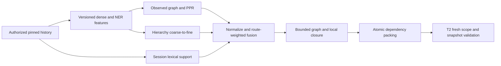

# T3b — Graph retrieval, fusion và evidence closure

Ngày 26/10/2026. Prototype offline sau [reader/hierarchy T3a](READER-HIERARCHY.md), giữ [hợp đồng T2](CONTRACT.md). Chưa nối vào ask production, chưa thay retrieval tài liệu SAG và chưa nghiệm thu chất lượng/tiết kiệm v1.

## Phạm vi đã triển khai

`services/session_context/graph.py` cung cấp feature DTO, optional local encoder/NER, observed entity–context graph và bounded personalized PageRank. `selection.py` cung cấp BM25 trên raw session text, hierarchical ranking, route/fusion, graph/local support và packing nguyên tử theo dependency. Hai test files tương ứng và optional extra trong `pyproject.toml`; không sửa T2/T3a/runtime callers.

### Learned features có version và nguyên văn

| Thành phần | Đã xác minh |
|---|---|
| Dense encoder | [BAAI/bge-m3](https://huggingface.co/BAAI/bge-m3), revision `5617a9f61b028005a4858fdac845db406aefb181`; vector 1024 chiều; card 8192 tokens, multilingual; MIT |
| NER | [Davlan/xlm-roberta-base-wikiann-ner](https://huggingface.co/Davlan/xlm-roberta-base-wikiann-ner), revision `642b9a14e71df124c43c67e47703a91341576dfb`; card có Vietnamese/English và PER/ORG/LOC; config thực là XLM-R base, hidden size 768 |
| Runtime đã dùng | sentence-transformers 5.7.0, transformers 5.17.0, torch 2.14.0, CPU; hai package đầu thành optional extra `session-context` |

Model card NER mô tả base/large không nhất quán và API metadata không khai license. Smoke research dùng public cache cục bộ; chưa coi license redistribution/production được duyệt. Không đưa weights vào repo hoặc tự bật model production. SPAcy không có trong environment; không thay NER bằng regex. Encoder mặc định của SAG không bị đổi.

`LocalFeatureEncoder` chỉ load revisions ghim từ cache có sẵn, `trust_remote_code=False`, không token đăng nhập; NER dùng safetensors, BGE bin load với `weights_only=True`. Nếu thiếu extra/cache thì lỗi được truyền ra; không giả features hoặc tự dùng model khác. Base app không tự import/load optional models.

Feature giữ SHA-256 nguyên văn, model/revisions/chunk policy, vector finite khác zero và entity offsets theo codepoint. Không chấp nhận duplicate entity span làm tăng tần suất giả. Entity key gồm nhãn và substring nguyên văn được NFC/casefold; normalization chỉ dùng cho key/ranking, không rewrite evidence.

Long text đi qua raw codepoint chunks truyền tường minh; mỗi chunk kiểm token count với tokenizer trước inference, quá giới hạn thì lỗi thay vì truncate. Vector là mean của normalized chunk vectors; NER offsets được đưa về toàn message. Chia chunk có thể cắt entity ở ranh giới và mean pooling có thể giảm chất lượng; T4 phải đo. Không gọi đây là semantic segmentation hoặc cách encode nguyên message giống hệt paper.

### Hai view và fusion

1. Chỉ dùng `HistoryRead` đã lọc quyền/provenance. Graph build kiểm lại eligible dependencies T2, feature hash/model/dimension và scope fingerprint.
2. Tạo context node cho mỗi message, entity node cho mỗi observed key. Entity–context edge có trọng số tần suất; adjacency chỉ giữa raw ordinals liền nhau và time gap trong ngưỡng, không nối qua row bị loại.
3. Query entity exact-match seeding + cosine context priors; PPR chạy số bước hữu hạn với damping tường minh. Không có entity anchor khớp thì dùng dense fallback. Không tự chạy uniform PageRank rồi nhận là có evidence liên quan.
4. BM25 dùng corpus frequencies của session, raw Unicode terms và stopwords chung hiện có. Không reuse financial-statement rewrites/hashed sparse vector của document index cho raw chat. Không dùng gold answer để tạo tín hiệu.
5. Hierarchy có centroid và lexical support ở episode/window/turn. Coarse-to-fine beam tìm vùng rồi turn; local view dùng khi closure cần neighbors. Cả graph và hierarchy đều chạy.
6. Route deterministic: không có query entities hoặc có cue follow-up/temporal thì ưu tiên local, còn lại relational. Cue chỉ là tín hiệu route, **chưa phải bộ lọc thời gian cứng** hoặc bảo đảm hiểu câu hỏi. Model NER có thể nhận sai/thiếu entity.
7. Min-max từng view, flat positive view thành 1, absent/zero-support thành 0; fuse theo `rho` của primary view. Score là tín hiệu ranking, không phải xác suất đúng. Ties có thứ tự deterministic.

Tham chiếu [Zero-Mem Eq. 3–14](https://arxiv.org/html/2607.29377v1). Sai khác prototype: exact entity alignment thay dense entity alignment; context-level PPR thay sentence co-occurrence propagation Eq. 9; temporal episodes và centroid/lexical coarse view; zero-support không được nâng thành flat evidence. Đây là triển khai có điều chỉnh cho SAG, chưa là tái lập nguyên vẹn nghiên cứu. Các giới hạn/top-k/beam/weights đều truyền tường minh; số dùng trong tests không phải default sản phẩm đã chốt.

### Closure và packing

Fusion chọn main roots. Graph support lấy ứng viên graph-ranked có entity chung với main; local support lấy neighbors của đúng anchor trong hierarchy. Mỗi loại có cap riêng; có thể rỗng. Không thêm arbitrary graph result chỉ để đủ số lượng.

Mỗi root được mở thành toàn bộ dependency closure, kiểm reference/hash và dedup. Một group vượt `max_messages` hoặc `max_codepoints` thì bỏ toàn group và trả `partial / selection_cap`; không đưa root với một phần dependencies. Không clip nguyên văn. Unknown legacy còn trong snapshot làm normal result `partial / unknown_provenance`. `groups` giữ dependency grouping để prompt fitter T7 không cắt phá group sau đó.

Codepoint cap là giới hạn packing cấu trúc, chưa bảo đảm fit tokenizer/window hoặc hóa đơn. T7 phải tính system/query/tool overhead, fit nhóm theo model thật, rồi cập nhật coverage. Full-session synthesis không nằm trong hàm normal selector này; T8 còn lại.

Coverage denominator giữ toàn eligible snapshot; visited chỉ những IDs đã đưa vào các groups, không đánh dấu mọi message vì đã index. Session statements vẫn phải phân biệt user/assistant theo T2; closure không tự giải mâu thuẫn hoặc suy lời user đã duyệt một đề xuất.



### Scope và tài nguyên

Snapshot/scope/model/hash khác phải reject; cache/graph không được mang sang thread/project khác. NER/encoder chỉ được gọi trên authorized HistoryRead hoặc query qua trusted caller; feature DTO không phải credential. Trước model input/output vẫn phải lấy quyền và raw rows mới rồi `validate_selection()`. T3b không có transaction/fence DB để đóng TOCTOU T5/T6.

Cùng request budget đi qua đọc, encoder/NER, build, PPR, hierarchy, closure và packing. Work-unit trừ cho tokenization/inference tokens, dimensions/dot products, nodes/edges/steps, sort, traversal và copy. Encoder/NER calls/tokens đo riêng với LLM calls/tokens; không tính encoder computation là miễn phí. Các synchronous inference/hash trong một lô chưa có preemptive cancel; kiểm trước/sau và không publish khi quá deadline. Không đổi model hoặc reset budget sau failure để vượt giới hạn.

Prototype in-memory và lookup/lexical scan toàn session; local radius/beam/graph steps đều có chi phí. Group packing theo codepoints chưa tối ưu precision/cost. Chưa có durable feature cache, lifecycle/backfill, production telemetry hoặc rollout.

## Kiểm chứng

Offline suite sau T3b: **161 passed, 2 deselected**; 33 ca T3b offline. Kiểm bridge/local/follow-up/no-anchor, frequency weights, malformed/stale features, scope/expiry, denied adjacency, normalization, atomic group/long-message caps, budget/cancel và retrieval message đầu trong 431 messages. Stub model tests chỉ kiểm adapter offsets/usage/truncation, không được nhận là learned-model quality.

Smoke model thật riêng: **1 passed**, hai câu hỏi synthetic Việt có đủ supporting message IDs và mọi returned span qua T2 validation. Pinned revisions như trên, vector 1024; **7 encoder calls / 81 input tokens**, **7 NER calls / 81 input tokens**, **0 generative LLM calls**; **108040 logical work units**, 16,25 giây trong phần đo (pytest tổng 19,54 giây). Đây là smoke, không phải baseline candidate accuracy hoặc savings. Câu thứ hai cũng có một local neighbor không cần cho đáp án; T4 còn phải đo precision/cost, không chỉ coverage.

Không chạy holdout hoặc live answer model. Ruff phần thay đổi PASS; toàn repo vẫn 124 findings cũ. Commands từ `SAG/apps/api`:

```powershell
.venv/Scripts/python.exe -m pytest -m "not ai_smoke" -q --tb=short
.venv/Scripts/python.exe -m ruff check sag_api/services/session_context tests/test_session_context_graph.py tests/test_session_context_selection.py
# Chỉ khi optional extra và pinned model cache đã sẵn sàng:
$env:SAG_RUN_SESSION_CONTEXT_MODEL_SMOKE='1'
.venv/Scripts/python.exe -m pytest tests/test_session_context_selection.py -m ai_smoke -q -s --tb=short
```

Test smoke được version trong test_session_context_selection.py, dùng dữ liệu synthetic có trong test. Không tải weights tự động trong test; optional extra chưa có thì cài có chủ ý bằng `pip install -e ".[session-context]"`, provision revisions công khai vào HF cache ngoài Git trước khi opt-in. Không gọi lệnh đó là production install/approval.

## Git, impact và rollback

Nhánh thực hiện `feat/Thang-session-context-graph-be-api` từ main cập nhật `7772270` + prerequisites T1–T3a. Thang đã yêu cầu push tiếp vào **PR #38**, head remote `feat/Thang-session-context-reader-be-api`; update phải fast-forward, không force-push/merge/approve. PR target main vẫn gồm T1–T3b.

Checkpoint sau T3b: [T4 calibration](CALIBRATION.md) bổ sung optional bounded batching/per-call exact chunk reuse và pin Torch trong extra; serial path giữ nguyên. Profile384/batch16 khác smoke128 ở đây và được đo riêng. Numeric contract đã khóa, nhưng regression/default grounding và [NER license audit](NER-LICENSE-AUDIT.md) chưa đạt rollout gate.

Không DB schema/model/index/migration hoặc dữ liệu thật, không env/public API/FE change. Optional extra là thay đổi dependency cấu hình duy nhất; mặc định app giữ nguyên. Rollback riêng commit T3b bỏ modules/tests/optional extra, không data migration. Model cache research ngoài Git không cần drop dữ liệu ứng dụng. T4 measurement/ngưỡng số đã có ở checkpoint trên; các rollout gates và T5–T9 còn lại; xem [researchtask](researchtask.md).
