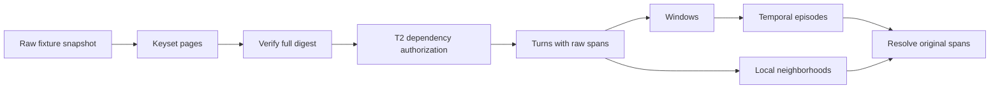

# T3a — Reader và temporal hierarchy offline

Ngày 26/10/2026. Triển khai theo [SPEC](SPEC.md) và [hợp đồng T2](CONTRACT.md). Không thay luồng ask hoặc `_history()` đang chạy.

## Reader đọc đủ snapshot

`FixtureTraceStore` chỉ nhận tuple `TraceMessage` synthetic có provenance tường minh. Không nhận raw ORM `Message`, không tự coi citations rỗng là recorded. Store sắp theo `(UTC created_at,id)`, ghim snapshot/generation và cấp keyset cursor gắn snapshot. Cùng timestamp dùng ID để phân định; timezone khác được quy về cùng UTC instant.

`read_history()` đọc từ trang đầu đến hết. Page size chỉ quyết định kích thước lô I/O; có thể đọc quá 8/200 message. Nó kiểm thứ tự tăng nghiêm ngặt, ID trùng, cursor không tiến, snapshot đổi và cuối cùng so digest toàn bộ dữ liệu đọc với snapshot ghim. Rơi trang/thiếu row không được trả thành read thành công. Đây là bảo đảm của fixture pinned store, chưa là transaction/fence database.

Sau đọc đầy đủ, `eligible_message_ids()` của T2 kiểm toàn bộ dependency graph, gồm dependency ở trang sau. Chỉ message hợp lệ được đưa vào `HistoryRead.messages`; `ordinals` giữ vị trí raw trước khi loại quyền/provenance. Metadata `excluded_count`/`unknown_provenance` chỉ dùng nội bộ, không đưa ra UI hoặc endpoint. Coverage giữ denominator eligible và **visited rỗng**: đọc/index không chứng minh đã tổng hợp xong nội dung.

Budget hoặc lỗi contract làm hàm raise và không trả object hoàn tất nửa chừng. Không resume/backfill bền trong T3a; driver tương lai chuyển lỗi sang trạng thái phù hợp T2/T8. Cursor chỉ phục vụ các trang trong snapshot, chưa phải checkpoint job bền.

## Bốn view cùng trỏ về nguyên văn

| Unit | Cách dựng trong prototype |
|---|---|
| `turn` | Một message nguyên tử, `origin` giữ ID/hash; nếu có nội dung thì span phủ toàn message |
| `window` | Nhóm các turn liên tiếp, không chồng lấn, tối đa `window_turns` |
| `episode` | Nhóm các window liên tiếp, tối đa `episode_windows`; chỉ dựa temporal continuity |
| `local` | Với mỗi turn, lấy tối đa `local_radius` hàng xóm mỗi phía trong cùng segment; `anchor_id` chỉ tâm |

Mỗi ordinal bị loại và khoảng cách thời gian **lớn hơn** `gap_seconds` tạo ranh giới segment. Windows, episodes và local không nối qua ranh giới đó. Đây là chính sách bảo thủ cho ACL; không dùng nội dung mất quyền để quyết định grouping. Khoảng cách bằng ngưỡng vẫn cùng segment.

Không LLM, summary, rewrite hoặc NER/encoder. Paper mô tả episodes dựa cả semantic continuity; T3a mới có temporal grouping, chưa gọi là tái lập toàn bộ [Zero-Mem, Method/Eq. 5](https://arxiv.org/html/2607.29377v1). Tham số kích thước/gap/radius truyền tường minh, chỉ là cấu hình cấu trúc trong thử nghiệm, chưa là default sản phẩm được chốt ở T4.

Unit ID là SHA-256 payload version `temporal-v1`, scope, loại, origin/span/children/anchor tương ứng. Không phụ thuộc page size hoặc thứ tự input ban đầu sau khi sort. Nhiều message rỗng vẫn có turn ID riêng vì giữ origin; local có cùng neighbors vẫn khác ID khi khác tâm. Snapshot envelope thay đổi khi dữ liệu/quyền/generation đổi; không dùng stable unit ID thay cho kiểm snapshot.

Parent chỉ chứa child IDs, không nhân bản toàn văn. `resolve_spans()` duyệt lặp, giữ thứ tự, loại trùng và trả span leaf quay về raw message. Message rỗng có origin nhưng không có zero-width span. Không tự cắt message dài hoặc normalize Unicode; span vẫn theo codepoint T2. Chia span nhỏ hơn cho prompt fitting là bước sau, phải giữ offset gốc.



## Tài nguyên và ranh giới

Cùng một `BudgetState` phải đi qua cold store build, toàn bộ pages, hierarchy và resolve. Tests failure-path có thể dùng budget riêng để cô lập bước; ví dụ đó không cho phép reset request budget khi retry. Không call generative model trong T3a.

Work-unit là đơn vị logic: row + block 1024 codepoints + Source/dependency references khi đọc/hash; cold ordering tính thêm `n*bit_length(n)`; mỗi page, node, edge, copy child refs và lookup/traversal resolve đều được tính. Kiểm trước lô/copy; deadline/cancel kiểm cùng budget và trước trả build. Không quy đơn vị này ra token, tiền hoặc thời gian thực đo được. Các hàm T2 synchronous bên trong một lô chưa có preemptive cancellation; T5/T6 cần adapter thực có timeout/fence.

Prototype giữ cả snapshot/index trong RAM, không phải streaming memory O(page_size). Cold read/build có chi phí theo toàn bộ snapshot. Local radius lớn tăng edges và có thể hết budget. `resolve_spans` hiện xây lookup theo toàn bộ units mỗi lần, có tính phí; T3b cần tránh gọi resolve cho mọi unit như một cách ranking. Không có cache bền, database pagination, resume/crash handling hoặc production concurrency/deletion acceptance.

Trước model input/output, caller vẫn phải resolve scope hiện hành, đọc snapshot mới và validate theo T2. `HistoryRead`/`TraceHierarchy` là objects nội bộ từ trusted adapter, không phải chứng chỉ quyền cho client tự gửi. Không bật production chỉ vì structural tests pass.

## Kiểm chứng và bàn giao

Tests mới: `tests/test_session_context_reader.py`, `tests/test_session_context_hierarchy.py` dưới `SAG/apps/api`. Kiểm 431 message với page sizes 1/8/37/200/1000; ties/timezone, bị mất trang, generation/scope mismatch, transitive revoke, denied boundaries, Unicode/empty content, node identity, budget/deadline/cancel và denominator không được mất row.

12 ca **calibration** của corpus T1 được expand để kiểm mỗi message có turn và mọi gold quote quay về raw. Đây là kiểm giữ dữ liệu cấu trúc; không chạy query retrieval, không đánh giá answer accuracy/recall, không tuning hoặc chạy holdout. Assistant fixture được khai báo synthetic, không dùng fixture metadata để suy provenance chat thật.

Nhánh `feat/Thang-session-context-reader-be-api` có phụ thuộc local T1 `f82eb78` và T2 `eb822bc`, origin/main vẫn `7772270` lúc bắt đầu. Không thêm schema/migration, env/config, dependency, public API hay thay đổi FE. Rollback riêng commit T3a; không data rollback. T3b còn graph/selection/fusion/closure và nghiên cứu encoder/NER.

Lệnh từ `SAG/apps/api`:

```powershell
.venv/Scripts/python.exe -m pytest tests/test_session_context_reader.py tests/test_session_context_hierarchy.py -q
.venv/Scripts/python.exe -m pytest -m "not ai_smoke" -q
.venv/Scripts/python.exe -m ruff check sag_api/services/session_context tests/test_session_context_reader.py tests/test_session_context_hierarchy.py
```

Kết quả cuối và review tại [researchtask](researchtask.md). Không live provider call hoặc backfill dữ liệu thật trong T3a.
