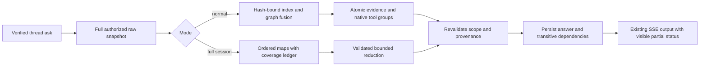

# Thread session context runtime contract

## T7 primitives

model.py supports the configured OpenAI-compatible Qwen/Qwen3-8B route; other model/tokenizer families fail explicitly until validated. Qwen tokenizer pinned atb968826d9c46dd6066d109eabc6255188de91218, local cache only; complete chat template+tool schemas+256 framing headroom. This is a conservative input bound checked against provider usage, not invoicing. BoundedLLM uses OpenAI SDK2.54 with SDK retries0 and owned httpx client follow_redirects=False; avoids LiteLLM's implicit alternating-message resend loop. OFF/stateless/default LLMClient transport unchanged. Extra dependency is optional and matches installed version, no new package installation required.

Actual SDK MockTransport tests cover one physical request on400/429/500 and307/308, no redirect/role rewrite/retry, deadline, unknown usage, stream closure/cancellation. On cancellation even a prior usage snapshot is incomplete: reserve remains unknown and further paid calls are blocked. Usage settles from last cumulative snapshot only. This validates SDK boundary, not provider billing internals.

packing.py wraps raw roles/spans as inert JSON, current query last once, system instructions separate; no historical assistant text becomes active assistant completion. Groups fitted atomically with model counter and actual tool schemas. Excess system/query raises; never truncates the question or silently keeps lastN. Provider returns JSON answer/supports with exact quotes from authorized IDs. Invented ID/quote or malformed JSON becomes UNKNOWN; quote membership is provenance validation, not proof of semantic entailment. Document numeric citations keep their existing independent gate.

## Additive thread API integration (T7/T8)

SAG_SESSION_CONTEXT_MODE=off|shadow|on, defaultoff. OFF keeps legacy, SHADOW can build/select local features but never adds answer/compression calls beyond the legacy request. ON uses validated session context; migrations0007 and pinned local models/tokenizer must exist. Input text only; image request under ON reports explicit unsupported mode. Named and default agent thread ask supported; stateless OpenAI endpoint remains unchanged.

Existing POST /api/v1/agents/{agent}/threads/{thread}/ask gains optional context_mode=normal|full_session. Omitted selects full only for explicit recognized whole-session phrases, otherwise normal; explicit enum overrides phrase routing. No extra endpoint/event type. This field adds no auth, Source scope, model or budget authority to the caller. Legacy clients keep their payload.

Existing terminal event payload gains optional session_context (mode,state,reason,eligible,visited,evidence refs/hash/offsets) and session_accounting (calls/usage/accounting completeness, no raw prompts/keys). Original output/citations/answer_status remain. Session quotes are not forged document citations; source/span provenance is separate metadata. Existing clients can ignore additive metadata; full partial output must include a visible natural-language prefix and missing-coverage counts, so clients do not need to interpret a new SSE event to see incompleteness. Browser fixture acceptance is recorded in evidence/browser: actual API/provider, visible live partial and reload at390/768/1280/1440; this does not certify the separate Continuum embed flow or PostgreSQL server isolation.

Runtime integration/coverage implementation and final results are recorded in researchtask and updated here when complete. Feature remains OFF; numeric thresholds unchanged from CALIBRATION-POLICY; new NER needs calibration and holdout before rollout. PostgreSQL shared row locks/fresh scope checks protect input/publication; SQLite/WASM tests alone cannot certify server multi-process behavior.

## Existing tool-assisted requests

The T4 one-attempt normal ceiling was measured on memory-only synthetic questions, with no document Sources. Applying it to existing search_context requests would break the native tool-call/result/answer protocol, which needs at least two model turns. Preserve that capability with an explicit tool_assisted budget profile when document/research tools are enabled (or an explicit time-only tool request): maxmin(7,configured agent_max_steps+1) attempts, eachinput8192/output4096, total12288*attempts, request60s. Seven follows deployed legacy six agent turns plus its finalization turn; no retry/redirect and no cloud decision-router call in this lane. Keep4096 input room for a tool result before it arrives; preserve native tool-call/result groups.

This additional workload ceiling is recorded before its protocol test and before holdout; it does not lower T4 quality/token-savings gates or claim measured savings for document/web-assisted requests. Pure memory-only normal queries retain one attempt/12288total; exhaustive full-session retains12/262144/360. Enabling tools is not an authorization grant: existing Source filters/principal/mappings and document citation gate stay mandatory, explicit @Source still requires search_context. Deployment remains OFF pending the complete validation gates; actual retrieval backend acceptance is separate from a retrieval-tool test double.

## Lifecycle and full-session behavior

Every text ask stores current-user provenance, reads authorized full raw history and reuses only hash/model/scope-matching features. Encoder weights are process-local singletons; inference is serialized, user feature dictionaries are request-local. Missing checkpoints resume from the last committed batch. Delete invalidates the derived generation in the same transaction while enabled; raw reread/hash validation also rejects stale/deleted rows after OFF rollback. Unknown legacy assistant authority stays excluded. The trusted single-project SAG-session owner can recover legacy user statements; general assertion membership is never guessed.

Before model input and final persistence, resolve current owner/project/partition/Source dependencies again. Shared PostgreSQL locks on Thread, selected Messages/provenance, index and used Source/mappings live through publication and are bounded by the shared request deadline. No distributed first-insert lease is claimed: conflicting jobs can fail closed and resume. Authorized history strips internal context markers and all frozen prompt previews; revocation hides answers whose transitive original dependencies are no longer available.

Full-session skips graph retrieval caps and scans the complete eligible pinned snapshot in ordered batches. Each batch includes whole dependency closure and one prior-message overlap. Only validated map outputs mark coverage visited; intermediate items retain original role/order/timestamps/exact quotes. Reduce can use only already-validated support pairs. It never truncates intermediate items to pretend completeness. Budget exhaustion returns an explicit partial result where publication can still be validated; deadline/unknown-accounting/auth failures can terminate the run. Cancellation uses the existing native runtime handle and stores an empty CANCELLED answer, never a successful complete answer. Up to8192 validated support pairs are allowed for full output, versus128 normal, bounded by provider output/call/work caps.

Simple greetings, complete arithmetic, clarification and explicit current-time requests retain existing narrow direct-intent behavior; unknown factual questions still require evidence. Time comes from the native get_time tool. All memory JSON is buffered and decoded before user-visible answer deltas; malformed references become UNKNOWN. Exact quote membership does not establish semantic correctness, which is measured separately.

## Backfill and rollback operations

From SAG/apps/api, run the job with private token files outside Git:

```powershell
.venv/Scripts/python.exe scripts/backfill_session_context.py --agent-id <agent> --thread-id <thread> --token-file <private-token-file>
# Add --assertion-file <private-signed-assertion-file> for the existing assertion auth mode.
# Add --apply only to build the derived index after the dry run is reviewed.
```

The job uses the same verified user/principal/owner functions as HTTP; there is no arbitrary owner/project option. Default dry run writes nothing. Apply uses180seconds/32Mwork units, clipped to token expiry; rerun resumes committed checkpoints. It emits counts/state, never token values/raw messages/errors. No real-chat backfill was run in this task.

Rollback order: set SAG_SESSION_CONTEXT_MODE=off, stop jobs and drain active requests, retain raw chat and migrations initially; run0007 down only after readers have stopped. Source-aware history continues to hide session answers without valid provenance, including if tables were removed; a savepoint prevents a missing derived table from aborting the outer history transaction. Re-enable only after rebuilding verified metadata and passing the gates.




## Model reference protocol v2 (pre-holdout calibration correction)

Observed v2 maps can fail exact-quote copying even when IDs and evidence are available. The internal model may now return supports[{id}] only; an explicit decoder opt-in resolves the whole exact authorized span text on the server. This preserves original immutable span/hash/source/dependency authority without asking the model to reproduce text bytes. Existing supplied quotes remain strictly validated, never repaired; unknown/unselected IDs fail closed. Default decoder stays strict for other callers. Intermediate maps materialize canonical id/quote pairs; reduce may choose only pairs represented by validated intermediate items. Semantic entailment still requires evaluation.

Bounded session model calls request response_format=json_object. Primary SiliconFlow docs define JSON mode; two explicit actual SDK preflight requests verified plain JSON and forced native function-tool mode on the configured Qwen3-8B route (209input+10output tokens, no retries). Result saved locally; four browser requests and these two preflight requests are outside the paired ledger, so no global money-saving claim is made. No JSON-schema support is assumed. This is applied only before final calibration/holdout and does not weaken numeric gates or add retry/repair calls.

Reference protocol also accepts supports:["S1"] as the exact equivalent of supports:[{"id":"S1"}], only in the explicit internal opt-in decoder. Supplied bad quotes remain rejected. Reducer string IDs resolve only previously mapped canonical quote pairs. Calibrationv3 identified this serialization mismatch before holdout; its diagnostic answers are preserved. Final verification usesv4, with the same numeric thresholds.

## Runtime evaluation resume contract (post-review, 2026-10-27)

`scripts/verify_session_runtime.py` requires an explicit, nonempty `SAG_LLM_BASE_URL`
before creating or resuming an experiment. SDK environment/default endpoint fallback
is rejected; the harness hashes the configured route without storing credentials.
This restriction applies to the opt-in evaluation harness, not application settings.

New manifests use `schema_version: 3`. Every experiment ledger call must retain
`estimated_input_tokens`, `max_output_tokens` and `configured_retries`, including
failed/unknown-usage calls. The saved `reserved_tokens` must exactly equal the sum
of `(estimated_input_tokens + max_output_tokens) * (1 + configured_retries)` for
all calls. Resume restores that total without refunding unused output allowance;
an explicit zero-call ledger with zero reservation is valid. Old schema reports,
missing reservation fields and inconsistent totals are rejected before new work or
report overwrite. Use a new experiment output rather than editing historical
reports to make them resumable. No live provider evaluation was repeated for this
contract change; existing quality/rollout NO-GO remains in force.

Post-fit evaluation diagnostics record each dispatched request separately. For
normal-mode synthetic replay, `fitted_evidence_recall_by_call` pairs each recall
with its call index and message hash. `fitted_gold_evidence_recall` describes the
last dispatched call only, and is null if it has no evidence frame; the separately
named `fitted_evidence_union_recall` is a union across calls, not proof that any
single request contained all evidence. Historical pre-fit artifacts cannot be
used to reconstruct these measurements.


## Post-validation F2 remediation & harness durability contract (2026-10-27)

1. **Per-item map support validation (`aggregate.py`)**:
   - `_items()` validates map output item-by-item against the current batch evidence. Valid supported items are retained even if the model emits an accompanying unsupported commentary/absence item (`supports: []`, unknown/out-of-batch ID, or invalid quote).
   - Whenever any item in a map batch is dropped (`not batch_clean`), `reason` is set to `"map_not_ready"`, only verified supporting message IDs (and their dependency closure within the batch) are added to `visited`, unverified messages from that batch remain in `unverified_ids` so subsequent 1-message overlap does not mark them visited, and the overall result remains `complete=False` (`state="partial"`). If a map batch produces zero valid items and drops at least one invalid item, `_items()` raises `ValueError("invalid_map_support")` and preserves any valid items extracted from earlier batches.
2. **Bounded multi-message map batches and reduce call reservation (`aggregate.py`)**:
   - Multi-message map batches (`len(ids) > 8`) are bounded to `min(input_limit, 10240)` tokens (`<= 8` message batches retain `input_limit`) so 200+ message sessions split into multiple bounded map requests that complete well within the 60s per-call SDK timeout (`BudgetedLLM`).
   - When `extracted` is non-empty and `max_calls > 1`, `aggregate_session` reserves 1 call (`reserve_for_reduce = 1`) for the reduction step rather than exhausting all calls on map batches.
   - Provider/transport exceptions (`APIError`, `httpx.HTTPError`, `TimeoutError`, `UpstreamError`, `ValueError`) during map or reduce are caught in `aggregate_session` to return a safe visible partial result (`map_not_ready` / `synthesis_not_ready`) when known usage permits revalidation.
3. **Post-`fit` dispatched prompt evidence & durable experiment resume (`runtime.py`, `model.py`, `verify_session_runtime.py`, `calibrate_session_context.py`, `session_context_accounting.py`)**:
   - `SessionContext.note_dispatch` captures the actual post-`memory.fit` `SESSION_EVIDENCE_JSON` message(s), `messages_sha256`, and `fitted_evidence` at `BudgetedLLM._create_completion`.
   - Both `verify_session_runtime.py` and `calibrate_session_context.py` durably checkpoint `in_flight_replay`, `status="started"`, `in_flight=True`, `reserved_tokens`, `elapsed_seconds`, and `replay_duration_seconds` to disk (`flush` + `os.fsync` + atomic `replace`) before every provider dispatch and upon settlement, and reject resume whenever an in-flight replay or unsettled call exists.
   - Cancelled or failed streams in `TrackedLLM` and `verify_session_runtime.py` keep `input_tokens=None, output_tokens=None` rather than committing partial mid-stream usage snapshots.
   - `SAG_SESSION_CONTEXT_MODE=off` and rollout `NO-GO` remain in force pending a fresh blind validation run.
