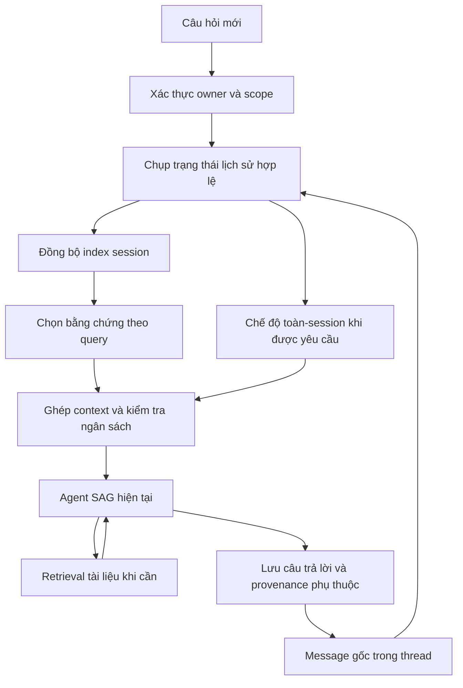

# Đặc tả v1: Context toàn bộ session chat theo Zero-Mem

Ngày: 2026-10-26. Chủ yêu cầu: Thang.

**Trạng thái triển khai 2026-10-27:** T1–T8 đã có implementation và kiểm thử; T9 đang đo bản runtime cố định trên calibration/holdout. Feature mặc định OFF, chưa chấp thuận rollout. Baseline tại [BASELINE](BASELINE.md); runtime và vận hành tại [RUNTIME](RUNTIME.md), schema riêng tại [PERSISTENCE](PERSISTENCE.md). Các mô tả prototype phía dưới ghi lại checkpoint lịch sử; hợp đồng runtime hiện hành ở RUNTIME.

Tài liệu cùng task: [nghiên cứu hiện trạng](researchtask.md), [kế hoạch](tasks/plan.md), [checklist](tasks/todo.md).

**T2 đã thực hiện:** [hợp đồng evidence/scope/provenance/budget](CONTRACT.md) và validators/tests nội bộ; T7 đã nối selector/typed grounding vào runtime theo RUNTIME. Full-session không được báo hoàn tất khi còn lịch sử thiếu provenance; partition stamp gốc không được suy từ project hiện tại.

**T3a đã thực hiện:** [reader/hierarchy offline](READER-HIERARCHY.md), pinned fixture keyset pages và turn/window/temporal episode/local views có nguyên văn provenance. Không coi temporal grouping là semantic episode segmentation hoặc production reader.

**T3b đã thực hiện:** [graph/fusion/closure offline](GRAPH-SELECTION.md), optional learned encoder/NER revisions ghim và synthetic model smoke; không coi là tái lập nguyên vẹn paper. Numeric contract của T4 và các rollout gaps được cập nhật bên dưới.

**T4 đã đo và khóa contract kiểm chứng:** [calibration](CALIBRATION.md), [numeric policy](CALIBRATION-POLICY.json) và [license audit](NER-LICENSE-AUDIT.md). Balanced giữ9/9 raw evidence normal; web-enabled answers5/10→9/10 và long-normal tokens giảm~76,7%. **Chưa đạt rollout gate**: compression-middle bị filler echo, default grounding chưa nhận session evidence, license fine-tune chưa xác minh. Đây là checkpoint T4 cũ. T5–T8 nay đã triển khai, NER candidate/license mới ghi ở MODEL-LICENSES; T9 kiểm chứng riêng, không dùng điểm trung bình để bỏ qua regression.

## 1. Mục tiêu và quyết định đã xác nhận

Xây bộ chọn context từ toàn bộ lịch sử của **một thread chat**. Mọi message gốc đã lưu và được phép đọc đều thuộc phạm vi có thể truy xuất, kể cả message rất cũ. Mỗi lần gọi model chỉ nhận bằng chứng cần thiết và vừa ngân sách. Không cam kết model đọc tất cả lịch sử trong mọi lượt hoặc recall tuyệt đối.

Các quyết định do Thang xác nhận trong hội thoại ngày 26/10/2026:

| Mã | Quyết định |
|---|---|
| D1 | Giữ SAG và retrieval kho tri thức; bổ sung quản lý context session |
| D2 | Không lấy 8 message hoặc cửa sổ 200 message cuối làm phạm vi nhớ |
| D3 | Hỗ trợ cả chat cũ và chat mới; người dùng tiếp tục thread hiện có |
| D4 | Câu hỏi cần bao phủ toàn session được tổng hợp nhiều lượt nếu cần, có giới hạn chi phí và thời gian |
| D5 | Câu hỏi thông thường dùng context gọn |
| D6 | Đo baseline trước rồi chốt ngưỡng số; chất lượng ít nhất ngang hiện tại, cải thiện nhớ thông tin cũ và chứng minh tiết kiệm trên session dài |
| D7 | Đánh giá câu hỏi tổng hợp toàn session riêng |

Các giá trị ngân sách, model encoder/NER, schema index và phần trăm tiết kiệm **chưa được phê duyệt**. Các lựa chọn dưới đây là đề xuất kỹ thuật, phải được kiểm chứng theo kế hoạch.

## 2. Liên hệ với nghiên cứu

Nguồn: [Zero-Mem v1](https://arxiv.org/html/2607.29377v1).

| Mục/phương trình | Thành phần tham chiếu |
|---|---|
| Preliminaries, 1–2 | Chọn bằng chứng từ lịch sử cho reader |
| Method, 3–5 | Entity–context graph và turn/window/episode/local span |
| Method, 6–11 | Routing theo query; graph propagation/PageRank và hierarchical retrieval |
| Method, 12–14 | Chuẩn hóa, fusion, evidence closure |
| Method, 15–16 | Calibration bằng quy tắc |

Tham chiếu dùng NER không sinh văn bản, BM25 và BGE-M3. Hai view cùng chạy; routing thay trọng số. “Zero-token” chỉ áp dụng memory operations; encoder và final reader vẫn có chi phí. Đây không phải bảo đảm nhớ đúng mọi chi tiết.

**Phần tự thiết kế cho SAG:** cập nhật index, backfill, ACL, budget, lifecycle, telemetry và chế độ tổng hợp toàn-session nhiều lượt. Chế độ tổng hợp này có LLM calls và không được quảng bá là zero-token memory operation. Nếu thay encoder/NER hoặc lược bớt thuật toán, phải ghi sai khác và kết quả đo; không gọi là bản tái lập nguyên vẹn nghiên cứu.

## 3. Hiện trạng và ranh giới

Base đã kiểm tra: `77722700fa8ed83112bff6640213b12d0235c11c` trên `origin/main`.

- Chat web dùng `POST /api/v1/agents/{agent_id}/threads/{thread_id}/ask`.
- `agent_domain._history()` lấy cửa sổ gần nhất; `prepare_ask()` gọi `compress_history()` với 40% context window. Nguồn: [agent_domain.py](../../../apps/api/sag_api/services/agent_domain.py).
- `Thread`, `Message` lưu nội dung, role, status, citations, steps và attachment metadata: [models/agent.py](../../../apps/api/sag_api/db/models/agent.py).
- `agent_service._fit_agent_context()` kiểm soát input/tool schemas và output reserve: [agent_service.py](../../../apps/api/sag_api/services/agent_service.py).
- `SearchContextTool` truy xuất kho tri thức: [builtin.py](../../../apps/api/sag_api/tools/builtin.py).

Không sửa retrieval tài liệu, ingestion/index tài liệu, graph viewer, Laya, identity hoặc membership trong deliverable context session. Session chat khác phiên đăng nhập. Không nhớ chéo thread hoặc chéo người dùng.

V1 tập trung văn bản message và metadata đã lưu. Không suy diễn rằng ảnh đính kèm hoặc toàn bộ raw tool output đã được lưu và có thể tìm theo nội dung; cần capability riêng nếu sau này mở rộng.

## 4. Luồng mục tiêu



Ngân sách giới hạn context gửi model và công việc của request; không phải tiêu chí loại vĩnh viễn message cũ khỏi chỉ mục.

### 4.1. Nhận và đồng bộ lịch sử

1. Xác thực thread bằng owner/scope hiện có trước khi đọc dữ liệu hay index.
2. Lưu user message như hiện tại; tránh đưa câu hỏi hiện tại hai lần vào context.
3. Đọc lịch sử bằng phân trang ổn định theo `(created_at, id)` trên snapshot. Page size là giới hạn I/O, không phải giới hạn phạm vi nhớ.
4. Với chat cũ, xây index từ message gốc theo tác vụ có checkpoint; với chat mới, bổ sung sau khi message đã lưu. Đề xuất dựng theo nhu cầu khi mở lại, có khả năng backfill nền theo cùng hợp đồng idempotent.
5. Chỉ công bố index sẵn sàng khi generation, dấu vết mutation và watermark khớp snapshot. Một maximum ID/timestamp đơn thuần không phát hiện đầy đủ sửa/xóa.
6. Khi index cũ/thiếu/lỗi, không âm thầm trở về cửa sổ gần nhất rồi coi là nhớ toàn session. Chờ/rebuild trong budget, hoặc trả trạng thái giới hạn rõ ràng.

### 4.2. Chọn context cho câu hỏi thông thường

Các bước thiết kế: lập query profile; tìm trên các view hợp lệ; hợp nhất; bổ sung bằng chứng nối và đoạn giải nghĩa; loại trùng; xác minh bản gốc/ACL lần cuối; đóng gói theo budget.

- Không có quy tắc bắt buộc chỉ giữ đúng N message gần nhất. Độ gần chỉ có thể là tín hiệu phục vụ ngữ cảnh câu tiếp nối.
- Message cũ vẫn có thể được chọn. Một message quá dài có thể chia span theo offset nhưng phải quay lại được bản gốc.
- Không dùng generated summary làm nguồn duy nhất thay thế đoạn cũ.
- Đặt bằng chứng lịch sử vào phần có nhãn rõ, không biến assistant text thành chỉ dẫn system hoặc lời xác nhận của user.
- Phân biệt phát biểu của user, đề xuất của assistant và xác nhận của user. Thứ tự thời gian không tự chứng minh một phát biểu đã thay thế mọi phát biểu trước.
- Giữ cặp native tool-call/result hợp lệ trong vòng agent đang chạy; lịch sử được truy hồi không được giả mạo tool call đã thực thi.
- Prompt fitter phải coi nhóm bằng chứng phụ thuộc là một đơn vị; nếu phải bỏ nhóm vì budget thì cập nhật trạng thái coverage. Không để một lần cắt sau retrieval phá mất cầu nối mà vẫn ghi là đủ.

### 4.3. Câu hỏi cần bao phủ toàn session

Ví dụ: “liệt kê tất cả quyết định”, “tổng hợp từ đầu cuộc chat”. Chế độ này là phần mở rộng sản phẩm được D4 cho phép.

1. Xác định phạm vi snapshot và số đơn vị hợp lệ. Duyệt đủ phạm vi theo lô, không lấy một gói top-k nhỏ làm bằng chứng hoàn tất.
2. Tạo kết quả trung gian có liên kết về message/span, sau đó tổng hợp nếu cần. Generated intermediate không thay thế lịch sử gốc và không tự trở thành nguồn có thẩm quyền.
3. Theo dõi đơn vị đã xử lý, các lô chưa xử lý, nguồn bị loại, thời gian và toàn bộ LLM calls.
4. Kiểm tra budget trước mỗi công việc/call; cancellation áp dụng cả lô tiếp theo, retry và bước tổng hợp cuối.
5. Chạm giới hạn thì dừng và nói rõ phần chưa bao phủ; không dùng nhãn “tất cả/đầy đủ” khi chỉ xử lý một phần.

Phân biệt **đã duyệt hết đơn vị hợp lệ** với **đã nhận ra mọi quyết định**. Việc thứ hai phải đo với nhãn chuẩn; tỷ lệ đã duyệt 100% không chứng minh recall ngữ nghĩa 100%.

## 5. Hợp đồng nội bộ đề xuất

Các tên dưới đây là khái niệm thiết kế mới, chưa phải symbol/API đã tồn tại:

| Khái niệm | Thông tin bắt buộc |
|---|---|
| Session snapshot | owner, agent/thread, scope fingerprint, generation/revision, thứ tự ổn định |
| Trace unit | message ID, role, timestamp, status, original span, content hash và phụ thuộc nguồn |
| Context selection | mode, bằng chứng đã chọn, thứ tự, dependency groups, tokenizer/estimate method, token estimate |
| Coverage | phạm vi hợp lệ, phạm vi đã duyệt, còn thiếu, index readiness; không tiết lộ số liệu ngoài scope |
| Budget state | deadline, remaining calls/tokens, output reserve, accounting completeness |

Ưu tiên giữ ask request hiện tại. Không tự thêm route hay SSE event công khai. Nếu cần UI nhận trạng thái indexing/partial/coverage mới, viết và duyệt contract trước, tách deliverable FE nếu cần. Trước rollout phải xác minh client thực tế hiển thị được lỗi/partial, không chỉ ghi telemetry phía server.

Endpoint tương thích OpenAI hiện là stateless: lịch sử do caller cung cấp, không có `thread_id` bền trong endpoint này. V1 phục vụ thread ask; không tự gắn history endpoint stateless vào thread khác. Tài liệu tích hợp phải nêu ranh giới này.

## 6. Dữ liệu, index và lifecycle

- Message gốc trong SAG database vẫn là nguồn chuẩn; index là dữ liệu dẫn xuất, có version và dựng lại được.
- Không thêm retention cap làm message hợp lệ tự biến mất khỏi phạm vi nhớ trong v1. Việc xóa theo yêu cầu/policy hiện có vẫn phải được tôn trọng.
- Ưu tiên tái sử dụng hạ tầng PostgreSQL/Qdrant đã có sau khi đo; không trộn namespace/index session với index tài liệu. Chưa chốt schema hay vector collection.
- Nếu cần bảng, field, index, constraint hoặc vector collection/payload mới: lập deliverable database riêng, migration mới, down/rollback và kiểm thử nâng cấp. Không sửa migration cũ.
- Backfill có checkpoint, khóa/lease hoặc cơ chế tương đương chống chạy trùng, resume sau crash, giới hạn tài nguyên và publish nguyên tử. Read path vẫn kiểm tra nguồn chuẩn.
- Delete thread/message phải làm nội dung không thể được trả lại ngay sau khi delete thành công, kể cả cache/vector/graph chưa dọn xong. Không chỉ dựa vào asynchronous deletion; revalidate IDs/hashes trước đóng gói.
- Concurrent ask/index/delete phải có generation fence; không được publish index cũ sau delete. Dữ liệu từ request chưa hoàn tất hoặc assistant failed/cancelled phải được đánh dấu đúng trạng thái, không coi là câu trả lời hoàn chỉnh.
- Message cũ thiếu owner mapping đáng tin cậy không được đoán quyền. Reuse quy trình legacy owner reconciliation khi phù hợp; báo các trường hợp chưa thể index.

## 7. Authorization và provenance

Kế thừa [BE–SAG IAM decision](../../security/be-iam-integration-decision.md) và [storage boundary](../../data-ownership-and-storage.md).

- Dùng `get_thread()` và `conversation_owner_key()` hiện có; không thay bằng owner/thread ID do client tự khai.
- Áp scope trước candidate generation và traversal; graph/hierarchy/cache không được chứa cầu nối xuyên quyền làm lộ dữ liệu hoặc ảnh hưởng kết quả bằng dữ liệu bị cấm.
- Embedding cache có key gắn model/version và quyền dữ liệu; kết quả cache không được bỏ qua authorization khi đọc.
- Mỗi bằng chứng dẫn xuất phải giữ toàn bộ dependency tới message và Source đã sử dụng, kể cả câu trả lời sau chỉ dựa vào history. Khi revoke một nguồn, mọi bằng chứng phụ thuộc nguồn đó phải được đánh giá lại.
- `SAG/tasks/todo.md` còn ghi thiếu propagation Source provenance xuyên lượt. Đây là khoảng trống thực tế phải giải quyết trước khi bật recall trên dữ liệu nhạy cảm. Không coi assistant message không có citation là bằng chứng chắc chắn không phụ thuộc nguồn.
- Trường hợp legacy không xác định được provenance: dùng chính sách an toàn có nhãn và đo tác động chất lượng; không khôi phục raw prompt preview hoặc câu trả lời đã bị ẩn.
- Log mặc định chỉ chứa IDs đã được giới hạn truy cập, hashes, counts và metrics. Không ghi raw chat, prompt, token hoặc credentials vào Git/telemetry không được phép.

## 8. Budget và trạng thái lỗi

Budget runtime phải hữu hạn cho cả normal và full-session mode. Giá trị cụ thể được đề xuất từ baseline/calibration, ghi trong cấu hình trước khi bật mode mới; không tự chọn số rồi gọi là quyết định của Thang.

Phải giới hạn: thời gian request, số LLM calls gồm retry/tổng hợp, tổng input/output tokens, công việc indexing của request và context của từng call. Chi phí tiền chỉ tính khi có model/rate xác minh được; thiếu usage/rate phải đánh dấu unknown, không ghi 0. Output tokens chưa biết trước cần reserve trước khi gọi và đối soát sau.

| Tình huống | Hành vi yêu cầu |
|---|---|
| Empty thread | Chỉ xử lý câu hỏi mới và ngữ cảnh hợp lệ hiện có |
| Index đang xây/stale | Hoàn tất trong budget hoặc báo chưa sẵn sàng/partial; không giả nhớ đầy đủ |
| Embedding/NER unavailable | Báo mode suy giảm hoặc lỗi có cấu trúc theo contract đã duyệt; không âm thầm nhận là full pipeline |
| Query/system vượt model window | Giữ lỗi rõ ràng, không âm thầm cắt câu hỏi |
| Deadline/call/token cap | Không bắt đầu call/lô mới; trả kết quả partial có phạm vi nếu contract hỗ trợ |
| Revoke/delete trong lúc chạy | Loại dữ liệu không còn hợp lệ trước xuất kết quả; hủy nếu không giữ được bảo đảm |
| Cancel/retry/crash | Dừng công việc, cleanup/resume idempotent; không double-count hoặc double-publish |

## 9. Đo baseline và nghiệm thu

### 9.1. Baseline và tập dữ liệu

- Baseline chính: cơ chế hiện tại tại commit đã ghim, gồm load limit, compression, retries và agent loop như thật. Không tắt summary để baseline trông rẻ/đắt hơn.
- Candidate: cùng dữ liệu, provider/model, tham số generation, tools và quyền truy cập. Ghi cấu hình đã redact và version fingerprint.
- Dùng corpus tiếng Việt và pha Việt/Anh có message IDs, timestamps, gold answer/decision items, gold evidence spans, scope và mutation events. Nhóm độ dài bao gồm vượt 8 message, vượt 200 message và vượt ngưỡng compression của model được chọn.
- Tách bộ calibration khỏi holdout trước khi chỉnh tham số; ghim seed/order và lịch sử mutation. Câu hỏi thông thường và toàn-session có báo cáo riêng.
- Có thể dùng fixture để kiểm thử logic offline. Chỉ live provider với usage thật mới chứng minh latency/cost; không gọi fixture/mock là nghiệm thu FE–BE/provider.
- Không tự chạy live model, backfill chat thật hoặc xuất raw chat trong task soạn tài liệu này.

### 9.2. Metrics

| Nhóm | Số liệu |
|---|---|
| Chất lượng | độ đúng theo gold, decision-item precision/recall, correctness theo trạng thái thời gian |
| Bằng chứng | evidence recall, source/span validity, missing bridge, unsupported claims |
| An toàn | cross-owner/thread/scope leakage, revoked/deleted dependency regression |
| Coverage | full-session traversal và semantic item recall, báo partial có đúng không |
| Tokens/calls | input/output/cached/reasoning nếu provider trả, mọi calls/retry và bước compression/tổng hợp |
| Thời gian | cold/warm indexing, retrieval, TTFT và end-to-end p50/p95 theo từng nhóm |
| Tổng chi phí | generation + encoder + index/storage; ghi chi phí lần đầu và amortized theo số lượt, không mặc định vô hạn lượt để làm đẹp số |

`estimate_tokens()` hiện là heuristic ký tự; không được dùng thay usage thực để tuyên bố giảm tiền. `LLMClient.complete()` hiện chỉ trả text, nên instrumentation phải bắt được usage của compression ngoài runtime. T1 đã thêm observer riêng trong replay harness và tùy chọn lấy stream usage mặc định tắt cho production. Provider usage thiếu phải thể hiện accounting incomplete.

Giảm token và giảm tiền là hai kết quả khác nhau. Khi tính tiền cần tách input/output/cache/reasoning theo rate có ngày và provenance; encoder self-host phải báo tài nguyên/thời gian nếu chưa quy đổi được tiền.

### 9.3. Quality gate

1. Lập baseline và kiểm tra accounting đầy đủ.
2. Chốt ngưỡng số/giới hạn vận hành dựa trên calibration **trước** khi đánh giá holdout; lưu decision record. Không chỉnh ngưỡng để hợp thức kết quả holdout.
3. Không giảm chất lượng theo tiêu chí đã chốt; kiểm tra từng nhóm quan trọng để average không che regression. Phải cải thiện nhóm nhớ thông tin cũ.
4. Không có regression leakage/deletion trong các tình huống bắt buộc. Mọi trích dẫn message/span phải hợp lệ.
5. Chứng minh tiết kiệm trên session dài cho câu hỏi thông thường; báo riêng mức giá phải trả để bao phủ toàn-session.
6. Không đánh dấu ready nếu provider usage, index lifecycle, provenance hoặc client partial-state còn chưa được kiểm chứng.

## 10. Commands, cấu trúc và phong cách triển khai

Chạy từ `SAG/apps/api`, dùng Python environment đã cài dependencies:

```powershell
python -m pytest -m "not ai_smoke" -q
python -m ruff check sag_api sag_agent tests
```

Đây là lệnh kiểm tra giai đoạn triển khai; T1 đã chạy offline suite, còn `ai_smoke` độc lập được loại ra vì live baseline có công cụ riêng. Không tự cài package/model mới. Lệnh benchmark T1 thực tế xem [BASELINE](BASELINE.md).

Cấu trúc mục tiêu: `sag_api/services/` sở hữu orchestration; `sag_api/db/` giữ persistence của SAG; `sag_agent/` giữ runtime không phụ thuộc ứng dụng; tests trong `tests/`; harness trong `scripts/`; dữ liệu chạy thật trong `.data/` đã ignore. Không nhét session memory vào ingestion/index tài liệu.

Theo mẫu hiện có: async service functions, typed inputs/results, SQLAlchemy qua owning layer, structured errors, dependency injection qua call arguments. Ví dụ chữ ký hiện có trong `agent_domain.py`:

```python
async def get_thread(
    session: AsyncSession, agent_id: str, thread_id: str, *, owner_key: str
) -> Thread:
    ...
```

Đây là ví dụ phong cách, không phải code mới. Hợp đồng nội bộ mới phải giữ provenance/coverage, không trả một list text mất metadata như đường history cũ. Tránh tạo framework/plugin hoặc public API khi chưa cần.

## 11. Impact, rollout và rollback

- **Phần đặc tả ban đầu:** chỉ tài liệu. **T1 được Thang yêu cầu sau đó:** thêm corpus/harness/tests, opt-in stream usage và báo cáo; không đổi selection, schema, dependency, runtime config hoặc public API. Không tự push.
- **Triển khai tương lai:** dự kiến ảnh hưởng SAG backend; database có thể cần derived index/provenance và phải tách nhánh/PR. FE chỉ là deliverable riêng nếu contract/status cần thay UI.
- Feature flag SAG_SESSION_CONTEXT_MODE=off|shadow|on đã được triển khai, mặc định off. Shadow mặc định không gọi thêm LLM trả phí; muốn so sánh output phải chạy benchmark được kiểm soát.
- Bật thử sau khi đạt offline/provider/integration gates. OFF giữ đường legacy để rollback; không xóa lịch sử gốc hay sửa raw messages để rollback.
- Rollback tắt selector mới, dừng jobs và vô hiệu generation index; schema dẫn xuất có down/cleanup riêng sau khi xác minh không còn reader, không drop tự động khi có request đang dùng.

Các quyết định kỹ thuật còn phải hoàn tất theo research: provider NER/encoder hỗ trợ Việt/Anh và dependencies, cơ chế durable generation/mutation, schema derived index, giới hạn vận hành, public partial-state contract nếu cần. Đây là điều kiện trước implementation/rollout tương ứng, không phải câu hỏi sản phẩm phải hỏi lại Thang từng chi tiết.
