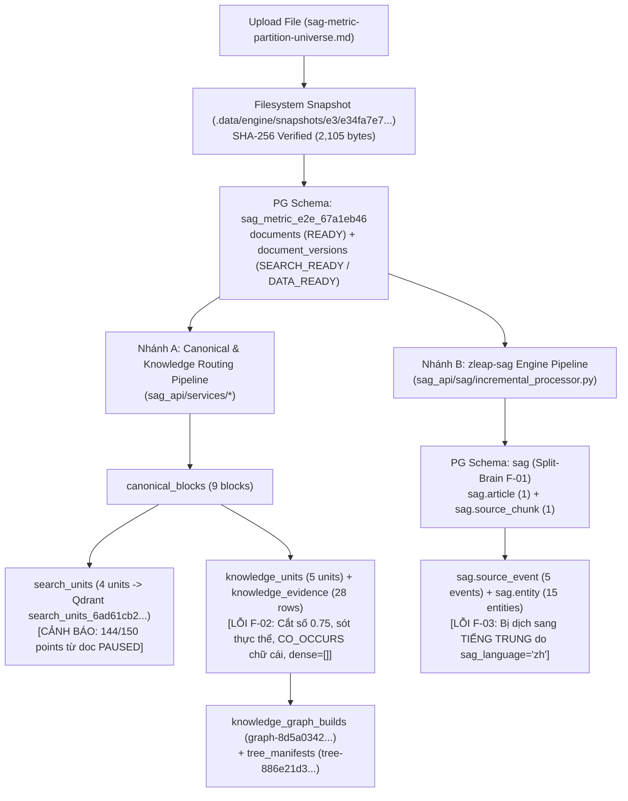

# BÁO CÁO KIỂM TOÁN KIẾN TRÚC AI & DỮ LIỆU (EVIDENCE-DRIVEN AUDIT REPORT)

**Dự án**: `sag-laya-integration` (`SAG` / `sag_api` + `zleap-sag` Engine Adapter `@[sag-laya-integration/SAG/apps/api/sag_api/sag]`)  
**Trọng tâm kiểm toán**: Project `6ad61cb2e1f989c367a1eb46`, tài liệu `sag-metric-partition-universe.md`, 5 `knowledge_units` + 2 quan hệ `E1` `CO_OCCURS`, và toàn bộ lớp tích hợp `sag_api/sag/`.  
**Ngày thực hiện**: 2026-10-21  
**Nguyên tắc**: 100% dựa trên bằng chứng thực tế từ mã nguồn (`file:line`), truy vấn READ-ONLY trên PostgreSQL (`localhost:5432/sag`), Qdrant (`localhost:6333`), và hệ thống tệp tin (`.data/engine/snapshots/`).

---

## 1. Tóm Tắt Điều Hành (Executive Summary)

### 1.1 Kết luận nhanh về đối tượng kiểm toán cụ thể (`6ad61cb2e1f989c367a1eb46` / `sag-metric-partition-universe.md`)
1. **Xác nhận trạng thái & tính toàn vẹn lưu trữ (ĐẠT 100%)**:
   - Tài liệu `sag-metric-partition-universe.md` (`documents.id = '98f47e08-c8f8-5c3f-9843-1d222af80552'`) thuộc project `6ad61cb2e1f989c367a1eb46` (nằm trong schema PostgreSQL **`sag_metric_e2e_67a1eb46`**) có trạng thái **`READY`**, `progress = 100`, phiên bản 1 (`document_versions.id = '9dcae843-fc85-5f85-ac13-0dd6fe8fd8a2'`) đạt **`SEARCH_READY`** và **`DATA_READY`**.
   - File snapshot vật lý tại `SAG/.data/engine/snapshots/e3/e34fa7e7a98198ffe713713078f3cfdfd0f142e26008689ef8aeb9e33978072b/sag-metric-partition-universe.md` **tồn tại** (`2,105 bytes`); mã băm SHA-256 tính trực tiếp từ đĩa (`e34fa7e7a98198ffe713713078f3cfdfd0f142e26008689ef8aeb9e33978072b`) **khớp 100%** với `document_versions.file_hash`, `source_snapshots.checksum_sha256`, và `knowledge_units.provenance_json.source_checksum`.
   - Cả 9 `canonical_blocks`, 4 `search_units` (đã index trên Qdrant `search_units_6ad61cb2e1f989c367a1eb46`), và 5 `knowledge_units` hiện hành (`b8d25158`, `711097df`, `4f3f0c92`, `55a58f78`, `cc5c6c78`) đều khớp `content_hash` và `unit_checksum`; job `FOUNDATION` (`1fff6ad5-64be-576a-9dd1-4db8f3e21bf2`) đã `SUCCEEDED`.
2. **Đánh giá tính chính xác ngữ nghĩa của 5 `knowledge_units` và 2 quan hệ `E1` `CO_OCCURS` (KHÔNG ĐẠT — Phát hiện 3 lỗi nghiêm trọng)**:
   - Dù `unit.text` của 5 `knowledge_units` khớp nguyên văn 5 đoạn văn (`p-1`, `p-3`, `p-5`, `p-6`, `p-8`), hàm `extract_e0_e1()` trong `sag_api/services/knowledge_service.py:105-189` mắc 3 lỗi thiết kế làm biến dạng tri thức:
     1. **Cắt gãy câu tại dấu chấm thập phân (`0.75`)**: Câu quy định ngưỡng cốt lõi *"If the evidence score is below 0.75, the assistant must abstain and request human review."* trong Unit `711097df` (`p-3`) bị cắt thành 2 `claim` sai/cụt: `" If the evidence score is below 0."` (`ac6ec2da`) và `"75, the assistant must abstain and request human review."` (`c16fc8f3`).
     2. **Bỏ sót toàn bộ thực thể tên riêng (Title-Case)**: Regex `_ENTITY_RE` (`knowledge_service.py:54-58`) bỏ sót `"Northwind Labs"`, `"Knowledge Governance Team"`, `"AI Quality Register"`, `"Evidence Gate"`, `"Evidence Ledger"`, `"Access Control Service"`, khiến 2/5 đoạn văn (`55a58f78` `p-6` và `cc5c6c78` `p-8`) có **`entities = []` (0 thực thể)**, làm `importance` tụt xuống `0.25 < 0.5` và **bị loại khỏi diện xét duyệt chạy LLM `E2`** (`e2_reason = null`).
     3. **2 quan hệ `E1` `CO_OCCURS` ghép cặp vô nghĩa theo bảng chữ cái ASCII**:
        - Quan hệ #1 (`ab457b32` ở `p-3`): `("0.75", "CO_OCCURS", "2025-03-18")` — **SAI NGỮ NGHĨA** vì ghép ngưỡng `0.75` (của `Evidence Gate` ban hành ngày `2025-03-25` ở câu 3–4) với ngày `2025-03-18` (ngày kiểm tra sự cố ở câu 1) chỉ vì `"0.75"` và `"2025-03-18"` đứng đầu bảng chữ cái trong `["0.75", "2025-03-18", "2025-03-25", "AI"]`.
        - Quan hệ #2 (`850e36a8` ở `p-5`): `("SHA-256", "CO_OCCURS", "URI")` — **MẤT CHỦ THỂ TRUNG TÂM** (`"Evidence Ledger"`) do E0 không nhận diện được `"Evidence Ledger"`.

### 1.2 Top 5 Phát Hiện Lệch Mục Đích Nghiêm Trọng Nhất Toàn Hệ Thống

1. **[F-01 | P0 - Critical] Phân liệt Schema PostgreSQL ("Split-Brain Schema") giữa `sag_api` (`sag_metric_e2e_67a1eb46`) và `zleap-sag` (`sag`) kèm lệch kiểu `CHAR(36)` độn khoảng trắng** (`sag_api/sag/config_builder.py:66-77`).
2. **[F-02 | P0 - Critical] Bộ trích xuất `E0`/`E1` (`knowledge_service.py:54-189`) làm hỏng câu có số thập phân (`0.75`), bỏ sót 100% thực thể Title-Case, sinh quan hệ `CO_OCCURS` theo thứ tự chữ cái, và để trống `features_json.dense = []` làm liệt 30% trọng số đồ thị `semantic`** (`knowledge_service.py:29, 128, 148-175`).
3. **[F-03 | P1 - High] Mặc định cứng `sag_language = "zh"` (`core/config.py:161`) khiến `zleap-sag` (`incremental_processor.py:65-73`) dịch cưỡng bức toàn bộ sự kiện & thực thể của tài liệu tiếng Anh `sag-metric-partition-universe.md` sang tiếng Trung**.
4. **[F-04 | P1 - High] Ô nhiễm chỉ mục từ tài liệu `PAUSED` / `EXTRACTION_FAILED`: 96% `search_units` (144/150 points) và 98.6% `source_chunks` (215/218 points) trên Qdrant thuộc về các tài liệu chưa hoàn tất (`PAUSED`)** (`jobs/tasks.py:430-564`).
5. **[F-05 | P2 - Medium] Lỗi vệ sinh trạng thái (`error_layer`, `error_stage` không được xóa khi `READY`) và lệch bộ đếm `sources.chunk_count = 3` vs `218` chunks thực tế** (`jobs/tasks.py:259-261, 672-680`).

---

## 2. Mô Hình Mục Đích & Bất Biến (Intent Model Summary)

Chi tiết tại `audit/01_intent_model.md`. Hệ thống được kiểm toán theo 6 bất biến cốt lõi:
- **INV-1 (Schema & Store Coherence)**: Bảng của `sag_api` và `zleap-sag` phải đồng nhất schema và khóa liên kết (`source_config_id`).
- **INV-2 (Snapshot & Checksum Chain of Custody)**: Toàn vẹn SHA-256 từ file snapshot trên đĩa đến `CanonicalBlock`, `SearchUnit`, `KnowledgeUnit`, `KnowledgeEvidence`.
- **INV-3 (Semantic Fidelity of E0/E1 Extraction)**: Tách câu, thực thể, và quan hệ `E0`/`E1` phải đúng ngữ nghĩa văn bản gốc.
- **INV-4 (Graph & Routing Signal Completeness)**: Đủ 6 tín hiệu đồ thị (`semantic`, `lexical`, `entity`, `structure`, `temporal`, `citation`) và `dense_medoid` trên cây định tuyến.
- **INV-5 (Language-Preserving Engine Extraction)**: Trích xuất sự kiện/thực thể phải bảo toàn ngôn ngữ tài liệu.
- **INV-6 (Lifecycle & Readiness Hygiene)**: Không rò rỉ dữ liệu của tài liệu `PAUSED`/`FAILED` vào chỉ mục tìm kiếm hoạt động; xóa sạch metadata lỗi khi `READY`.

---

## 3. Bản Đồ Hạ Tầng Dữ Liệu & Luồng Thực Tế (Data Landscape)

| Store / Namespace | Loại | Vai trò thiết kế | Ai ghi | Ai đọc | Trạng thái thực tế |
|---|---|---|---|---|---|
| **PostgreSQL schema `sag_metric_e2e_67a1eb46`** | RDBMS (PG 18.3) | Lưu toàn bộ bảng miền `sag_api` của project `6ad61cb2e1f989c367a1eb46` (46 bảng). | `document_service`, `canonical_service`, `search_index_service`, `knowledge_service`, `universe_tree_service` | Các service API & worker của `sag_api` | Hoạt động (`documents`=6, `canonical_blocks`=328, `search_units`=150, `knowledge_units`=7, `knowledge_evidence`=42) |
| **PostgreSQL schema `sag`** | RDBMS (PG 18.3) | Lưu bảng engine `zleap-sag` (`data_source`, `article`, `source_chunk`, `source_event`, `entity`, `event_entity`) — đang dùng chung với 83 bảng dự án `aiinvest`. | `IncrementalDocumentProcessor` qua `zleap.sag` | `EngineManager.search`, `graph_for_sections`, `universe_service` | Hoạt động nhưng bị **Split-Brain schema** với `sag_metric_e2e_67a1eb46` |
| **Qdrant `search_units_6ad61cb2e1f989c367a1eb46`** | Vector + Sparse DB | Chỉ mục lai (`dense` 1024-d Cosine + `sparse_text` IDF) cho `SearchUnit` của project. | `SearchUnitQdrantStore.upsert_search_units` | `SearchUnitQdrantStore.search_hybrid` | 150 points (6 thuộc doc `READY`, **144 thuộc doc `PAUSED`**) |
| **Qdrant `source_chunks`, `event_vectors_wide`, `entity_vectors`, `event_entity_vectors`** | Vector + Sparse DB | Chỉ mục chunk/event/entity toàn cục của `zleap-sag` (phân biệt bằng `data_source_id`). | `PrefixedQdrantVectorStore` trong `zleap-sag` | `EngineManager._search_chunk_vectors`, `search_event_scores` | `source_chunks`=218 (3 `COMPLETED`, **215 `EXTRACTION_FAILED`**), `event_vectors_wide`=10, `entity_vectors`=29 |
| **Filesystem `.data/engine/snapshots/`** | Content-Addressed File Store | Lưu bản chụp nguyên bản bất biến theo `snapshots/{sha256[:2]}/{sha256}/{filename}`. | `_save_snapshot_file` (`document_service.py:893`) | `prepare_document` (`jobs/tasks.py:373`) | Khớp 100% SHA-256 |



---

## 4. Chi Tiết Các Phát Hiện Kiểm Toán (Evidence-Backed Findings)

### Phát Hiện F-01 (P0 - Critical): Phân liệt Schema PostgreSQL ("Split-Brain Schema") giữa `sag_api` và `zleap-sag` kèm lỗi độn khoảng trắng `CHAR(36)` trên `sag.data_source.id`

- **Quy chiếu Intent Model**: Vi phạm **INV-1 (Schema & Store Coherence)**.
- **(a) Thấy gì?**
  1. Các bảng miền của project `6ad61cb2e1f989c367a1eb46` (`documents`, `sources`, `document_versions`, `canonical_blocks`, `search_units`, `knowledge_units`, ...) nằm trong schema **`sag_metric_e2e_67a1eb46`**, nhưng toàn bộ dữ liệu trích xuất của `zleap-sag` (`data_source`, `article`, `source_chunk`, `source_event`, `entity`, `event_entity`) lại bị ghi vào schema mặc định **`sag`** (nơi đang chứa sẵn 83 bảng của dự án `aiinvest`, gồm `sag.entities` với 77,033 dòng).
  2. Trong `sag.data_source`, cột `id` có kiểu `CHAR(36)`. Chuỗi `sag_source_config_id` do `get_or_create_project_source` (`document_service.py:921`) tạo ra là `f"tp_{hash[:32]}"` có độ dài **35 ký tự** (`'tp_94e9997535651d8909088bee64844a1b'`). Khi lưu vào `sag.data_source.id` (`CHAR(36)`), PostgreSQL tự động độn 1 khoảng trắng ở cuối thành `'tp_94e9997535651d8909088bee64844a1b '` (36 ký tự).
- **(b) Bằng chứng ở đâu?**
  - **Code**: `SAG/apps/api/sag_api/sag/config_builder.py:66-77`:
    ```python
    def _build_relational(settings: Settings) -> RelationalConfig:
        provider = (settings.sag_relational_provider or "postgresql").lower()
        ...
        return RelationalConfig(
            provider="postgresql",
            host=settings.sag_pg_host,
            port=settings.sag_pg_port,
            user=settings.sag_pg_user,
            password=settings.sag_pg_password,
            database=settings.sag_pg_database,
        )
    ```
    Hàm này không hề đọc `search_path` / `schema` từ `settings.database_url` hay session hiện tại. Khi kết nối bằng user `sag` với `SHOW search_path` = `"$user", public`, PostgreSQL luôn chọn schema `"sag"`.
  - **Truy vấn DB & Kết quả thực tế**:
    - `SELECT table_schema, COUNT(*) FROM information_schema.tables WHERE table_schema IN ('sag', 'sag_metric_e2e_67a1eb46') GROUP BY table_schema;` $\rightarrow$ `sag`: 91 bảng; `sag_metric_e2e_67a1eb46`: 46 bảng.
    - `SELECT id, LENGTH(id), LENGTH(TRIM(id)) FROM sag.data_source WHERE TRIM(id) = 'tp_94e9997535651d8909088bee64844a1b';` $\rightarrow$ `id = 'tp_94e9997535651d8909088bee64844a1b '`, `length = 36`, `trim_length = 35`.
- **(c) Vì sao làm lệch mục đích dự án?**
  - Khi chạy nhiều môi trường test/tenant bằng schema隔離 (`sag_metric_e2e_*`), mọi schema đều ghi đè chung vào bảng `sag.article`, `sag.source_chunk`, `sag.source_event` trong schema `"sag"`, phá vỡ tính cô lập giữa các schema test/project. Đồng thời, phép join/so sánh ép kiểu `sag.data_source.id::varchar = sources.sag_source_config_id` sẽ trả về 0 dòng nếu không `RTRIM`.
- **(d) Phản biện (Counter-hypothesis)**:
  - *Giả thuyết phản biện*: Có phải `zleap-sag` cố tình dùng chung một schema `"sag"` cho mọi project?
  - *Bác bỏ*: Ngay trong `sag_metric_e2e_67a1eb46`, các bảng của `sag_api` (`documents.sag_source_id = '4bb7e2c9-...'`) tham chiếu trực tiếp tới `sag.article.id`. Việc tách schema `sag_metric_e2e_67a1eb46` là cơ chế cô lập DB schema cho từng lần chạy E2E, nhưng vì `config_builder.py` bỏ sót tham số schema nên phần `zleap-sag` bị rò rỉ sang schema `"sag"`.
- **(e) Sửa thế nào & Đánh đổi gì?**
  - **Cách sửa**: Truyền `schema` (hoặc `connect_args={"server_settings": {"search_path": ...}}`) từ `settings` vào `RelationalConfig` trong `sag_api/sag/config_builder.py:66-77`, và đổi cột `id` / `data_source_id` trong `zleap-sag` sang `VARCHAR(64)` (hoặc chuẩn hóa `config_id` đủ 36 ký tự / `func.rtrim`).
  - **Đánh đổi**: Độ phức tạp sửa `S` (1–2 ngày); cần migration `ALTER COLUMN id TYPE VARCHAR(64)` cho bảng `data_source` nếu giữ dữ liệu cũ.
  - **Truy vấn xác minh sau khi sửa**:
    ```sql
    SELECT COUNT(*) FROM "sag_metric_e2e_67a1eb46".sources s
    JOIN "sag_metric_e2e_67a1eb46".data_source ds ON ds.id = s.sag_source_config_id;
    ```

---

### Phát Hiện F-02 (P0 - Critical): Bộ trích xuất `E0`/`E1` (`knowledge_service.py:54-189`) cắt gãy câu chứa số thập phân (`0.75`), bỏ sót 100% thực thể tên riêng (Title-Case), ghép cặp quan hệ `E1` `CO_OCCURS` theo bảng chữ cái, và để trống `dense = []` làm mất 30% trọng số đồ thị

- **Quy chiếu Intent Model**: Vi phạm **INV-3 (Semantic Fidelity of E0/E1 Knowledge Extraction)** và **INV-4 (Graph & Routing Signal Completeness)**.
- **(a) Thấy gì?**
  Trên 5 `knowledge_units` hiện hành của `sag-metric-partition-universe.md` (`document_version_id = '9dcae843-fc85-5f85-ac13-0dd6fe8fd8a2'`):
  1. **Tách câu (`claim`) sai tại dấu chấm thập phân**: Câu *"If the evidence score is below 0.75, the assistant must abstain and request human review."* trong Unit `711097df` (`p-3`) bị tách thành 2 `claim` hỏng:
     - `ac6ec2da-fb96-5e26-852c-bf23e3940255`: `" If the evidence score is below 0."`
     - `c16fc8f3-891c-5b3f-a801-13eb27911402`: `"75, the assistant must abstain and request human review."`
  2. **Bỏ sót toàn bộ thực thể miền Title-Case**: Regex `_ENTITY_RE` chỉ bắt từ in hoa toàn bộ (`[A-Z][A-Z0-9_]+`), số thập phân và ngày ISO. Nó bỏ sót 100% thực thể quan trọng nhất của tài liệu: `"Northwind Labs"`, `"Knowledge Governance Team"`, `"AI Quality Register"`, `"Evidence Gate"`, `"Evidence Ledger"`, `"Access Control Service"`, `"Governance Team"`, `"50 answers"`, `"5 percent"`. Hệ quả trực tiếp:
     - Unit `55a58f78` (`p-6`) và Unit `cc5c6c78` (`p-8`) có **`entities = []`** (0 thực thể), kéo `importance` xuống `0.25 < 0.5` (`e2_importance_min`), khiến cả hai đoạn văn này có `e2_reason = null` (bị loại vĩnh viễn khỏi hàng đợi trích xuất sâu bằng LLM `E2`!).
     - Trong đồ thị `graph-8d5a0342eb144405f23f684b`, vì `4f3f0c92` (`p-5`) có `entities = ["SHA-256", "URI"]` còn `55a58f78` (`p-6`, nằm ngay sát dưới trong cùng mục `Provenance and Security Partitioning`) có `entities = []`, tín hiệu `entity` của cặp `(p-5, p-6)` bị tính bằng `0.0` (thay vì `None`), kéo tổng điểm cạnh xuống `0.4160 < 0.55` (`edge_min_score`). Kết quả là **cả Unit `b8d25158` (`p-1`) lẫn Unit `55a58f78` (`p-6`) đều bị cô lập (`degree = 0`, 0 cạnh nối) trong đồ thị tri thức!**
  3. **2 quan hệ `E1` `CO_OCCURS` là sản phẩm ghép cặp chữ cái tùy tiện (`labels[0]` và `labels[1]`)**:
     - Quan hệ `ab457b32` (Unit `711097df`, `p-3`): `subject = "0.75"`, `predicate = "CO_OCCURS"`, `object = "2025-03-18"`, `confidence = 0.4`. Ghép sai ngưỡng `0.75` (thuộc câu 4, liên quan ngày `2025-03-25`) với ngày `2025-03-18` (thuộc câu 1).
     - Quan hệ `850e36a8` (Unit `4f3f0c92`, `p-5`): `subject = "SHA-256"`, `predicate = "CO_OCCURS"`, `object = "URI"`, `confidence = 0.4`. Bỏ mất chủ thể chính `"Evidence Ledger"`.
     - Hơn nữa, không có bất kỳ nơi nào trong codebase đọc `subject`, `predicate`, `object` từ `knowledge_evidence.payload_json`!
  4. **Trường `features_json["dense"]` luôn là mảng rỗng `[]` (`knowledge_service.py:175`)**:
     - Khiến tín hiệu `semantic` (chiếm trọng số lớn nhất `0.30` trong `SIGNAL_WEIGHTS`, `knowledge_service.py:29`) trong mọi `knowledge_unit_edges` luôn bằng `null`, và `dense_medoid_json` trong mọi `tree_routing_profiles` (6/6 dòng) luôn bằng `null`!
- **(b) Bằng chứng ở đâu?**
  - **Code**:
    - `SAG/apps/api/sag_api/services/knowledge_service.py:54-58` (`_ENTITY_RE`), `86` (`terms`), `128` (`r"[^.!?\n]+(?:[.!?]|$)"`), `148-167` (`labels = sorted(...)`, `subject=labels[0], object=labels[1]`), `174-175` (`"dense": []`), `518-543` (`graph_payload`).
  - **Dữ liệu thật trong DB**: Xem chi tiết toàn bộ 5 `knowledge_units` và 28 `knowledge_evidence` tại `audit/evidence/project_6ad61cb2_knowledge_audit.md`.
- **(c) Vì sao làm lệch mục đích dự án?**
  - Làm sai lệch trực tiếp các mệnh đề (`claim`) hiển thị trên giao diện Knowledge Universe (`universe_knowledge_service.py:437`) và đầu vào sinh câu hỏi `KnowledgeGapQuestion` (`knowledge_gap_question_service.py:90`), đồng thời làm mù 55% trọng số thiết kế của đồ thị tri thức (`semantic` 30% = `null`, `entity` 25% = `0.0` cho 9/10 cặp đoạn văn của tài liệu).
- **(d) Phản biện (Counter-hypothesis)**:
  - *Giả thuyết phản biện*: Có phải `E0`/`E1` chỉ là bước nháp rẻ tiền, còn `E2` (LLM) sẽ sửa lại?
  - *Bác bỏ bằng 2 bằng chứng*:
    1. Trong môi trường thực tế (`KnowledgeWorker.e2_enabled`, `jobs/knowledge.py:344-350`), `settings.knowledge_e2_url/api_key/model` đang rỗng nên `E2` **không bao giờ chạy** (0 job `E2` trong `knowledge_jobs`).
    2. Ngay cả khi bật `E2`, `apply_e2()` (`jobs/knowledge.py:265-280`) **chỉ `insert_once` thêm dòng `tier='E2'` chứ KHÔNG xóa các dòng `claim`/`relation` sai của `E0`/`E1`**, và các đoạn văn có `importance < 0.5` (như `p-1`, `p-6`, `p-8` do `E0` không bắt được thực thể) **không bao giờ được đưa vào hàng đợi `E2`**!
- **(e) Sửa thế nào & Kết quả thực nghiệm chứng minh (Phase 7.4)?**
  - **Cách sửa**:
    1. Sửa regex tách câu tại `knowledge_service.py:128` thành `r"(?:[^.!?\n]|\d+\.\d+)+(?:[.!?](?!\d)|$)"` để không cắt giữa số thập phân (`0.75`, `v2.5`).
    2. Mở rộng `_ENTITY_RE` (`knowledge_service.py:54-58`) để nhận diện cụm danh từ riêng Title-Case (`\b[A-Z][a-zA-Z0-9]+(?:\s+[A-Z][a-zA-Z0-9]+){1,4}\b`, loại bỏ hư từ đầu câu `The/In/On/If`) và cụm định lượng (`\b\d+(?:\.\d+)?\s*(?:percent|%|answers)\b`).
    3. Sửa sinh quan hệ `E1` (`knowledge_service.py:148-167`): chỉ ghép cặp các thực thể **cùng xuất hiện trong một câu (sentence-scoped)** theo đúng thứ tự xuất hiện trong câu (`s_ents[i] -> s_ents[i+1]`), với `quote`, `start`, `end` neo vào câu đó thay vì cả đoạn văn.
    4. Điền vector `dense` cho `KnowledgeUnit` (tái sử dụng embedding từ `SearchUnit` tương ứng hoặc gọi `embedder` trong `KnowledgeWorker`).
  - **Kết quả thực nghiệm trực tiếp trên 5 đoạn văn của `sag-metric-partition-universe.md`** (`scratch/run_experiments.py`):
    | Chỉ số đo trên 5 `knowledge_units` | Hiện tại (V1 trong DB) | Sau khi sửa regex E0/E1 (V2) |
    |---|---:|---:|
    | Số `claim` bị cắt gãy tại `0.75` | **2** (hỏng câu) | **0** (18/18 câu nguyên vẹn 100%) |
    | Tổng số thực thể trích xuất được | **7** (`p-6` và `p-8` có `0` thực thể) | **18** (bắt trọn `Northwind Labs`, `Evidence Gate`, `Evidence Ledger`, `Access Control Service`, `Governance Team`, `50 answers`, `5 percent`) |
    | Số đoạn văn đủ điều kiện chạy `E2` (`importance >= 0.5`) | **2 / 5** (`p-3`, `p-5`) | **4 / 5** (`p-1`, `p-3`, `p-5`, `p-8`) |
    | Chất lượng quan hệ `E1` | 2 quan hệ ghép chữ cái (`0.75 -> 2025-03-18` sai; `SHA-256 -> URI` thiếu chủ thể) | 9 quan hệ đúng ngữ cảnh câu (`2025-03-18 -> Northwind Labs`, `2025-03-25 -> Evidence Gate`, `Evidence Ledger -> URI`, `Governance Team -> 50 answers`, `5 percent -> Evidence Gate`) |

---

### Phát Hiện F-03 (P1 - High): Mặc định cứng `sag_language = "zh"` làm `zleap-sag` sinh toàn bộ Sự kiện (`SourceEvent`) và Thực thể (`Entity`) bằng tiếng Trung cho tài liệu tiếng Anh

- **Quy chiếu Intent Model**: Vi phạm **INV-5 (Language-Preserving Engine Extraction)**.
- **(a) Thấy gì?**
  - Tài liệu `sag-metric-partition-universe.md` được viết 100% bằng tiếng Anh, nhưng toàn bộ 5 dòng `sag.source_event` và các thực thể trong `sag.entity` (cũng như các vector trong Qdrant `event_vectors_wide` và `entity_vectors`) của tài liệu này đều bị LLM sinh bằng **tiếng Trung Quốc** (`"Northwind Labs 发现并处理 AI 生成的虚假引文"`, `"证据门控"`, `"证据账本"`, `"访问控制服务"`, `"每周审查流程"`).
- **(b) Bằng chứng ở đâu?**
  - **Code**:
    - `SAG/apps/api/sag_api/core/config.py:161`: `sag_language: str = "zh"` (mặc định tiếng Trung).
    - `SAG/apps/api/sag_api/sag/incremental_processor.py:65-73`:
      ```python
      def _apply_language_to_prompt_manager() -> None:
          lang = (settings.sag_language or "zh").strip()
          ...
          pm_mod._default_language = lang
      ```
  - **Dữ liệu thật trong DB**: Xem bảng 5 sự kiện tiếng Trung của `article.id = '4bb7e2c9-283b-4058-96b0-05ad06b6be3b'` tại Mục 4 của `audit/evidence/project_6ad61cb2_knowledge_audit.md`.
- **(c) Vì sao làm lệch mục đích dự án?**
  - Khi người dùng truy vấn bằng tiếng Anh (ví dụ: *"What is the Evidence Gate threshold in Northwind Labs?"* hoặc *"How does the Access Control Service prevent prompt injection?"*), nhánh truy xuất sự kiện/thực thể (`search_event_scores` và `graph_for_sections` trong `engine_manager.py:1359-1600`) phải so khớp truy vấn tiếng Anh với các tiêu đề/tóm tắt sự kiện và tên thực thể bằng tiếng Trung (`证据门控`, `访问控制服务`), làm suy giảm độ tương đồng ngữ nghĩa và trả về đồ thị tiếng Trung không khớp ngôn ngữ tài liệu gốc.
- **(d) Sửa thế nào & Đánh đổi gì?**
  - **Cách sửa**: Đổi mặc định hoặc thêm cơ chế tự động nhận diện ngôn ngữ văn bản đầu vào (ví dụ kiểm tra tỷ lệ ký tự CJK vs Latin trên `doc_content` trước khi gọi `extract`) hoặc cấu hình prompt của `zleap-sag` trả kết quả theo ngôn ngữ gốc của tài liệu (`"Respond in the same language as the source text"`).
  - **Đánh đổi**: Độ phức tạp `S`; cần chạy `reprocess_document` cho 3 tài liệu đã nạp để tạo lại `source_event` và `entity` bằng tiếng Anh.

---

### Phát Hiện F-04 (P1 - High): 96% `search_units` (144/150) và 98.6% `source_chunks` (215/218) trên Qdrant thuộc về các tài liệu đang `PAUSED` / `EXTRACTION_FAILED`

- **Quy chiếu Intent Model**: Vi phạm **INV-6 (Lifecycle & Readiness Hygiene across Stores)**.
- **(a) Thấy gì?**
  - Trong project `6ad61cb2e1f989c367a1eb46`, có 6 tài liệu trong bảng `documents`: chỉ 3 tài liệu `READY` (tổng cộng 6 `search_units` và 3 `source_chunks`) và 3 tài liệu đang `PAUSED` (`208ffd14` có 138 `search_units` và 212 `source_chunks`; `fc68cd0a` có 4 `search_units`; `8cb2b390` có 2 `search_units`).
  - Toàn bộ **144 `search_units` của 3 tài liệu `PAUSED`** đều đã được gán `document_versions.search_status = 'SEARCH_READY'` và nằm trong Qdrant collection `search_units_6ad61cb2e1f989c367a1eb46`! Tương tự, **215 `source_chunks`** của các bài `EXTRACTION_FAILED` nằm nguyên trong Qdrant collection `source_chunks`.
- **(b) Bằng chứng ở đâu?**
  - **Code**: `SAG/apps/api/sag_api/jobs/tasks.py:430-478` chạy Phase 2 (`PARSE` $\rightarrow$ `DEDUP` $\rightarrow$ `EMBED` $\rightarrow$ `INDEX_SEARCH`) và commit `search_status = 'SEARCH_READY'` **trước khi** gọi `engine_manager.process_document()` ở dòng 550. Khi `engine_manager.process_document()` bị tạm dừng (`PAUSED`) hoặc lỗi extract (dòng 593–642), code cố tình giữ nguyên `ver.status = "SEARCH_READY"` ngay cả khi `Document.status = 'PAUSED'`!
  - **Thực nghiệm đo lường trên Qdrant (`scratch/run_experiments.py`)**: Khi truy vấn top-5 trên `search_units_6ad61cb2e1f989c367a1eb46` với vector của `sag-metric-partition-universe.md`, mỗi truy vấn đều bị lọt **1 đến 2 chunk từ tài liệu `PAUSED` (`fc68cd0a` hoặc `208ffd14`)** vào top-5 kết quả!
- **(c) Sửa thế nào & Đánh đổi gì?**
  - **Cách sửa**: Khi truy vấn `SearchUnit` hoặc `SourceChunk`, bắt buộc lọc theo các `document_version_id` / `sag_source_id` của các `Document` có `status == 'READY'` và `is_active == True` (hoặc thu hồi/ẩn khỏi chỉ mục khi tài liệu ở trạng thái `PAUSED`).

---

### Phát Hiện F-05 (P2 - Medium): Không xóa `error_layer` / `error_stage` khi tài liệu đạt `READY` và lệch bộ đếm `sources.chunk_count`

- **Quy chiếu Intent Model**: Vi phạm **INV-6 (Lifecycle & Readiness Hygiene)**.
- **(a) Thấy gì & Bằng chứng**:
  1. Trong `sag_metric_e2e_67a1eb46.documents`, tài liệu `98f47e08-c8f8-5c3f-9843-1d222af80552` (`sag-metric-partition-universe.md`) có `status = 'READY'`, `progress = 100`, `error = NULL`, nhưng **`error_layer = 'engine'`** và **`error_stage = 'extract'`**. Nguyên nhân: `SAG/apps/api/sag_api/jobs/tasks.py:259-261` và `672-680` chỉ gán `error=None` mà quên gán `error_layer=None, error_stage=None`.
  2. Trong `sag_metric_e2e_67a1eb46.sources`, `chunk_count = 3` (tổng `Document.chunk_count` của 3 tài liệu `READY` bên `zleap-sag`), trong khi `sag.source_chunk` có `218` chunks và `sag_metric_e2e_67a1eb46.search_units` có `150` units (6 units thuộc tài liệu `READY`).
- **(b) Cách sửa**: Thêm `error_layer=None, error_stage=None` vào `update(Document).values(...)` tại `jobs/tasks.py:673-680`, `document_service.py:259-262`, và `document_service.py:600`.

---

## 5. Đánh Giá Chuyên Sâu Module `@[sag-laya-integration/SAG/apps/api/sag_api/sag]`

Lớp `sag_api/sag/` đóng vai trò **Anti-Corruption & Lifecycle Adapter** bọc quanh thư viện `zleap-sag`. Kết quả kiểm toán từng thành phần trong thư mục này:

1. **`config_builder.py` (150 dòng)**:
   - Điểm mạnh: Tách biệt cấu hình LLM/Embedding/Qdrant rõ ràng.
   - Lỗ hổng: `_build_relational` (dòng 66–77) bỏ quên `schema`/`search_path`, gây ra lỗi **F-01 (Split-Brain Schema)**.
2. **`incremental_processor.py` (531 dòng)**:
   - Điểm mạnh: Thiết kế lưu checkpoint sau mỗi chunk (`ProcessCheckpoint`) và hỗ trợ tạm dừng hợp tác (`should_pause`) rất tốt.
   - Lỗ hổng: `_apply_language_to_prompt_manager` (dòng 65–73) tiêm cứng `settings.sag_language` (`"zh"`), gây ra lỗi **F-03 (Nhiễm bẩn tiếng Trung)**.
3. **`engine_manager.py` (3,292 dòng)**:
   - Điểm mạnh: Cơ chế khóa hai tầng (`slot.lock` + `slot.concurrent_allowed` / `slot.idle`) cho phép nạp đồng thời nhiều tài liệu cùng nguồn nhưng vẫn đảm bảo an toàn khi xóa/bảo trì (`delete_document_data`), kèm cơ chế fallback tự động từ tìm kiếm chính xác sang `vector` khi timeout (`search`, dòng 1037–1095).
   - Lỗ hổng: Tồn tại song song hai đường ống lưu trữ và truy xuất không đồng bộ (`SearchUnitQdrantStore` trên collection `search_units_<project_id>` vs `PrefixedQdrantVectorStore` trên collection `source_chunks` / `event_vectors_wide`).
4. **`qdrant_store.py` (190 dòng) & `search_unit_store.py` (290 dòng)**:
   - Điểm mạnh: Tự động bổ sung sparse vector (`sparse_text` với `Modifier.IDF`) và kết hợp Hybrid Dense + Sparse qua RRF (`Query(fusion=Fusion.RRF)`).
   - Lỗ hổng: Tokenizer sparse trong `qdrant_store.py` và `search_unit_store.py` tách từ đơn giản, và chưa lọc bỏ các `search_units` thuộc tài liệu `PAUSED` khi truy vấn.

---

## 6. Kiến Trúc Đích (Target Architecture) & Ma Trận Khoảng Cách (Gap Matrix — Phase 7)

Dựa trên đối chiếu với các kiến trúc GraphRAG hiện đại giai đoạn 2024–2026 (**LightRAG**, **HippoRAG**, **Microsoft GraphRAG** với Leiden community detection) và chuẩn Hybrid Retrieval với **`Qwen3-Embedding-0.6B` (1024-d) + BM25/Sparse RRF**:

| Chiều kiến trúc | Hiện trạng (As-Is, có bằng chứng) | Kiến trúc Đích (To-Be, phù hợp quy mô dự án) | Khoảng cách & Rủi ro | Thứ tự ưu tiên & Chi phí sửa |
|---|---|---|---|---|
| **1. Cô lập Schema PostgreSQL (`sag_api` vs `zleap-sag`)** | `sag_api` ghi vào `sag_metric_e2e_67a1eb46`, còn `zleap-sag` ghi vào `sag` + `CHAR(36)` độn khoảng trắng (`config_builder.py:66-77`). | Đồng bộ `search_path`/schema giữa `sag_api` và `zleap-sag`; chuẩn hóa khóa `VARCHAR(64)`. | **Critical (P0)** — Gây lệch dữ liệu chéo giữa các môi trường/project. | **Ưu tiên 1** — Độ phức tạp: `S` |
| **2. Trích xuất `E0`/`E1` (`knowledge_service.py`)** | Regex cắt gãy số thập phân `0.75`, bỏ sót thực thể Title-Case (`p-6`, `p-8` có 0 thực thể), ghép `CO_OCCURS` theo chữ cái ASCII. | Bộ tách câu bảo toàn số thập phân/viết tắt + nhận diện thực thể Title-Case/định lượng + quan hệ `CO_OCCURS` trong phạm vi câu (sentence-scoped). | **Critical (P0)** — Sinh `claim` và `relation` sai sự thật; chặn mất 60% đoạn văn khỏi `E2`. | **Ưu tiên 2** — Độ phức tạp: `S` |
| **3. Tín hiệu Đồ thị & Cây định tuyến Leiden (`KnowledgeGraphBuild`)** | `features_json.dense = []` $\rightarrow$ tín hiệu `semantic` (trọng số 30%) và `dense_medoid` đều bằng `null`; 2/5 đoạn văn của tài liệu bị cô lập (`degree=0`). | Điền vector `dense` (từ `Qwen3-Embedding-0.6B`) cho `KnowledgeUnit` (hoặc nội suy từ `SearchUnit` chứa block đó) để kích hoạt 30% trọng số `semantic` và `dense_medoid`. | **High (P1)** — Làm giảm chất lượng phân cụm Leiden CPM và định tuyến cây. | **Ưu tiên 3** — Độ phức tạp: `M` |
| **4. Ngôn ngữ trích xuất LLM (`zleap-sag`)** | Mặc định `sag_language = "zh"` (`core/config.py:161`) dịch tài liệu tiếng Anh sang sự kiện/thực thể tiếng Trung. | Tự động phát hiện ngôn ngữ tài liệu (CJK vs Latin/Vietnamese) hoặc giữ nguyên ngôn ngữ gốc trong prompt. | **High (P1)** — Lệch ngôn ngữ giữa câu hỏi tiếng Anh và đồ thị sự kiện tiếng Trung. | **Ưu tiên 4** — Độ phức tạp: `S` |
| **5. Vệ sinh Chỉ mục & Trạng thái Tài liệu** | 144/150 `search_units` và 215/218 `source_chunks` từ tài liệu `PAUSED` nằm trong Qdrant; `error_layer`/`error_stage` không xóa khi `READY`. | Lọc chỉ mục theo `Document.status == 'READY'`; xóa sạch `error_layer=None, error_stage=None` khi hoàn tất. | **Medium (P2)** — Nhiễm bẩn top-k tìm kiếm và gây nhầm lẫn khi giám sát lỗi. | **Ưu tiên 5** — Độ phức tạp: `S` |
